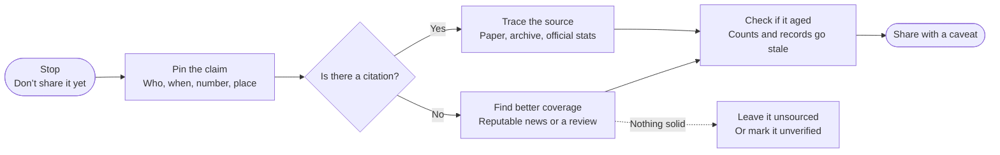

# 100 Strange Facts, Fact-Checked: A Verification Guide

Based on List 25’s “100 Facts So Strange You’ll Have to Google Them” (53:53). A method for checking viral trivia, then a verdict on all 100 claims, with timestamp links and sources. The video’s opening promise that every fact is verified does not hold.

**PDF:** [Download this guide (PDF)](guide.pdf)

## At a glance

| Metric | Value | Detail |
| --- | --- | --- |
| Claims in the video | **100** | Numbered 100 down to 1 |
| Confirmed | **56** | Core claim and key details hold |
| False or garbled | **5** | The headline, or a central detail, is wrong |
| Need a caveat | **39** | Mostly true, overstated, outdated, or unsourced |

| | |
| --- | --- |
| **Video** | 100 Facts So Strange You’ll Have to Google Them |
| **Channel** | List 25, hosted by Mike Estrin · uploaded 12 October 2026 · 53:53 |
| **Watch** | [youtu.be/55Uw8GF_SZU](https://youtu.be/55Uw8GF_SZU) |
| **The video’s promise** | “Every single fact on this list is verified, sourced, and completely real.” (0:09) |
| **This guide’s verdict** | Most of the list is solid popular science or history. Several headlines are wrong, several numbers are stale or unsourced, and the video never shows its sources. |

!!! warning "Read this first"

    The closer tells you to look up three facts and promises you will find they are exactly as stated (53:31). Do that, but do not stop at another trivia page. Some of the confident claims in this video fail a primary-source check.

## How to verify a strange fact

*A working method based on Mike Caulfield’s SIFT moves, the CRAAP test, and the International Fact-Checking Network’s emphasis on traceable evidence.*

1. **Stop before you share** — A fact that feels too neat is the one most likely to be a legend, a stale number, or a headline that oversells the study.
2. **Write the claim in one sentence** — Name the people, the place, the date and the number. “Someone in 1906 got one minute in jail” is weaker than “Joe Munch, Seattle, 19 January 1906.” Wrong names and cities are how you catch a garbled retelling.
3. **Look for a real citation** — A reliable account names a paper, a court, an official dataset or a contemporary newspaper. “Researchers have estimated” with no names is not a source.
4. **Go to the original, not a listicle** — Read the abstract and the limitation, not just a headline. This is how the video’s knuckle-cracking fact falls apart: the 2015 MRI paper says the opposite of what the script claims.
5. **Find better coverage** — Prefer official statistics, peer-reviewed papers, archives and established newsrooms over “100 facts” pages that copy one another.
6. **Check whether the number has aged** — Library counts, car registrations, population estimates and “last surviving” records change. A fact that was fair in 2015 can be wrong in 2026.
7. **Watch for trivia failure modes** — Urban legends with a named student and a year; lifetime averages with no method; “first ever” claims; chemical names sold as English words; and a surprising story that exists in many versions (cakes and ale, swords, sherry).

## Scorecard

*Judgements as of 24 November 2026. “Confirmed” means the core claim and the key details hold. “Mostly true” needs a hedge. “Overstated or outdated” is in the right neighbourhood but the wording, a number, or a role is off.*

| Item | Value |
| --- | --- |
| Confirmed | 56 |
| Mostly true | 15 |
| Overstated or outdated | 17 |
| Unverified | 7 |
| False or garbled | 5 |

> Every single fact on this list is verified, sourced, and completely real.
>
> — List 25, 0:09

## Where the video is wrong

*The clearest departures from the sources, plus a few claims that are too precise to trust.*

| # | The video says | What the sources say | Watch |
| --- | --- | --- | --- |
| 95 | A 2015 real-time MRI study settled that the knuckle-crack is a bubble collapsing, not forming. | Kawchuk et al., PLOS ONE 2015, concluded the opposite: the sound is tied to cavity formation (tribonucleation), and the cavity remains visible after the crack. | [▶ 3:04](https://youtu.be/55Uw8GF_SZU?t=184) |
| 84 | An Oxford statute lets students demand wine; Adam House invoked it in 1983 and was fined for not wearing a sword. | Snopes and Oxford’s academic-dress history treat this as an urban legend that has circulated, in many versions, since at least the 1950s. Current exam regulations have no such entitlement. | [▶ 9:11](https://youtu.be/55Uw8GF_SZU?t=551) |
| 74 | Maudie Hopkins, the last Civil War widow, died in 2020 still receiving the pension. | Hopkins died in 2008. Helen Viola Jackson, the last known widow, died on 16 December 2020. She had married James Bolin in 1936 and never applied for the pension. | [▶ 14:02](https://youtu.be/55Uw8GF_SZU?t=842) |
| 54 | French naval officer Henri Ziegler was present for both atomic bombings, alongside Tsutomu Yamaguchi. | Yamaguchi, a Japanese engineer, is the officially recognized double survivor and died in 2010. Ziegler was a French officer and later an Airbus executive. No reliable account places him at both bombings. | [▶ 24:07](https://youtu.be/55Uw8GF_SZU?t=1447) |
| 29 | Typewriter is the longest English word you can type on the top QWERTY row. | Typewriter has 10 letters. Rupturewort and proprietory have 11, all on that row. | [▶ 37:26](https://youtu.be/55Uw8GF_SZU?t=2246) |
| 15 | The inventor of the Segway died riding one off a cliff. | Jimi Heselden, who had bought the company, died that way in 2010. Dean Kamen invented the Segway. | [▶ 44:54](https://youtu.be/55Uw8GF_SZU?t=2694) |
| 50 | Cho Munch got a one-minute sentence in Louisville, Kentucky, in 1906. | Seattle Daily Times, 20 January 1906: Joe Munch, sentenced by Judge Archibald Frater in Seattle. The one-minute jail term is documented; the name, city, and “shortest ever” claim are not. | [▶ 26:19](https://youtu.be/55Uw8GF_SZU?t=1579) |
| 1 | Krakatoa was heard clearly in Australia, 350 km away. | Perth is about 3,100 km from Krakatoa, not 350. The Rodrigues report at about 4,800 km is the standard far record. The rest of the fact is sound. | [▶ 52:21](https://youtu.be/55Uw8GF_SZU?t=3141) |
| 59 | Jim Cummings has voiced Pooh since 1888 and called a child-support hotline. | He took over the role in 1988. Volunteer hospital and wish-foundation calls in character are documented. The child-support-hotline wording is the weaker part. | [▶ 21:34](https://youtu.be/55Uw8GF_SZU?t=1294) |

## All 100 claims

*Filter by verdict. Timestamp links open the video at that fact. Notes are short; follow the sources section for the underlying documents.*

| # | Claim | Verdict | Note | Watch |
| --- | --- | --- | --- | --- |
| 100 | The lighter was invented before the match | Confirmed | Döbereiner’s lamp, 1823; Walker’s friction match, 1826. Earlier fire-starting methods existed. | [▶ 0:27](https://youtu.be/55Uw8GF_SZU?t=27) |
| 99 | The sticker on fruit is edible | Mostly true | FDA requires food-contact materials. Safe if swallowed, not meant to be eaten. | [▶ 0:57](https://youtu.be/55Uw8GF_SZU?t=57) |
| 98 | The US has more public libraries than McDonald’s restaurants | Confirmed | IMLS FY2024: 17,415 public-library outlets. Widely reported US McDonald’s counts remain a few thousand lower. | [▶ 1:25](https://youtu.be/55Uw8GF_SZU?t=85) |
| 97 | A typical cumulus cloud weighs about 500,000 kg | Confirmed | Standard calculation: ~1 km³ at ~0.5 g of water per m³. Order of magnitude is right. | [▶ 1:54](https://youtu.be/55Uw8GF_SZU?t=114) |
| 96 | Hawaiian pizza was invented in Canada by a Greek immigrant | Confirmed | Sam Panopoulos, Chatham, Ontario, 1962. Named for the pineapple brand, not Hawaii. | [▶ 2:32](https://youtu.be/55Uw8GF_SZU?t=152) |
| 95 | Knuckle cracking is a bubble collapsing, settled by a 2015 MRI study | False or garbled | The 2015 Kawchuk PLOS ONE study found the opposite: the sound goes with cavity formation, not collapse. | [▶ 3:04](https://youtu.be/55Uw8GF_SZU?t=184) |
| 94 | Finland has more saunas than cars | Overstated or outdated | ~3.3 million saunas is still widely cited, but Statistics Finland counted 3.82 million registered passenger cars at the end of 2025. Cars in traffic use are lower (~2.72 million). | [▶ 3:38](https://youtu.be/55Uw8GF_SZU?t=218) |
| 93 | The longest English word takes over 3 hours to pronounce | Overstated or outdated | That string is titin’s systematic chemical name, not a dictionary English word. Auto-captions say “Titan.” | [▶ 4:11](https://youtu.be/55Uw8GF_SZU?t=251) |
| 92 | There are more trees on Earth than stars in the Milky Way | Confirmed | Crowther et al., Nature 2015: about 3 trillion trees. Milky Way stars are usually estimated at 100–400 billion. | [▶ 5:01](https://youtu.be/55Uw8GF_SZU?t=301) |
| 91 | The word salary comes from salt because Roman soldiers were paid in salt | Overstated or outdated | Salarium is related to sal (salt). Historians dispute that soldiers were regularly paid in salt itself. | [▶ 5:31](https://youtu.be/55Uw8GF_SZU?t=331) |
| 90 | The shortest war lasted 38 to 45 minutes | Confirmed | Anglo-Zanzibar War, 27 August 1896. Often given as 38 minutes. | [▶ 5:51](https://youtu.be/55Uw8GF_SZU?t=351) |
| 89 | The average person spends six months of life waiting at red lights | Unverified | A classic unsourced “lifetime statistic.” The video cites “multiple studies” but names none. | [▶ 6:18](https://youtu.be/55Uw8GF_SZU?t=378) |
| 88 | The Eiffel Tower was supposed to be torn down after 20 years | Confirmed | Built for the 1889 fair with a 20-year permit. Radio use is what kept it. | [▶ 6:47](https://youtu.be/55Uw8GF_SZU?t=407) |
| 87 | A single strand of spaghetti is called a spaghetto | Confirmed | Correct Italian grammar. Same pattern as graffiti/graffito. | [▶ 7:29](https://youtu.be/55Uw8GF_SZU?t=449) |
| 86 | The first person to survive Niagara Falls in a barrel was a 63-year-old teacher | Confirmed | Annie Edson Taylor, 24 October 1901, her birthday. | [▶ 8:02](https://youtu.be/55Uw8GF_SZU?t=482) |
| 85 | Crows can recognize and remember human faces | Confirmed | John Marzluff and colleagues at the University of Washington. | [▶ 8:42](https://youtu.be/55Uw8GF_SZU?t=522) |
| 84 | Oxford students can demand wine in exams; Adam House did so in 1983 | False or garbled | An urban legend documented by Snopes and Oxford’s own academic-dress history. No such current statute. | [▶ 9:11](https://youtu.be/55Uw8GF_SZU?t=551) |
| 83 | Koala fingerprints are nearly identical to human ones | Confirmed | Widely reported in forensic and zoology literature; they can be hard to tell apart. | [▶ 9:54](https://youtu.be/55Uw8GF_SZU?t=594) |
| 82 | Muscle comes from the Latin for little mouse | Confirmed | Musculus, a diminutive of mus. | [▶ 10:18](https://youtu.be/55Uw8GF_SZU?t=618) |
| 81 | The creator of Sherlock Holmes believed in fairies | Confirmed | Arthur Conan Doyle publicly defended the Cottingley fairy photographs. | [▶ 10:44](https://youtu.be/55Uw8GF_SZU?t=644) |
| 80 | The inventor of the Pringles can is buried in one | Confirmed | Fredric Baur (often misspelled Bauer). His ashes were placed in a Pringles can. | [▶ 11:23](https://youtu.be/55Uw8GF_SZU?t=683) |
| 79 | The average person walks past a murderer 36 times in a lifetime | Unverified | No named study, method, or data source. Treat as invented precision. | [▶ 11:47](https://youtu.be/55Uw8GF_SZU?t=707) |
| 78 | The Atlantic Ocean is getting wider every year | Confirmed | Seafloor spreading at the Mid-Atlantic Ridge, on the order of a few centimetres a year. | [▶ 12:18](https://youtu.be/55Uw8GF_SZU?t=738) |
| 77 | There are more fake flamingos than real ones | Unverified | Wild flamingos are about 3.5–4 million. Cumulative plastic-flamingo sales are huge, but no current census of lawn ornaments was cited. | [▶ 12:43](https://youtu.be/55Uw8GF_SZU?t=763) |
| 76 | The Hawaiian alphabet has 13 letters | Confirmed | Five vowels, seven consonants, and the ʻokina. | [▶ 13:08](https://youtu.be/55Uw8GF_SZU?t=788) |
| 75 | A wood frog can survive being frozen | Confirmed | Rana sylvatica: ice forms in the body, and the frog thaws and resumes function. | [▶ 13:36](https://youtu.be/55Uw8GF_SZU?t=816) |
| 74 | The last Civil War widow, Maudie Hopkins, died in 2020 still drawing a pension | False or garbled | Hopkins died in 2008. Helen Viola Jackson, the last known widow, died 16 December 2020 and never applied for the pension. | [▶ 14:02](https://youtu.be/55Uw8GF_SZU?t=842) |
| 73 | A snail can sleep for 3 years | Mostly true | Land snails can enter long dormancy (estivation or hibernation). “Sleep” overstates it. | [▶ 14:31](https://youtu.be/55Uw8GF_SZU?t=871) |
| 72 | The first computer bug was an actual bug | Overstated or outdated | A moth was found in the Harvard Mark II in 1947. The word bug for a technical fault is older. | [▶ 14:57](https://youtu.be/55Uw8GF_SZU?t=897) |
| 71 | A teaspoon of neutron-star material would weigh about 1 billion metric tons | Confirmed | Order-of-magnitude figure from neutron-star density. | [▶ 15:32](https://youtu.be/55Uw8GF_SZU?t=932) |
| 70 | Butterflies taste with their feet | Confirmed | Chemoreceptors on the tarsi. | [▶ 15:58](https://youtu.be/55Uw8GF_SZU?t=958) |
| 69 | Ireland’s population has still not recovered to pre-famine levels | Confirmed | True for the island as a whole (~8.2 million before the famine, about 7 million now). The Republic alone is a different comparison. | [▶ 16:23](https://youtu.be/55Uw8GF_SZU?t=983) |
| 68 | It rains sulfuric acid on Venus | Confirmed | The video correctly adds that the rain evaporates before it reaches the surface. | [▶ 16:59](https://youtu.be/55Uw8GF_SZU?t=1019) |
| 67 | The Great Barrier Reef is the largest living structure on Earth | Confirmed | About 2,300 km long. A common and fair description of the reef system. | [▶ 17:28](https://youtu.be/55Uw8GF_SZU?t=1048) |
| 66 | Bananas are berries; strawberries are not | Confirmed | Correct botanical classification. | [▶ 18:00](https://youtu.be/55Uw8GF_SZU?t=1080) |
| 65 | Cats domesticated themselves | Mostly true | The leading model is commensal domestication around early grain stores, not planned breeding like dogs. | [▶ 18:26](https://youtu.be/55Uw8GF_SZU?t=1106) |
| 64 | Polar bears have black skin and transparent fur | Confirmed | The fur looks white because it scatters light. | [▶ 19:02](https://youtu.be/55Uw8GF_SZU?t=1142) |
| 63 | The Sun makes up 99.86% of the mass of the solar system | Confirmed | A standard figure; often rounded to 99.8%. | [▶ 19:28](https://youtu.be/55Uw8GF_SZU?t=1168) |
| 62 | Sloths can hold their breath for up to 40 minutes | Mostly true | Widely reported, including in popular science from zoos and National Geographic. Primary measurements vary. | [▶ 20:02](https://youtu.be/55Uw8GF_SZU?t=1202) |
| 61 | The fax machine was invented before the telephone | Confirmed | Alexander Bain’s facsimile work dates to 1843; Bell’s telephone patent is 1876. | [▶ 20:29](https://youtu.be/55Uw8GF_SZU?t=1229) |
| 60 | You cannot comb a hairy ball flat | Confirmed | The hairy-ball theorem in topology. | [▶ 21:00](https://youtu.be/55Uw8GF_SZU?t=1260) |
| 59 | The voice of Winnie the Pooh called a child-support hotline to cheer up kids | Mostly true | Jim Cummings has long made volunteer calls in character to sick children. The “child-support hotline” wording is weaker, and “since 1888” is wrong (he took over in 1988). | [▶ 21:34](https://youtu.be/55Uw8GF_SZU?t=1294) |
| 58 | A blue whale’s tongue weighs as much as an elephant | Confirmed | A standard comparison; an elephant is a fair order-of-magnitude match. | [▶ 22:07](https://youtu.be/55Uw8GF_SZU?t=1327) |
| 57 | The first film ever made shows a man sneezing | Overstated or outdated | The body of the fact is fairer: Fred Ott’s Sneeze (1894) is the first motion picture registered for US copyright, not the first film made. Earlier films exist, including Roundhay Garden Scene (1888). | [▶ 22:38](https://youtu.be/55Uw8GF_SZU?t=1358) |
| 56 | Methuselah, the oldest living tree, is over 5,000 years old | Overstated or outdated | Methuselah is about 4,850 years old. A different, unnamed Great Basin bristlecone has been dated over 5,000 years. The Forest Service still keeps locations secret. | [▶ 23:06](https://youtu.be/55Uw8GF_SZU?t=1386) |
| 55 | The human body contains enough carbon to make about 9,000 pencils | Unverified | A recycled body-composition factoid with no method given. | [▶ 23:33](https://youtu.be/55Uw8GF_SZU?t=1413) |
| 54 | A French soldier, Henri Ziegler, survived both Hiroshima and Nagasaki | False or garbled | Tsutomu Yamaguchi, a Japanese engineer, is officially recognized as a double survivor and died in 2010 at 93. That part is right. Henri Ziegler was a French air-force officer and later Airbus executive; no evidence places him at both bombings. | [▶ 24:07](https://youtu.be/55Uw8GF_SZU?t=1447) |
| 53 | The concept of zero is a relatively recent invention | Mostly true | A placeholder zero is older (Babylon). The modern zero as a number is usually traced to India, later than many people assume. | [▶ 24:49](https://youtu.be/55Uw8GF_SZU?t=1489) |
| 52 | A bloodhound’s trail can be used as evidence in court | Mostly true | Some US courts have admitted trailing evidence, with caveats about reliability and foundation. | [▶ 25:23](https://youtu.be/55Uw8GF_SZU?t=1523) |
| 51 | The longest recorded chicken flight is 13 seconds and 92 m | Unverified | Repeated in trivia lists. No named, dated, official record was given. | [▶ 25:51](https://youtu.be/55Uw8GF_SZU?t=1551) |
| 50 | The shortest prison sentence was 1 minute, given to Cho Munch in Louisville in 1906 | Overstated or outdated | A 20 January 1906 Seattle Daily Times story describes Joe Munch, not Cho, sentenced to one minute in Seattle, not Louisville. Calling it the shortest ever is impossible to prove. | [▶ 26:19](https://youtu.be/55Uw8GF_SZU?t=1579) |
| 49 | The real Robinson Crusoe was rescued after four years | Mostly true | Alexander Selkirk was marooned about four years and four months. Defoe’s character spends 28 years on the island. | [▶ 26:51](https://youtu.be/55Uw8GF_SZU?t=1611) |
| 48 | The human nose can smell more than one trillion distinct scents | Overstated or outdated | Bushdid et al., Science 2014. Gerkin and Castro (2015) showed the estimate is extremely fragile and was not a sound lower bound. | [▶ 27:37](https://youtu.be/55Uw8GF_SZU?t=1657) |
| 47 | Set has the most definitions of any English word | Confirmed | A long-standing Oxford English Dictionary claim, though run has competed in some counts. | [▶ 28:00](https://youtu.be/55Uw8GF_SZU?t=1680) |
| 46 | A cockroach can live for weeks without its head | Confirmed | They can survive days to weeks, then usually die of thirst or infection. | [▶ 28:27](https://youtu.be/55Uw8GF_SZU?t=1707) |
| 45 | The inventor of cruise control was blind | Confirmed | Ralph Teetor, patented in 1948 after earlier work. | [▶ 28:54](https://youtu.be/55Uw8GF_SZU?t=1734) |
| 44 | There is a lake in Africa that explodes | Confirmed | Lake Nyos, Cameroon, 1986: a limnic eruption of carbon dioxide. | [▶ 29:30](https://youtu.be/55Uw8GF_SZU?t=1770) |
| 43 | A soccer match started a war | Overstated or outdated | The 1969 Football War between El Salvador and Honduras was real. The match was a spark, not the cause. | [▶ 30:11](https://youtu.be/55Uw8GF_SZU?t=1811) |
| 42 | J is the youngest letter in the English alphabet | Mostly true | J became distinct from I in the 16th–17th centuries, late among English letters. | [▶ 30:40](https://youtu.be/55Uw8GF_SZU?t=1840) |
| 41 | The plot of Romeo and Juliet takes place over four days | Confirmed | Sunday through Thursday in the play. | [▶ 31:14](https://youtu.be/55Uw8GF_SZU?t=1874) |
| 40 | The inventor of the World Wide Web gave it away for free | Confirmed | Tim Berners-Lee released the core web technology without royalties. | [▶ 31:42](https://youtu.be/55Uw8GF_SZU?t=1902) |
| 39 | You cannot hum while holding your nose closed | Overstated or outdated | True only if the mouth is closed too. You can hum with your mouth open and your nose pinched. | [▶ 32:15](https://youtu.be/55Uw8GF_SZU?t=1935) |
| 38 | The average person walks about 160,000 km in a lifetime | Unverified | Another unsourced lifetime average. It depends entirely on the assumptions. | [▶ 32:43](https://youtu.be/55Uw8GF_SZU?t=1963) |
| 37 | The entire internet weighs approximately 50 g | Overstated or outdated | A back-of-the-envelope electron-mass model, not a measurement. The auto-caption also drops the minus in 9.11 × 10⁻³¹ kg. | [▶ 33:10](https://youtu.be/55Uw8GF_SZU?t=1990) |
| 36 | Sea otters hold hands while sleeping so they don’t drift apart | Confirmed | Well documented rafting behaviour. | [▶ 33:42](https://youtu.be/55Uw8GF_SZU?t=2022) |
| 35 | The Bible is the most shoplifted book in the world | Unverified | Repeated for decades by booksellers. There is no comprehensive retail dataset behind it. | [▶ 34:08](https://youtu.be/55Uw8GF_SZU?t=2048) |
| 34 | Peanuts are not nuts | Confirmed | They are legumes. Auto-captions say “seed pond” for seed pod. | [▶ 34:43](https://youtu.be/55Uw8GF_SZU?t=2083) |
| 33 | The shortest commercial flight takes 57 seconds | Confirmed | Loganair’s Westray to Papa Westray route in Orkney. Typical flights are a couple of minutes; 57 seconds is the often-cited record. | [▶ 35:16](https://youtu.be/55Uw8GF_SZU?t=2116) |
| 32 | Every well-shuffled deck is almost certainly unique in history | Confirmed | 52! is about 8 × 10⁶⁷. A thorough shuffle makes a repeat vanishingly unlikely. | [▶ 35:46](https://youtu.be/55Uw8GF_SZU?t=2146) |
| 31 | Alaska is the most northern, western, and eastern US state | Confirmed | The Aleutians cross the 180th meridian, so Alaska is both farthest west and farthest east. | [▶ 36:19](https://youtu.be/55Uw8GF_SZU?t=2179) |
| 30 | There is a cloud of alcohol in space | Confirmed | The Sagittarius B2 molecular cloud contains organic molecules including alcohol. | [▶ 36:57](https://youtu.be/55Uw8GF_SZU?t=2217) |
| 29 | Typewriter is the longest English word you can type on the top QWERTY row | False or garbled | Typewriter has 10 letters. Longer top-row words include rupturewort and proprietory (11). | [▶ 37:26](https://youtu.be/55Uw8GF_SZU?t=2246) |
| 28 | Pigeons have better color vision than humans | Confirmed | They have more cone types than the three in a typical human eye. | [▶ 37:58](https://youtu.be/55Uw8GF_SZU?t=2278) |
| 27 | There is a species of ant that explodes to protect the colony | Confirmed | Exploding ants in Colobopsis (formerly grouped with Camponotus). | [▶ 38:28](https://youtu.be/55Uw8GF_SZU?t=2308) |
| 26 | The first oranges were not orange | Confirmed | Early cultivars were green or yellow; the English color word came from the fruit. | [▶ 39:02](https://youtu.be/55Uw8GF_SZU?t=2342) |
| 25 | The shortest gap between two countries is 3.8 km | Confirmed | Big Diomede (Russia) and Little Diomede (US). About 3.8–4 km. | [▶ 39:34](https://youtu.be/55Uw8GF_SZU?t=2374) |
| 24 | The Sahara was green and had lakes about 11,000 years ago | Confirmed | The African Humid Period. | [▶ 40:07](https://youtu.be/55Uw8GF_SZU?t=2407) |
| 23 | The shortest complete English sentence is “I am” | Overstated or outdated | It is a short complete declarative. Imperatives like “Go.” are shorter, and “I do” is the same length. Auto-captions doubled the I. | [▶ 40:44](https://youtu.be/55Uw8GF_SZU?t=2444) |
| 22 | High heels were originally made for Persian soldiers | Confirmed | 17th-century Persian cavalry used heels to secure the boot in the stirrup. | [▶ 41:14](https://youtu.be/55Uw8GF_SZU?t=2474) |
| 21 | Tigers have striped skin, not just striped fur | Confirmed | The pigment pattern is in the skin. | [▶ 41:46](https://youtu.be/55Uw8GF_SZU?t=2506) |
| 20 | A church in the Czech Republic is decorated with human bones | Confirmed | Sedlec Ossuary, Kutná Hora. | [▶ 42:12](https://youtu.be/55Uw8GF_SZU?t=2532) |
| 19 | Sloths can turn their hands about 270 degrees | Mostly true | Sloths have unusually rotatable limbs. 270 degrees is widely claimed; treat the exact angle as approximate. | [▶ 42:58](https://youtu.be/55Uw8GF_SZU?t=2578) |
| 18 | The surface area of human lungs equals a tennis court | Overstated or outdated | Alveolar surface area is usually given as about 70–100 m². A tennis court is closer to 200–260 m². It is a rough analogy, often closer to half a court. | [▶ 43:28](https://youtu.be/55Uw8GF_SZU?t=2608) |
| 16 | The Great Wall of China took over 2,000 years to build | Overstated or outdated | Walls were built, rebuilt, and abandoned across many dynasties. That is not one continuous 2,000-year construction job. | [▶ 44:20](https://youtu.be/55Uw8GF_SZU?t=2660) |
| 17 | Penguins propose to their mates with a pebble | Confirmed | Well described in Adélie (and sometimes gentoo) courtship. | [▶ 43:55](https://youtu.be/55Uw8GF_SZU?t=2635) |
| 15 | The inventor of the Segway died by riding one off a cliff | Overstated or outdated | Jimi Heselden, who bought the company in 2009, died that way in 2010. Dean Kamen invented the Segway. Auto-captions misspell Heselden. | [▶ 44:54](https://youtu.be/55Uw8GF_SZU?t=2694) |
| 14 | The inventor of the intermittent wiper sued automakers and won $10 million | Confirmed | Robert Kearns. About $10.2 million from Ford, and a later, larger award from Chrysler. | [▶ 45:26](https://youtu.be/55Uw8GF_SZU?t=2726) |
| 13 | The Empire State Building has its own ZIP code | Confirmed | 10118 is real. | [▶ 45:59](https://youtu.be/55Uw8GF_SZU?t=2759) |
| 12 | Horses and cows sleep standing up but can only dream lying down | Mostly true | The stay apparatus lets them rest standing. REM sleep requires lying down. Cows more often lie down to rest than horses do. | [▶ 46:33](https://youtu.be/55Uw8GF_SZU?t=2793) |
| 11 | The word quarantine comes from the number 40 | Confirmed | From Italian quaranta. The video correctly notes that Ragusa first used 30 days. | [▶ 47:07](https://youtu.be/55Uw8GF_SZU?t=2827) |
| 10 | About 108 billion humans have ever lived, and 8 billion is roughly 7% | Overstated or outdated | The Population Reference Bureau’s 2022 update is about 117 billion ever born, or roughly 7% alive. The 108 billion figure is older. The idea holds. | [▶ 47:44](https://youtu.be/55Uw8GF_SZU?t=2864) |
| 9 | The dot over a lowercase i is called a tittle | Confirmed | A real typographic term. It appears in Matthew 5:18 in the King James Version. | [▶ 48:14](https://youtu.be/55Uw8GF_SZU?t=2894) |
| 8 | A teaspoon of healthy soil holds a billion microorganisms | Mostly true | Order of magnitude is plausible and often cited, but the count varies enormously by soil type. | [▶ 48:40](https://youtu.be/55Uw8GF_SZU?t=2920) |
| 7 | The entire human species could fit inside a sugar cube | Mostly true | A popular-science illustration of how empty atoms are. The exact “sugar cube” volume is a rounding of nuclear matter, not a lab measurement. | [▶ 49:13](https://youtu.be/55Uw8GF_SZU?t=2953) |
| 6 | The man who wrote Happy Birthday didn’t get paid for 80 years | Overstated or outdated | Mildred and Patty Hill wrote the melody in 1893. The lyrics came later. Warner collected royalties for decades; a 2015 case put the song in the public domain. It was not written by “a man.” | [▶ 49:38](https://youtu.be/55Uw8GF_SZU?t=2978) |
| 5 | The color orange is named after the fruit | Confirmed | English used “yellow-red” until the fruit’s name arrived. | [▶ 50:12](https://youtu.be/55Uw8GF_SZU?t=3012) |
| 4 | Humans are the only animals with chins | Confirmed | A true chin (mental eminence) is unique to Homo sapiens among living animals. Why we have one is still debated. | [▶ 50:50](https://youtu.be/55Uw8GF_SZU?t=3050) |
| 3 | “The quick brown fox jumps over the lazy dog” is a pangram | Confirmed | 35 letters, every letter of the alphabet at least once. | [▶ 51:21](https://youtu.be/55Uw8GF_SZU?t=3081) |
| 2 | It is physically impossible to lick your own elbow | Mostly true | True for the vast majority of people, as the video itself hedges. Some people can. | [▶ 51:53](https://youtu.be/55Uw8GF_SZU?t=3113) |
| 1 | The loudest recorded sound was heard 5,000 km away | Mostly true | Krakatoa, 27 August 1883, is the standard example. Rodrigues, ~4,800 km, is right. Australia is about 3,100 km (Perth), not 350 km. The pressure wave was recorded worldwide. | [▶ 52:21](https://youtu.be/55Uw8GF_SZU?t=3141) |

## Common mistakes

### When you watch a facts list

- ✗ Treating “verified and sourced” as true when no sources appear on screen or in the description.
- ✗ Googling the claim and stopping at another “100 facts” page that copied the same wording.
- ✗ Trusting a lifetime average (“six months at red lights,” “36 murderers”) that names no study.
- ✗ Repeating the headline when the body of the fact is narrower (“first film ever” vs “first copyrighted film”).

### When you retell one

- ✗ Keeping a vivid name and year (Adam House, 1983) that actually mark a legend.
- ✗ Leaving in a number that has aged (saunas vs cars, 108 billion humans ever born).
- ✗ Swapping roles: the buyer of a company for the inventor, a widow who died in 2008 for one who died in 2020.
- ✗ Skipping the paper’s conclusion and restating an older theory (knuckle cracking).

## Beyond the video

- Keep a source log: paper, official table, or contemporary newspaper, plus the date you checked it.
- Prefer official statistics (IMLS, Statistics Finland, Population Reference Bureau) over a presenter’s rounded figures.
- For science claims, read the paper or a later critique, not a press release. The 2014 “trillion scents” estimate is a good example of a result that did not survive scrutiny.
- “Last surviving” and “shortest ever” claims are almost always provisional.
- Auto-captions on this video scramble names (Cho Munch, Jimmy Haselden, Titan, Frederick Bauer) and at least one year (1888 for 1988). Fix those before you quote the transcript.
- The description cites “fair use” and does not list sources for the 100 claims. That is a gap, not a source.

## Standards and sources

*Each link was checked on 24 November 2026, except where noted.*

| Standard or guidance | What to use it for |
| --- | --- |
| SIFT (Stop, Investigate, Find, Trace) — Mike Caulfield, 2019 | A short, repeatable method for any viral claim |
| CRAAP test (currency, relevance, authority, accuracy, purpose) | Judging whether a page is a source or just a retelling |
| International Fact-Checking Network Code of Principles | Traceable evidence, corrections, and not overclaiming certainty |
| Cite the paper, not the headline | Especially for one-study claims like knuckle cracking and odor discrimination |
| Official statistics over trivia rounding | Libraries, vehicles, population, and other counts that change |

- [SIFT: The four moves](https://hapgood.us/2019/06/19/sift-the-four-moves/) — hapgood.us
- [CRAAP test overview](https://guides.library.illinoisstate.edu/evaluating/craap) — Illinois State University Library
- [IFCN Code of Principles](https://www.ifcncodeofprinciples.org/) — ifcncodeofprinciples.org
- [Kawchuk et al., Real-Time Visualization of Joint Cavitation](https://journals.plos.org/plosone/article?id=10.1371/journal.pone.0119470) — PLOS ONE, 2015
- [Did a student demand cakes and ale during a test?](https://www.snopes.com/fact-check/cakes-and-ale/) — Snopes
- [Helen Viola Jackson, last known Civil War widow](https://www.smithsonianmag.com/smart-news/last-surviving-widow-civil-war-veteran-dies-101-180976702/) — Smithsonian Magazine
- [How many people have ever lived on Earth?](https://www.prb.org/articles/how-many-people-have-ever-lived-on-earth/) — Population Reference Bureau
- [Crowther et al., Mapping tree density at a global scale](https://www.nature.com/articles/nature14967) — Nature, 2015
- [The number of olfactory stimuli humans can discriminate is still unknown](https://pmc.ncbi.nlm.nih.gov/articles/PMC4491703/) — PMC / Gerkin & Castro, 2015
- [IMLS Public Libraries Survey, FY2024 documentation](https://www.imls.gov/sites/default/files/2026-06/PublicLibrariesSurvey_FiscalYear2024_DataDocumentationandUsersGuide.pdf) — imls.gov
- [Finnish vehicle stock, 2025](https://stat.fi/en/publication/cmfqlg5zx01jd07uordhc6leg) — Statistics Finland
- [The one-minute jail sentence (Joe Munch, 1906)](https://www.futilitycloset.com/2016/01/06/short-timer/) — Futility Closet, citing the Seattle Daily Times
- [1883 eruption of Krakatoa (distances)](https://en.wikipedia.org/wiki/1883_eruption_of_Krakatoa) — Wikipedia, citing the Royal Society report
- [Methuselah and the Ancient Bristlecone Pine Forest](https://www.fs.usda.gov/r05/inyo/recreation/schulman-grove) — US Forest Service, Inyo National Forest
- [Typewriter words (longer top-row words exist)](https://digitalcommons.butler.edu/wordways/vol32/iss4/13) — Word Ways / Butler Digital Commons
- [Fred Ott’s Sneeze](https://www.loc.gov/item/00694131/) — Library of Congress

## Troubleshooting

| What you hit | Likely cause | What to do |
| --- | --- | --- |
| Every search result is another facts list with the same wording | The claim has been copied, not sourced | Search for a name, a date and a journal or agency, or add the word “study,” “statute,” or “obituary.” |
| Two reputable pages disagree on a number | The dataset was updated, or they used different definitions | Check the year and the definition (registered cars vs cars in use; Republic of Ireland vs the whole island). |
| A paper’s press release and the paper don’t match | The headline oversold the finding | Trust the paper’s abstract and limitations. That is the knuckle-crack mistake in this video. |
| The only source is “researchers estimate” | There may be no study | Leave it unverified. Do not share the number as a fact. |
| A proper name looks slightly off in a transcript | Auto-captions and retellings scramble names | Search likely spellings (Joe not Cho, Heselden not Haselden, titin not Titan, Baur not Bauer). |
| A “last surviving” claim conflicts with later news | A later person was identified, or the wrong person was named | Use the most recent reputable obituary and say “last known.” |

## Caption fixes

*Fixes used in this guide where the YouTube auto-captions, or the script as captioned, scramble a name or a word.*

| Caption or wording | Correction | Fact |
| --- | --- | --- |
| Titan, the largest known protein | Titin | 93 |
| Adam House / Oxford wine statute | An unsubstantiated legend, not a documented 1983 case | 84 |
| Frederick Bauer | Fredric Baur | 80 |
| Cho Munch, Louisville, Kentucky | Joe Munch, Seattle, Washington | 50 |
| seed pond | seed pod | 34 |
| I I am | I am | 23 |
| voiced Winnie the Pooh since 1888 | 1988 | 59 |
| Jimmy Haselden | Jimi Heselden | 15 |
| 9.11 × 10 to the 31st kg | 9.11 × 10⁻³¹ kg | 37 |
| quarantino | quarantena (from quaranta) | 11 |

## Final checklist

*Nothing ticked yet, as of 24 November 2026.*

- [ ] Pick three facts from the video and write each as one precise sentence *(Name, place, date, number)*
- [ ] Find a primary source for each, not another trivia list
- [ ] Read past the headline when the source is a paper
- [ ] Check whether any number has been updated since the video was made
- [ ] Do not share the Oxford wine story, the Maudie Hopkins 2020 death, Henri Ziegler as a double survivor, or the collapsing-bubble knuckle explanation
- [ ] If you retell a confirmed fact, keep the hedge the evidence actually supports
- [ ] Note that this video’s description does not list sources for the 100 claims

## Caveats and unverified claims

- This guide is based on the spoken transcript (1,528 caption cues). Anything shown only on screen and never said is not covered.
- Confirmed means the claim is well supported in reputable sources checked on 24 November 2026, not that every side detail was re-measured from raw data.
- I could not open McDonald’s own restaurant-count page this turn (the site blocked the request). The libraries comparison uses the IMLS FY2024 outlet count and widely reported US McDonald’s totals, which still sit several thousand lower.
- The Washington State Library blog post reprinting the 1906 Joe Munch article did not load from this environment. The Seattle Daily Times account is cited here via a secondary reprint.
- Unverified does not mean false. It means the video gave no checkable source, and I did not find one strong enough to confirm the precise number.
- A few popular-science illustrations (the sugar-cube compressed humans, the 50 g internet, a teaspoon of soil) are kept as “mostly true” or “overstated” because they are teaching analogies, not laboratory results.

