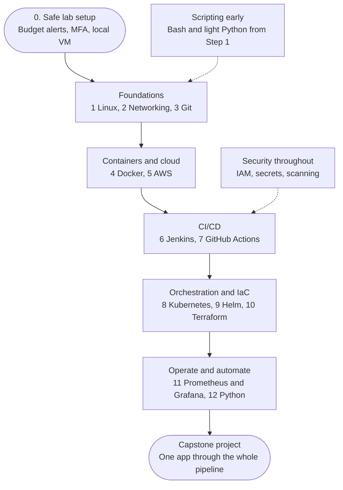
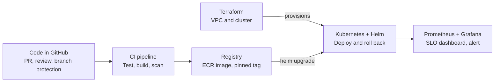

# Free DevOps Roadmap: Step-by-Step Study Guide

**PDF:** [Download this guide (PDF)](guide.pdf)

## Overview

| | |
| --- | --- |
| **Source** | LinkedIn post, 'Free DevOps Roadmap: From Zero to Job-Ready' |
| **Author** | David Popoola |
| **Posted** | 22 Nov 2026 |
| **Link** | [https://www.linkedin.com/posts/david-popoola-op_devops-sre-cloudcomputing-share-7530280973574238208-WZg9/](https://www.linkedin.com/posts/david-popoola-op_devops-sre-cloudcomputing-share-7530280973574238208-WZg9/) |
| **Format** | 12 YouTube courses in order, 60h 48m by YouTube's own durations |

!!! note "The post's core advice"

    Follow the videos in order, but don't just watch: build, practise, break, fix, repeat.

This guide is built from the post, the infographic and each video's title, chapters and metadata. I did not transcribe 61 hours of video. Items marked "Beyond the post" come from the cited standards, not from the author or the presenters.

## Language warning

!!! warning "8 of the 12 courses are in Hindi"

    YouTube lists Hindi spoken language for the Linux, Git, Docker, Jenkins, GitHub Actions, Kubernetes, Terraform and Prometheus videos, and five say "Hindi" in the title. The post does not mention this. English alternatives are listed further down.

## Roadmap

*The post's order, grouped into stages; dashed items are beyond-the-post additions.*

## Time per topic

*Video length in hours, from YouTube metadata.*

Plan at least hands-on time time; the post itself says watching alone is not enough.

## All 12 courses

| # | Topic | Channel | Length | Language | Posted | Video |
| --- | --- | --- | --- | --- | --- | --- |
| 1 | Linux | TrainWithShubham | 5h 46m | Hindi | Oct 2024 | [https://youtu.be/e01GGTKmtpc](https://youtu.be/e01GGTKmtpc) |
| 2 | Networking | Abhishek.Veeramalla | 3h 11m | English | Apr 2024 | [https://youtu.be/iSOfkw_YyOU](https://youtu.be/iSOfkw_YyOU) |
| 3 | Git & GitHub | CodeWithHarry | 2h 32m | Hindi (per YouTube metadata) | Jul 2026 | [https://youtu.be/AB3J8ufDYHQ](https://youtu.be/AB3J8ufDYHQ) |
| 4 | Docker | TrainWithShubham | 5h 07m | Hindi | Nov 2024 | [https://youtu.be/9bSbNNH4Nqw](https://youtu.be/9bSbNNH4Nqw) |
| 5 | AWS | Telusko | 10h 17m | English | Jul 2026 | [https://youtu.be/KmsfUenqK4w](https://youtu.be/KmsfUenqK4w) |
| 6 | CI/CD with Jenkins | TrainWithShubham | 6h 23m | Hindi | Sep 2024 | [https://youtu.be/XaSdKR2fOU4](https://youtu.be/XaSdKR2fOU4) |
| 7 | CI/CD with GitHub Actions | Learn Code With Durgesh | 1h 23m | Hindi (per YouTube metadata) | Jul 2026 | [https://youtu.be/NIAEruc-eP8](https://youtu.be/NIAEruc-eP8) |
| 8 | Kubernetes | TrainWithShubham | 11h 43m | Hindi (per YouTube metadata) | Dec 2024 | [https://youtu.be/W04brGNgxN4](https://youtu.be/W04brGNgxN4) |
| 9 | Helm | Rahul Wagh | 2h 08m | English | Sep 2023 | [https://youtu.be/DQk8HOVlumI](https://youtu.be/DQk8HOVlumI) |
| 10 | Terraform | TrainWithShubham | 7h 22m | Hindi | Mar 2025 | [https://youtu.be/S9mohJI_R34](https://youtu.be/S9mohJI_R34) |
| 11 | Monitoring (Prometheus & Grafana) | TrainWithShubham | 40m | Hindi | Sep 2024 | [https://youtu.be/DXZUunEeHqM](https://youtu.be/DXZUunEeHqM) |
| 12 | Python for DevOps | TrainWithShubham | 4h 17m | English (per YouTube metadata) | Jul 2026 | [https://youtu.be/mM6X7wjEtag](https://youtu.be/mM6X7wjEtag) |

## Step 0: Set up a safe lab (beyond the post)

!!! warning "Cloud labs can bill you"

    AWS, EKS, load balancers, NAT gateways and databases charge by the hour. Set guardrails before Step 5.

**How to do it**

1. **Create the AWS account and lock root** — Enable MFA on the root user and do not create root access keys (AWS root-user best practices).
2. **Create an admin identity** — Use IAM Identity Center or an IAM user with MFA for daily work.
3. **Set a budget alert** — AWS Budgets with an email alert at a small monthly amount; review the Free Tier terms.
4. **Start local** — Ubuntu VM or WSL2, Docker Desktop or Docker Engine, and KIND or minikube cost nothing.
5. **Make a portfolio repo** — One GitHub repo with a folder per step, a README and notes.

## Steps 1-12

*Each step: the post's video, key chapters with timestamp links, practice tasks, common mistakes and additions beyond the post.*

Hands-on practice (beyond the post)

Common mistakes

Beyond the post: standards and best practice

### Step 1: Linux

**Video:** Linux For DevOps In One Shot | Complete Beginners to Advanced Linux (Hindi)  
**Channel:** TrainWithShubham · 5h 46m · Hindi · Oct 2024  
**Watch:** [https://youtu.be/e01GGTKmtpc](https://youtu.be/e01GGTKmtpc)  
**Stage:** Foundations  
**What:** Learn the Linux command line, users and permissions, files, networking commands, text tools and disk management.  
**Why:** Almost every server, container and CI runner you will touch runs Linux.

**Key chapters**

| Time | Key chapter | Link |
| --- | --- | --- |
| 16:30 | What is Linux OS? How to set up a Linux server | [https://youtu.be/e01GGTKmtpc?t=990](https://youtu.be/e01GGTKmtpc?t=990) |
| 52:40 | Linux basic commands for DevOps engineers | [https://youtu.be/e01GGTKmtpc?t=3160](https://youtu.be/e01GGTKmtpc?t=3160) |
| 1:57:50 | Users and groups management | [https://youtu.be/e01GGTKmtpc?t=7070](https://youtu.be/e01GGTKmtpc?t=7070) |
| 2:45:30 | File management | [https://youtu.be/e01GGTKmtpc?t=9930](https://youtu.be/e01GGTKmtpc?t=9930) |
| 3:37:40 | Linux networking commands | [https://youtu.be/e01GGTKmtpc?t=13060](https://youtu.be/e01GGTKmtpc?t=13060) |
| 4:30:30 | AWK, GREP, FIND, SED | [https://youtu.be/e01GGTKmtpc?t=16230](https://youtu.be/e01GGTKmtpc?t=16230) |
| 5:03:38 | Volume management and LVM | [https://youtu.be/e01GGTKmtpc?t=18218](https://youtu.be/e01GGTKmtpc?t=18218) |

**Hands-on practice (beyond the post)**

1. **Build a practice box** — Ubuntu in a local VM or WSL2 is free; a cloud VM works once Step 0's billing guardrails exist.
2. **Daily drills** — Create users and groups, set permissions with `chmod`/`chown`, read logs with `journalctl`, `grep` and `awk`.
3. **Write a Bash script** — Back up a folder, rotate old copies, and run it from `cron` (beyond the video: no Bash scripting chapter is listed).

**Common mistakes**

- Working as root all the time instead of using `sudo` from a normal user.
- Using `chmod 777` to 'fix' permission errors.

**Beyond the post**

- Add shell scripting: the video's chapter list has no Bash scripting section, yet scripting is a core DevOps skill on roadmap.sh.
- Learn SSH key login and disabling password login; CIS Benchmarks are the reference for hardening Linux.

### Step 2: Networking

**Video:** Learn Networking in 3 Hours | Networking Fundamentals + AWS VPC Networking  
**Channel:** Abhishek.Veeramalla · 3h 11m · English · Apr 2024  
**Watch:** [https://youtu.be/iSOfkw_YyOU](https://youtu.be/iSOfkw_YyOU)  
**Stage:** Foundations  
**What:** IP addresses, CIDR, subnets and ports, the OSI model, then AWS networking, security groups, NACLs and a VPC lab.  
**Why:** Most outages and 'it works on my machine' problems are DNS, ports, routing or firewall rules.

**Key chapters**

| Time | Key chapter | Link |
| --- | --- | --- |
| 0:58 | IP address, CIDR, subnets, ports | [https://youtu.be/iSOfkw_YyOU?t=58](https://youtu.be/iSOfkw_YyOU?t=58) |
| 40:52 | OSI model | [https://youtu.be/iSOfkw_YyOU?t=2452](https://youtu.be/iSOfkw_YyOU?t=2452) |
| 1:11:32 | AWS networking | [https://youtu.be/iSOfkw_YyOU?t=4292](https://youtu.be/iSOfkw_YyOU?t=4292) |
| 1:40:22 | AWS security groups and NACLs | [https://youtu.be/iSOfkw_YyOU?t=6022](https://youtu.be/iSOfkw_YyOU?t=6022) |
| 2:25:35 | AWS VPC hands-on | [https://youtu.be/iSOfkw_YyOU?t=8735](https://youtu.be/iSOfkw_YyOU?t=8735) |

**Hands-on practice (beyond the post)**

1. **Subnet by hand** — Split a /16 into /24s and work out usable hosts without a calculator, then check with one.
2. **Trace a request** — Use `dig`, `curl -v`, `ss -tlnp` and `traceroute` on your Linux box.
3. **Do the VPC lab** — Public and private subnets, an internet gateway and security groups (ties into Step 5).

**Common mistakes**

- Opening security groups to `0.0.0.0/0` on SSH (port 22) to get a lab working.
- Confusing security groups (stateful) with NACLs (stateless).

**Beyond the post**

- Learn DNS records (A, CNAME, TXT) and TLS basics; the post's list has no separate DNS or HTTPS material beyond the AWS Route 53 chapters in Step 5.

### Step 3: Git & GitHub

**Video:** Git Tutorial for Beginners: Learn Git in One Video  
**Channel:** CodeWithHarry · 2h 32m · Hindi (per YouTube metadata) · Jul 2026  
**Watch:** [https://youtu.be/AB3J8ufDYHQ](https://youtu.be/AB3J8ufDYHQ)  
**Stage:** Foundations  
**What:** Version control basics, branching, merge conflicts, stash, tags, rebase, GitHub hosting and multi-user workflows.  
**Why:** Everything in DevOps, from app code to pipelines and infrastructure, lives in Git.

**Key chapters**

| Time | Key chapter | Link |
| --- | --- | --- |
| 23:17 | Hands-on Git | [https://youtu.be/AB3J8ufDYHQ?t=1397](https://youtu.be/AB3J8ufDYHQ?t=1397) |
| 46:26 | Ignoring files | [https://youtu.be/AB3J8ufDYHQ?t=2786](https://youtu.be/AB3J8ufDYHQ?t=2786) |
| 55:58 | Branching | [https://youtu.be/AB3J8ufDYHQ?t=3358](https://youtu.be/AB3J8ufDYHQ?t=3358) |
| 1:13:37 | Merge conflicts | [https://youtu.be/AB3J8ufDYHQ?t=4417](https://youtu.be/AB3J8ufDYHQ?t=4417) |
| 1:29:08 | Git rebase | [https://youtu.be/AB3J8ufDYHQ?t=5348](https://youtu.be/AB3J8ufDYHQ?t=5348) |
| 1:38:38 | Using GitHub to host repositories | [https://youtu.be/AB3J8ufDYHQ?t=5918](https://youtu.be/AB3J8ufDYHQ?t=5918) |
| 2:15:35 | Multi-user setup | [https://youtu.be/AB3J8ufDYHQ?t=8135](https://youtu.be/AB3J8ufDYHQ?t=8135) |
| 2:27:33 | Modern Git workflow | [https://youtu.be/AB3J8ufDYHQ?t=8853](https://youtu.be/AB3J8ufDYHQ?t=8853) |

**Hands-on practice (beyond the post)**

1. **Make a public portfolio repo** — Every later step adds a folder or repo here; it doubles as your job portfolio.
2. **Practise pull requests** — Branch, open a PR, resolve a deliberate merge conflict, squash-merge.
3. **Protect main** — Turn on branch protection requiring a PR and passing checks.

**Common mistakes**

- Committing secrets or `.env` files; add a `.gitignore` before the first commit.
- Rewriting shared history with `push --force` on a branch others use.

**Beyond the post**

- Enable GitHub secret scanning and push protection on your repos.
- Use clear commit messages; Conventional Commits is a widely used convention.

### Step 4: Docker

**Video:** Docker In One Shot with 2 Live DevOps Projects (Hindi)  
**Channel:** TrainWithShubham · 5h 07m · Hindi · Nov 2024  
**Watch:** [https://youtu.be/9bSbNNH4Nqw](https://youtu.be/9bSbNNH4Nqw)  
**Stage:** Containers & cloud  
**What:** Docker architecture, images, Dockerfiles, networking, volumes, Compose, registries, multi-stage builds and two projects.  
**Why:** Containers are the standard unit you build in CI and run in Kubernetes.

**Key chapters**

| Time | Key chapter | Link |
| --- | --- | --- |
| 11:58 | Docker architecture | [https://youtu.be/9bSbNNH4Nqw?t=718](https://youtu.be/9bSbNNH4Nqw?t=718) |
| 45:00 | Dockerfile for a Java application | [https://youtu.be/9bSbNNH4Nqw?t=2700](https://youtu.be/9bSbNNH4Nqw?t=2700) |
| 1:22:00 | Docker networking | [https://youtu.be/9bSbNNH4Nqw?t=4920](https://youtu.be/9bSbNNH4Nqw?t=4920) |
| 1:50:00 | Volumes and storage | [https://youtu.be/9bSbNNH4Nqw?t=6600](https://youtu.be/9bSbNNH4Nqw?t=6600) |
| 1:59:10 | Docker Compose | [https://youtu.be/9bSbNNH4Nqw?t=7150](https://youtu.be/9bSbNNH4Nqw?t=7150) |
| 2:33:25 | Multi-stage builds | [https://youtu.be/9bSbNNH4Nqw?t=9205](https://youtu.be/9bSbNNH4Nqw?t=9205) |
| 2:55:21 | Project 1 | [https://youtu.be/9bSbNNH4Nqw?t=10521](https://youtu.be/9bSbNNH4Nqw?t=10521) |
| 4:54:12 | Docker Scout and Docker Init | [https://youtu.be/9bSbNNH4Nqw?t=17652](https://youtu.be/9bSbNNH4Nqw?t=17652) |

**Hands-on practice (beyond the post)**

1. **Containerise a small app** — Write a multi-stage Dockerfile, run as a non-root user, keep the image small.
2. **Compose a 2-tier stack** — App plus database with a named volume and a private network.
3. **Scan the image** — Use Docker Scout (covered in the video) or Trivy and fix high-severity findings.

**Common mistakes**

- Using `latest` tags and huge base images.
- Baking secrets into images with `ENV` or `COPY`.

**Beyond the post**

- Docker's build best practices: multi-stage builds, minimal base images, pinned versions, a `.dockerignore`, and non-root users.

### Step 5: AWS

**Video:** AWS Tutorial for Everyone in One Shot  
**Channel:** Telusko · 10h 17m · English · Jul 2026  
**Watch:** [https://youtu.be/KmsfUenqK4w](https://youtu.be/KmsfUenqK4w)  
**Stage:** Containers & cloud  
**What:** Cloud basics, IAM, EC2, EBS, load balancers, auto scaling, S3, RDS, VPC, Route 53, CloudWatch, CodePipeline, CLI, CloudFormation, ECS and Terraform.  
**Why:** AWS is the cloud the rest of this roadmap deploys to.

**Key chapters**

| Time | Key chapter | Link |
| --- | --- | --- |
| 31:46 | IAM: root user vs IAM user | [https://youtu.be/KmsfUenqK4w?t=1906](https://youtu.be/KmsfUenqK4w?t=1906) |
| 45:41 | IAM groups, policies and roles | [https://youtu.be/KmsfUenqK4w?t=2741](https://youtu.be/KmsfUenqK4w?t=2741) |
| 1:08:02 | EC2 | [https://youtu.be/KmsfUenqK4w?t=4082](https://youtu.be/KmsfUenqK4w?t=4082) |
| 2:43:58 | Application Load Balancer hands-on | [https://youtu.be/KmsfUenqK4w?t=9838](https://youtu.be/KmsfUenqK4w?t=9838) |
| 3:13:00 | S3 | [https://youtu.be/KmsfUenqK4w?t=11580](https://youtu.be/KmsfUenqK4w?t=11580) |
| 4:27:29 | Build a custom VPC | [https://youtu.be/KmsfUenqK4w?t=16049](https://youtu.be/KmsfUenqK4w?t=16049) |
| 5:25:39 | CloudWatch and SNS alerts | [https://youtu.be/KmsfUenqK4w?t=19539](https://youtu.be/KmsfUenqK4w?t=19539) |
| 5:49:21 | AWS CLI | [https://youtu.be/KmsfUenqK4w?t=20961](https://youtu.be/KmsfUenqK4w?t=20961) |
| 6:45:25 | ECR and ECS | [https://youtu.be/KmsfUenqK4w?t=24325](https://youtu.be/KmsfUenqK4w?t=24325) |

**Hands-on practice (beyond the post)**

1. **Secure the account first** — See Step 0: MFA on root, an admin IAM identity, a budget alert.
2. **Deploy your container** — Push the Step 4 image to ECR and run it on ECS or EC2 behind a load balancer.
3. **Tear down** — Delete everything at the end of each session and check the bill next day.

**Common mistakes**

- Doing labs as the root user or with long-lived access keys.
- Leaving load balancers, NAT gateways or RDS running overnight.

**Beyond the post**

- The last part of this video (from 7:14:56) covers Terraform, which Step 10 repeats in depth; you can skip it here.
- AWS root-user guidance: enable MFA on root, do not create root access keys, use it only for the few tasks that need it.
- The AWS Well-Architected Framework is the reference for design decisions; its security and cost pillars matter most for labs.

### Step 6: CI/CD with Jenkins

**Video:** Jenkins In One Shot | DevOps Production CICD Pipelines [Hindi]  
**Channel:** TrainWithShubham · 6h 23m · Hindi · Sep 2024  
**Watch:** [https://youtu.be/XaSdKR2fOU4](https://youtu.be/XaSdKR2fOU4)  
**Stage:** CI/CD  
**What:** Jenkins setup, freestyle and declarative pipelines, agents, shared libraries, role-based users, a Kubernetes/ArgoCD project and DevSecOps scanning.  
**Why:** Jenkins is still common in enterprises, and the pipeline ideas carry to every CI tool.

**Key chapters**

| Time | Key chapter | Link |
| --- | --- | --- |
| 7:12 | Jenkins setup on AWS EC2 | [https://youtu.be/XaSdKR2fOU4?t=432](https://youtu.be/XaSdKR2fOU4?t=432) |
| 36:10 | Declarative pipeline | [https://youtu.be/XaSdKR2fOU4?t=2170](https://youtu.be/XaSdKR2fOU4?t=2170) |
| 42:30 | Jenkins agents (multi-node) | [https://youtu.be/XaSdKR2fOU4?t=2550](https://youtu.be/XaSdKR2fOU4?t=2550) |
| 1:40:55 | Shared libraries | [https://youtu.be/XaSdKR2fOU4?t=6055](https://youtu.be/XaSdKR2fOU4?t=6055) |
| 2:00:38 | Role-based user management | [https://youtu.be/XaSdKR2fOU4?t=7238](https://youtu.be/XaSdKR2fOU4?t=7238) |
| 2:08:18 | CI/CD project with Kubernetes, ArgoCD, Prometheus | [https://youtu.be/XaSdKR2fOU4?t=7698](https://youtu.be/XaSdKR2fOU4?t=7698) |
| 4:49:08 | DevSecOps with OWASP, Trivy, SonarQube | [https://youtu.be/XaSdKR2fOU4?t=17348](https://youtu.be/XaSdKR2fOU4?t=17348) |

**Hands-on practice (beyond the post)**

1. **Pipeline as code** — A `Jenkinsfile` in your repo that tests, builds and scans the Step 4 image.
2. **Run builds on agents** — Keep the controller for orchestration only.
3. **Add a security gate** — Fail the build on critical Trivy findings.

**Common mistakes**

- Exposing the Jenkins UI to the internet with default or weak admin credentials.
- Hard-coding credentials in the Jenkinsfile instead of the credentials store.

**Beyond the post**

- Jenkins security docs: do not run builds on the controller, keep plugins updated, and use role-based access.
- OWASP Top 10 CI/CD Security Risks covers pipeline-specific threats such as poisoned pipeline execution and weak credential hygiene.

### Step 7: CI/CD with GitHub Actions

**Video:** Complete CI/CD Pipeline Tutorial with GitHub Actions & Docker | DevOps Masterclass  
**Channel:** Learn Code With Durgesh · 1h 23m · Hindi (per YouTube metadata) · Jul 2026  
**Watch:** [https://youtu.be/NIAEruc-eP8](https://youtu.be/NIAEruc-eP8)  
**Stage:** CI/CD  
**What:** CI/CD concepts, Dockerising a Spring Boot app, pushing to Docker Hub, running on AWS, and a full GitHub Actions workflow.  
**Why:** GitHub Actions is the default CI for code on GitHub and the fastest way to automate your portfolio.

**Key chapters**

| Time | Key chapter | Link |
| --- | --- | --- |
| 4:17 | What is CI/CD? | [https://youtu.be/NIAEruc-eP8?t=257](https://youtu.be/NIAEruc-eP8?t=257) |
| 8:14 | Architecture of a CI/CD pipeline | [https://youtu.be/NIAEruc-eP8?t=494](https://youtu.be/NIAEruc-eP8?t=494) |
| 20:34 | Creating the Dockerfile | [https://youtu.be/NIAEruc-eP8?t=1234](https://youtu.be/NIAEruc-eP8?t=1234) |
| 28:07 | Pushing the image to Docker Hub | [https://youtu.be/NIAEruc-eP8?t=1687](https://youtu.be/NIAEruc-eP8?t=1687) |
| 36:48 | Setting up AWS to pull and run the image | [https://youtu.be/NIAEruc-eP8?t=2208](https://youtu.be/NIAEruc-eP8?t=2208) |
| 47:36 | Exploring GitHub Actions | [https://youtu.be/NIAEruc-eP8?t=2856](https://youtu.be/NIAEruc-eP8?t=2856) |
| 52:45 | Writing the complete workflow | [https://youtu.be/NIAEruc-eP8?t=3165](https://youtu.be/NIAEruc-eP8?t=3165) |

**Hands-on practice (beyond the post)**

1. **Rebuild Step 6 in Actions** — Test, build, scan and push on every PR and merge.
2. **Use OIDC for AWS** — Let the workflow assume an IAM role instead of storing access keys (beyond the video).
3. **Protect deploys** — Use environments with required reviewers for production.

**Common mistakes**

- Storing long-lived AWS keys as repository secrets.
- Using third-party actions by tag instead of a pinned commit SHA.

**Beyond the post**

- GitHub's Actions security hardening guide: least-privilege `GITHUB_TOKEN` permissions, pin actions to full commit SHAs, use OIDC for cloud access.
- SLSA describes supply-chain levels for build provenance; signed, reproducible builds are the goal.

### Step 8: Kubernetes

**Video:** Kubernetes In One Shot | 3 Live DevOps Projects | Beginners to Advanced  
**Channel:** TrainWithShubham · 11h 43m · Hindi (per YouTube metadata) · Dec 2024  
**Watch:** [https://youtu.be/W04brGNgxN4](https://youtu.be/W04brGNgxN4)  
**Stage:** Orchestration & IaC  
**What:** Architecture, KIND/minikube/kubeadm clusters, workloads, storage, services, ingress, config and secrets, probes, autoscaling, RBAC, operators, Istio and three projects.  
**Why:** Kubernetes is the standard way to run containers at scale.

**Key chapters**

| Time | Key chapter | Link |
| --- | --- | --- |
| 10:12 | Kubernetes architecture and kubectl | [https://youtu.be/W04brGNgxN4?t=612](https://youtu.be/W04brGNgxN4?t=612) |
| 35:25 | KIND cluster | [https://youtu.be/W04brGNgxN4?t=2125](https://youtu.be/W04brGNgxN4?t=2125) |
| 1:35:22 | Pods | [https://youtu.be/W04brGNgxN4?t=5722](https://youtu.be/W04brGNgxN4?t=5722) |
| 1:44:00 | Deployments | [https://youtu.be/W04brGNgxN4?t=6240](https://youtu.be/W04brGNgxN4?t=6240) |
| 3:04:05 | Services | [https://youtu.be/W04brGNgxN4?t=11045](https://youtu.be/W04brGNgxN4?t=11045) |
| 3:24:30 | Ingress | [https://youtu.be/W04brGNgxN4?t=12270](https://youtu.be/W04brGNgxN4?t=12270) |
| 4:11:10 | ConfigMaps and Secrets | [https://youtu.be/W04brGNgxN4?t=15070](https://youtu.be/W04brGNgxN4?t=15070) |
| 4:32:30 | Resource quotas and limits | [https://youtu.be/W04brGNgxN4?t=16350](https://youtu.be/W04brGNgxN4?t=16350) |
| 4:40:45 | Probes | [https://youtu.be/W04brGNgxN4?t=16845](https://youtu.be/W04brGNgxN4?t=16845) |
| 6:11:55 | RBAC | [https://youtu.be/W04brGNgxN4?t=22315](https://youtu.be/W04brGNgxN4?t=22315) |
| 9:09:40 | Project 1: 3-tier chat app on minikube | [https://youtu.be/W04brGNgxN4?t=32980](https://youtu.be/W04brGNgxN4?t=32980) |

**Hands-on practice (beyond the post)**

1. **Use a free local cluster** — KIND or minikube, as the video does, before paying for EKS.
2. **Deploy your app properly** — Deployment with requests/limits, readiness and liveness probes, a Service and an Ingress.
3. **Lock it down** — A namespace, a least-privilege RBAC role and a NetworkPolicy.

**Common mistakes**

- Running pods without resource requests and limits or probes.
- Treating Kubernetes Secrets as encrypted; by default they are only base64-encoded.

**Beyond the post**

- Kubernetes configuration best practices: declarative YAML in Git, labels, and avoiding naked pods.
- An EKS control plane costs $0.10 per cluster per hour on standard support (AWS EKS pricing), so delete practice clusters.
- Validate with the CKA certification once comfortable; it is hands-on rather than multiple choice.

### Step 9: Helm

**Video:** Complete Helm Chart Tutorial: From Beginner to Expert Guide  
**Channel:** Rahul Wagh · 2h 08m · English · Sep 2023  
**Watch:** [https://youtu.be/DQk8HOVlumI](https://youtu.be/DQk8HOVlumI)  
**Stage:** Orchestration & IaC  
**What:** Helm concepts, install, create, upgrade and rollback, dry runs and linting, a custom chart, Helmfile, repositories, hooks and tests.  
**Why:** Helm packages Kubernetes apps so they can be versioned, configured per environment and rolled back.

**Key chapters**

| Time | Key chapter | Link |
| --- | --- | --- |
| 25:53 | Helm architecture | [https://youtu.be/DQk8HOVlumI?t=1553](https://youtu.be/DQk8HOVlumI?t=1553) |
| 30:00 | Creating your first chart | [https://youtu.be/DQk8HOVlumI?t=1800](https://youtu.be/DQk8HOVlumI?t=1800) |
| 45:28 | helm upgrade | [https://youtu.be/DQk8HOVlumI?t=2728](https://youtu.be/DQk8HOVlumI?t=2728) |
| 47:53 | helm rollback | [https://youtu.be/DQk8HOVlumI?t=2873](https://youtu.be/DQk8HOVlumI?t=2873) |
| 50:20 | Debug and dry run | [https://youtu.be/DQk8HOVlumI?t=3020](https://youtu.be/DQk8HOVlumI?t=3020) |
| 55:14 | helm lint | [https://youtu.be/DQk8HOVlumI?t=3314](https://youtu.be/DQk8HOVlumI?t=3314) |
| 1:05:23 | Creating a custom chart | [https://youtu.be/DQk8HOVlumI?t=3923](https://youtu.be/DQk8HOVlumI?t=3923) |
| 1:22:01 | Helmfile | [https://youtu.be/DQk8HOVlumI?t=4921](https://youtu.be/DQk8HOVlumI?t=4921) |
| 1:50:07 | Helm hooks | [https://youtu.be/DQk8HOVlumI?t=6607](https://youtu.be/DQk8HOVlumI?t=6607) |

**Hands-on practice (beyond the post)**

1. **Chart your app** — Turn the Step 8 manifests into a chart with values for dev and prod.
2. **Lint and template in CI** — Run `helm lint` and `helm template` in your Step 7 workflow.
3. **Practise a rollback** — Ship a broken release and recover with `helm rollback`.

**Common mistakes**

- Putting secrets in plain `values.yaml` committed to Git.
- Installing third-party charts without reading what they create.

**Beyond the post**

- This video is from 2023, the oldest on the list; check commands against the current Helm docs.
- Follow the Helm chart best practices guide for naming, values and labels.

### Step 10: Terraform

**Video:** Terraform In One Shot | 3 Live DevOps Projects with Notes (Hindi)  
**Channel:** TrainWithShubham · 7h 22m · Hindi · Mar 2025  
**Watch:** [https://youtu.be/S9mohJI_R34](https://youtu.be/S9mohJI_R34)  
**Stage:** Orchestration & IaC  
**What:** Infrastructure as code, Terraform vs Ansible and CloudFormation, syntax, providers, variables, modules, loops, conditionals, state, debugging, EKS and CI/CD.  
**Why:** Clicking in the console does not scale or repeat; code-defined infrastructure can be reviewed, versioned and rebuilt.

**Key chapters**

| Time | Key chapter | Link |
| --- | --- | --- |
| 12:35 | Infrastructure as code: why it matters | [https://youtu.be/S9mohJI_R34?t=755](https://youtu.be/S9mohJI_R34?t=755) |
| 24:31 | Terraform vs Ansible | [https://youtu.be/S9mohJI_R34?t=1471](https://youtu.be/S9mohJI_R34?t=1471) |
| 51:40 | Basic syntax: blocks, arguments, attributes | [https://youtu.be/S9mohJI_R34?t=3100](https://youtu.be/S9mohJI_R34?t=3100) |
| 1:23:21 | Provider, resource, variable, output, module | [https://youtu.be/S9mohJI_R34?t=5001](https://youtu.be/S9mohJI_R34?t=5001) |
| 3:23:00 | Loops: for_each and count | [https://youtu.be/S9mohJI_R34?t=12180](https://youtu.be/S9mohJI_R34?t=12180) |
| 4:07:05 | Advanced commands and state manipulation | [https://youtu.be/S9mohJI_R34?t=14825](https://youtu.be/S9mohJI_R34?t=14825) |
| 4:08:10 | Debugging Terraform issues | [https://youtu.be/S9mohJI_R34?t=14890](https://youtu.be/S9mohJI_R34?t=14890) |
| 7:01:00 | Deploying an EKS cluster | [https://youtu.be/S9mohJI_R34?t=25260](https://youtu.be/S9mohJI_R34?t=25260) |
| 7:12:55 | CI/CD with Terraform | [https://youtu.be/S9mohJI_R34?t=25975](https://youtu.be/S9mohJI_R34?t=25975) |

**Hands-on practice (beyond the post)**

1. **Rebuild Step 5 in code** — VPC, subnets, security groups and an EC2 or ECS service as Terraform.
2. **Remote state** — Store state in S3 with locking; never commit `terraform.tfstate`.
3. **Plan in PRs** — Run `terraform fmt`, `validate` and `plan` in CI; apply only after review.

**Common mistakes**

- Committing state files, which can contain secrets.
- Running `apply` from a laptop against shared environments.

**Beyond the post**

- HashiCorp's Terraform style guide covers file layout, naming and formatting.
- Terraform moved to the Business Source License in 2023; OpenTofu is the open-source fork if licensing matters to an employer.

### Step 11: Monitoring (Prometheus & Grafana)

**Video:** Easiest Prometheus & Grafana Tutorial For DevOps on Kubernetes | Observability in Hindi  
**Channel:** TrainWithShubham · 40m · Hindi · Sep 2024  
**Watch:** [https://youtu.be/DXZUunEeHqM](https://youtu.be/DXZUunEeHqM)  
**Stage:** Operate & automate  
**What:** Set up Prometheus and Grafana on Kubernetes for metrics and dashboards (no chapters are listed for this video).  
**Why:** You cannot run what you cannot see; monitoring is how you know a deploy worked.

**Hands-on practice (beyond the post)**

1. **Install the stack** — Prometheus and Grafana on your KIND cluster, then dashboards for node and pod health.
2. **Instrument your app** — Expose a `/metrics` endpoint and graph request rate, errors and latency.
3. **Write one alert** — Alert on a symptom users feel, such as error rate, not on CPU alone.

**Common mistakes**

- Building dashboards no one looks at and alerts that fire constantly.
- Ignoring logs and traces; metrics are only one part of observability.

**Beyond the post**

- At 40 minutes this is the thinnest topic on the list. Add SRE basics: Google's SRE book chapter on service level objectives (SLIs, SLOs, error budgets).
- Prometheus docs on alerting and metric naming describe alerting on symptoms and consistent metric names.
- Track the DORA metrics (deployment frequency, lead time, change failure rate, recovery time) for your own pipeline.

### Step 12: Python for DevOps

**Video:** Give Me 4 Hours, I will Make You PRO in Python for DevOps  
**Channel:** TrainWithShubham · 4h 17m · English (per YouTube metadata) · Jul 2026  
**Watch:** [https://youtu.be/mM6X7wjEtag](https://youtu.be/mM6X7wjEtag)  
**Stage:** Operate & automate  
**What:** Python basics, virtual environments, psutil health checks, Flask APIs, boto3 and S3, and AI agents with Amazon Bedrock AgentCore.  
**Why:** Scripting glues tools together: automation, cloud APIs, log parsing and custom checks.

**Key chapters**

| Time | Key chapter | Link |
| --- | --- | --- |
| 49:03 | Virtual environments | [https://youtu.be/mM6X7wjEtag?t=2943](https://youtu.be/mM6X7wjEtag?t=2943) |
| 1:01:01 | DevOps CPU health check | [https://youtu.be/mM6X7wjEtag?t=3661](https://youtu.be/mM6X7wjEtag?t=3661) |
| 1:30:00 | Building a system metrics API | [https://youtu.be/mM6X7wjEtag?t=5400](https://youtu.be/mM6X7wjEtag?t=5400) |
| 1:59:05 | Uploading files to S3 | [https://youtu.be/mM6X7wjEtag?t=7145](https://youtu.be/mM6X7wjEtag?t=7145) |
| 2:17:50 | boto3 vs infrastructure as code | [https://youtu.be/mM6X7wjEtag?t=8270](https://youtu.be/mM6X7wjEtag?t=8270) |
| 3:40:00 | Agent analysing log files | [https://youtu.be/mM6X7wjEtag?t=13200](https://youtu.be/mM6X7wjEtag?t=13200) |
| 3:58:00 | Amazon Bedrock AgentCore overview | [https://youtu.be/mM6X7wjEtag?t=14280](https://youtu.be/mM6X7wjEtag?t=14280) |

**Hands-on practice (beyond the post)**

1. **Automate a chore** — A script that finds and tags or reports untagged or idle AWS resources with boto3.
2. **Parse logs** — Count error levels in a log file, as the video does, then run it in CI.
3. **Package it** — Use a venv, `requirements.txt`, and a Dockerfile.

**Common mistakes**

- Hard-coding AWS keys in scripts; use IAM roles or profiles.
- Using boto3 to create long-lived infrastructure that should be in Terraform (the video's own boto3 vs IaC chapter).

**Beyond the post**

- Video order departs from common roadmaps: roadmap.sh lists a scripting language among core DevOps skills, so start light Python or Bash alongside Linux instead of saving it for last.

## Capstone project (beyond the post)

*One project that proves every step and becomes your portfolio piece.*

Write a README with an architecture diagram, how to run it, what broke and how you fixed it, and a teardown command. That write-up is what interviewers read.

## Suggested schedule

*Beyond the post: about 10 hours a week, half watching and half building; an estimate.*

| Weeks | Steps | Build by the end |
| --- | --- | --- |
| 1-2 | 0, 1, 2 | Linux VM, Bash backup script, subnetting notes |
| 3 | 3 | Portfolio repo with PR workflow and branch protection |
| 4-5 | 4 | Multi-stage image of your app, Compose stack |
| 6-8 | 5 | App running on AWS, then torn down |
| 9-10 | 6, 7 | Pipelines that test, build, scan and push |
| 11-13 | 8 | App on KIND with probes, limits and RBAC |
| 14 | 9 | Helm chart with dev and prod values |
| 15-16 | 10 | Step 5 infrastructure rebuilt in Terraform |
| 17 | 11 | Dashboard and one SLO-based alert |
| 18 | 12 | boto3 automation script in CI |
| 19-20 | Capstone | End-to-end project and README |

## English alternatives (beyond the post)

*Found by YouTube search on 23 Nov 2026; titles and lengths from YouTube, content not reviewed.*

| Topic | Video | Channel | Length | Link |
| --- | --- | --- | --- | --- |
| Linux | Introduction to Linux – Full Course for Beginners | freeCodeCamp | 6h 08m | [https://youtu.be/sWbUDq4S6Y8](https://youtu.be/sWbUDq4S6Y8) |
| Git | Learn Git – Full Course for Beginners | freeCodeCamp | 3h 44m | [https://youtu.be/zTjRZNkhiEU](https://youtu.be/zTjRZNkhiEU) |
| Docker | Docker Tutorial for Beginners [FULL COURSE in 3 Hours] | TechWorld with Nana | 2h 46m | [https://youtu.be/3c-iBn73dDE](https://youtu.be/3c-iBn73dDE) |
| Jenkins | Jenkins Tutorial – Deploy a Test Server with Docker + Linux | freeCodeCamp | 1h 03m | [https://youtu.be/f4idgaq2VqA](https://youtu.be/f4idgaq2VqA) |
| Kubernetes | Kubernetes Tutorial for Beginners [FULL COURSE in 4 Hours] | TechWorld with Nana | 3h 37m | [https://youtu.be/X48VuDVv0do](https://youtu.be/X48VuDVv0do) |
| Terraform | Terraform Course - Automate your AWS cloud infrastructure | freeCodeCamp | 2h 21m | [https://youtu.be/SLB_c_ayRMo](https://youtu.be/SLB_c_ayRMo) |
| Prometheus | How Prometheus Monitoring works | TechWorld with Nana | 22m | [https://youtu.be/h4Sl21AKiDg](https://youtu.be/h4Sl21AKiDg) |
| Prometheus | Setup Prometheus Monitoring on Kubernetes using Helm | TechWorld with Nana | 26m | [https://youtu.be/QoDqxm7ybLc](https://youtu.be/QoDqxm7ybLc) |

Networking, AWS, Helm and Python in the original list are already in English. No English GitHub Actions alternative was checked.

## Where the post departs from best practice

| Post | Issue | Better practice |
| --- | --- | --- |
| No language noted | 8 of 12 videos are in Hindi | Use the English alternatives where needed |
| Python last | Scripting is needed from day one | Bash and light Python alongside Linux |
| No Bash scripting | Linux video lists no scripting chapter | Add shell scripting practice |
| 40 min of monitoring | Observability under-weighted | Add SLOs, logs, alerting, DORA metrics |
| No security topic | Only in Jenkins' DevSecOps chapter | IAM, secrets, scanning in every step |
| No config management | Ansible absent | Add Ansible basics after Terraform |
| No cost guardrails | AWS and EKS labs bill hourly | MFA, budgets, teardown (Step 0) |
| 'Job-ready' in 61 hours | Watching is not experience | Projects, portfolio, then certifications |
| Overlap | AWS video repeats Terraform | Skip its Terraform part; do Step 10 |

What the post gets right: a sensible foundations-first order, free resources, and the reminder to build and break things rather than only watch.

## Best practices and standards

| Area | Source | Steps |
| --- | --- | --- |
| Skills map | roadmap.sh DevOps roadmap | All |
| Linux hardening | CIS Benchmarks | 1 |
| Version control | Pro Git book, Conventional Commits | 3 |
| Containers | Docker build best practices | 4 |
| Cloud account safety | AWS root-user best practices, AWS Budgets | 0, 5 |
| Cloud design | AWS Well-Architected Framework | 5, 10 |
| Pipeline security | OWASP Top 10 CI/CD Security Risks | 6, 7 |
| Actions security | GitHub Actions security hardening | 7 |
| Supply chain | SLSA | 6, 7 |
| Kubernetes | Kubernetes configuration and security docs | 8 |
| Helm | Helm chart best practices | 9 |
| Terraform | HashiCorp style guide; OpenTofu | 10 |
| Reliability | Google SRE book (SLOs), Prometheus practices | 11 |
| Delivery metrics | DORA four keys | 11 |
| App design | The Twelve-Factor App | 4, 8 |

## Troubleshooting

| Symptom | Likely cause | Fix |
| --- | --- | --- |
| Permission denied | Wrong owner or mode, or not using sudo | Check `ls -l`; fix owner, not 777 |
| Cannot SSH to EC2 | Security group, key or user name | Allow 22 from your IP only; check key and user |
| Docker: permission denied on socket | User not in docker group | Add user to group and log in again |
| Image is huge | Single-stage build, fat base image | Multi-stage build, slim base, .dockerignore |
| Unexpected AWS bill | Resources left running | Check Billing and Cost Explorer; delete; set a budget |
| Pod in CrashLoopBackOff | App error or bad config | `kubectl logs` and `kubectl describe pod` |
| Pod stuck Pending | No resources or unbound PVC | `kubectl describe`; adjust requests or storage |
| Terraform state lock | Interrupted run | Confirm no run active, then `terraform force-unlock` |
| Workflow cannot reach AWS | Missing OIDC role or permissions | Check `id-token: write` and the role trust policy |
| Grafana shows no data | Wrong data source or scrape target | Check Prometheus targets page |

## Final checklist

*Status 23 Nov 2026: nothing recorded yet. Tell me finish items and I will update this page.*

- [ ] AWS root MFA, admin identity and budget alert set — Step 0
- [ ] Linux VM and a working Bash script — Step 1
- [ ] Can subnet and trace a request — Step 2
- [ ] Portfolio repo with PRs and branch protection — Step 3
- [ ] Multi-stage, non-root, scanned image — Step 4
- [ ] App deployed on AWS and torn down — Step 5
- [ ] Jenkins pipeline with a security gate — Step 6
- [ ] GitHub Actions with OIDC and pinned actions — Step 7
- [ ] App on Kubernetes with probes, limits, RBAC — Step 8
- [ ] Helm chart with rollback tested — Step 9
- [ ] Infrastructure in Terraform with remote state — Step 10
- [ ] Dashboard and one SLO-based alert — Step 11
- [ ] Python automation script in CI — Step 12
- [ ] Capstone project with README — Capstone

## Sources

- [Free DevOps Roadmap: From Zero to Job-Ready](https://www.linkedin.com/posts/david-popoola-op_devops-sre-cloudcomputing-share-7530280973574238208-WZg9/) — David Popoola on LinkedIn
- [DevOps Roadmap](https://roadmap.sh/devops) — roadmap.sh
- [Root user best practices](https://docs.aws.amazon.com/IAM/latest/UserGuide/root-user-best-practices.html) — AWS IAM docs
- [Managing costs with AWS Budgets](https://docs.aws.amazon.com/cost-management/latest/userguide/budgets-managing-costs.html) — AWS docs
- [AWS Free Tier](https://docs.aws.amazon.com/awsaccountbilling/latest/aboutv2/free-tier.html) — AWS docs
- [Amazon EKS pricing](https://aws.amazon.com/eks/pricing/) — AWS
- [AWS Well-Architected Framework](https://docs.aws.amazon.com/wellarchitected/latest/framework/welcome.html) — AWS docs
- [Docker build best practices](https://docs.docker.com/build/building/best-practices/) — Docker docs
- [Security hardening for GitHub Actions](https://docs.github.com/en/actions/security-for-github-actions/security-guides/security-hardening-for-github-actions) — GitHub docs
- [Top 10 CI/CD Security Risks](https://owasp.org/www-project-top-10-ci-cd-security-risks/) — OWASP
- [Supply-chain Levels for Software Artifacts](https://slsa.dev/) — SLSA
- [Jenkins security](https://www.jenkins.io/doc/book/security/) — Jenkins docs
- [Configuration best practices](https://kubernetes.io/docs/concepts/configuration/overview/) — Kubernetes docs
- [Kubernetes security concepts](https://kubernetes.io/docs/concepts/security/) — Kubernetes docs
- [Chart best practices](https://helm.sh/docs/chart_best_practices/) — Helm docs
- [Terraform style guide](https://developer.hashicorp.com/terraform/language/style) — HashiCorp
- [OpenTofu](https://opentofu.org/) — Linux Foundation project
- [Service Level Objectives](https://sre.google/sre-book/service-level-objectives/) — Google SRE book
- [Alerting practices](https://prometheus.io/docs/practices/alerting/) — Prometheus docs
- [DORA's four key metrics](https://dora.dev/guides/dora-metrics-four-keys/) — DORA
- [The Twelve-Factor App](https://12factor.net/) — 12factor.net
- [CIS Benchmarks](https://www.cisecurity.org/cis-benchmarks) — Center for Internet Security
- [Pro Git](https://git-scm.com/book/en/v2) — git-scm.com
- [Certified Kubernetes Administrator](https://training.linuxfoundation.org/certification/certified-kubernetes-administrator-cka/) — Linux Foundation
