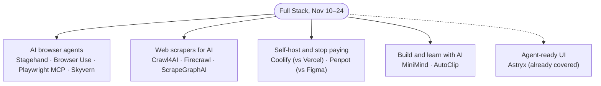
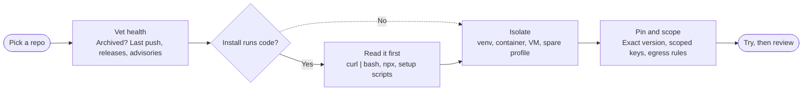

# Full Stack’s Featured Repos, Nov 10–24, 2026: Step-by-Step Try-It Guide

The follow-up to the Top 10 GitHub Repos guide. It covers 12 repos from 7 Full Stack videos posted Nov 11–23, grouped by category. Each repo gets try-it steps, the video’s verdict, common mistakes and Beyond the video safety notes.

**PDF:** [Download this guide (PDF)](guide.pdf)

## At a glance

| Metric | Value | Detail |
| --- | --- | --- |
| Repos featured | **12** | 1 already in the earlier guide (Astryx) |
| New videos | **7** | Nov 11–23, 2026 |
| Archived repos | **0** | All 12 had commits in the past 7 weeks |



!!! warning "Read this first"

    Five of these tools act on the live web or hold keys: Stagehand, Browser Use, Skyvern, Coolify and the scrapers. Run them in a VM, container or throwaway browser profile, never with your everyday logins.

## Videos used

*Window: Nov 10–24, 2026, the wider of the two options. No new weekly Top 10 roundup has been posted since Nov 17.*

| Date | Video | Length | Watch |
| --- | --- | --- | --- |
| Nov 11 | Coolify: Stop Paying for Vercel | 12:10 | [youtu.be/C-EVJSyzXUY](https://youtu.be/C-EVJSyzXUY) |
| Nov 13 | Astryx – Make Your Agent Build Real UI (Full Tutorial) | 13:21 | [youtu.be/4_PGDvdbqy0](https://youtu.be/4_PGDvdbqy0) |
| Nov 15 | Browser Use vs Stagehand vs Playwright MCP vs Skyvern | 15:33 | [youtu.be/2QB60rVcAFQ](https://youtu.be/2QB60rVcAFQ) |
| Nov 17 | Top 10 GitHub Repos This Week, Nov 9–15 (source of the earlier guide) | 24:18 | [youtu.be/Blo_TXR-S-4](https://youtu.be/Blo_TXR-S-4) |
| Nov 18 | Firecrawl vs Crawl4AI vs ScrapeGraphAI | 16:27 | [youtu.be/U_5yTX-oYJk](https://youtu.be/U_5yTX-oYJk) |
| Nov 20 | MiniMind – Train Your Own LLM From Scratch | 13:30 | [youtu.be/rW18QUzbVeY](https://youtu.be/rW18QUzbVeY) |
| Nov 21 | Penpot: Stop Paying for Figma | 12:27 | [youtu.be/3OOn3QAreFg](https://youtu.be/3OOn3QAreFg) |
| Nov 23 | AutoClip – Free Open-Source OpusClip Alternative | 13:04 | [youtu.be/3-tPZ83nDRQ](https://youtu.be/3-tPZ83nDRQ) |

## Before you run any repo (Beyond the video)

*A supply-chain check based on OpenSSF Scorecard, SLSA and NIST SSDF.*



1. **Check it isn’t archived or abandoned** — Look at the last push, the release cadence and open security advisories. Run `scorecard --repo=github.com/<owner>/<repo>`.
2. **Read installers before running them** — Coolify’s `curl | bash`, `npx …@latest` and `uvx` all execute remote code. Download the script, read it, then run it.
3. **Verify what you download** — Check checksums or provenance files (AutoClip ships `build-provenance.json`) and use scoped npm names (Astryx).
4. **Isolate** — Use Python venvs, Docker with memory limits, a VM for browser agents, and a browser profile with no saved logins.
5. **Pin versions** — Use exact tags (`browser-use==1.0.8`, `@playwright/mcp@0.0.86`) and commit lockfiles. Run `npm audit` or `pip-audit`.
6. **Scope secrets and egress** — Use one API key per tool with a spend cap, block internal network ranges from scraper and agent workers, and turn telemetry off where possible.

## All 12 compared

*Stars, latest release and last push from the GitHub API on Nov 24, 2026. None are archived.*

| Item | Value |
| --- | --- |
| Firecrawl | 208,210 |
| Browser Use | 121,888 |
| Crawl4AI | 87,738 |
| MiniMind | 69,740 |
| Coolify | 66,407 |
| Penpot | 62,685 |
| Playwright MCP | 40,078 |
| ScrapeGraphAI | 32,903 |
| Astryx | 32,677 |
| Stagehand | 26,127 |
| Skyvern | 23,501 |
| AutoClip | 14,787 |

| Repo | Category | Lang | License | Latest release | Last push | Video’s verdict | Risk | In earlier guide? |
| --- | --- | --- | --- | --- | --- | --- | --- | --- |
| browserbase/stagehand | AI browser agents | TypeScript | MIT | 3.7.4 (Nov 18) | Nov 24 | Video’s overall pick | High · acts while logged in as you | No |
| browser-use/browser-use | AI browser agents | Python | MIT | 1.0.8 (Nov 22) | Nov 22 | Best for Python on your own Chrome, cheapest | High · model writes and runs code | No |
| microsoft/playwright-mcp | AI browser agents | TypeScript | Apache-2.0 | v0.0.86 (Nov 18) | Nov 18 | Best free browser for a coding agent | Medium · only as safe as the agent driving it | No |
| Skyvern-AI/skyvern | AI browser agents | Python | AGPL-3.0 | v1.0.58 (Nov 15) | Nov 24 | Best for login and 2FA portals without code | High · stores credentials | No |
| unclecode/crawl4ai | Web scrapers for AI | Python | Apache-2.0 | v0.9.6 (Nov 20) | Nov 23 | Video’s overall pick | Medium · you own robots.txt compliance | No |
| firecrawl/firecrawl | Web scrapers for AI | TypeScript | AGPL-3.0 | v2.11.0 (Jun 19) | Nov 24 | Best if you’d rather pay than run browsers | Medium · cloud key and data leave your network | No |
| ScrapeGraphAI/Scrapegraph-ai | Web scrapers for AI | Python | MIT | v2.3.1 (Oct 6) | Oct 6 | Best for a few fields with a local model | Medium · SSRF if you accept user URLs | No |
| coollabsio/coolify | Self-host and stop paying | PHP | Apache-2.0 | v4.7.6 (Nov 19) | Nov 23 | Cancel Vercel if you’re a small team paying per seat | High · the panel holds your server keys | No |
| penpot/penpot | Self-host and stop paying | Clojure | MPL-2.0 | 2.19.4 (Nov 23) | Nov 24 | Cancel Figma if you design web or app screens, not motion | Low · self-host needs TLS | No |
| jingyaogong/minimind | Build and learn with AI | Python | Apache-2.0 | minimind-3 weights (Apr 2026) | Nov 23 | For learning how training works, not for production | Low · loads downloaded model weights | No |
| zhouxiaoka/autoclip | Build and learn with AI | Python | MIT | v1.6.0 (Nov 24) | Nov 24 | Replaces OpusClip for people-talking content on Apple Silicon or Windows | Medium · unsigned installers, cloud model keys | No |
| meta/astryx | Agent-ready UI | TypeScript | MIT | v0.7.x beta | Nov 24 | For React 19 internal tools and dashboards | Low · UI library | Yes (#1) |

## Browser agents scorecard

*The video’s seven rounds, from [▶ 2:25](https://youtu.be/2QB60rVcAFQ?t=145)*

| Round | Winner | Why, per the video |
| --- | --- | --- |
| Setup (2:25) | Playwright MCP | One config block, nothing to pin |
| Tokens (4:12) | Browser Use | Its own 100-task test matched scores with a half to a third of the tokens (their benchmark) |
| Reliability (6:03) | Skyvern | Planner, actor, validator loop with published runs |
| Control (8:08) | Stagehand | Code plus AI steps, typed extract, observe first |
| Security (9:34) | Stagehand | The password never reaches the model, and navigation is gated |
| Cost and license (11:42) | Browser Use | MIT, cloud browsers at 6 cents an hour |
| Maintenance (13:05) | Playwright MCP | Smallest issue queue, Microsoft behind it |

> Nobody’s guard rails are air tight here.
>
> — Full Stack, 9:34

## Scrapers scorecard

*The video’s seven rounds, from [▶ 3:05](https://youtu.be/U_5yTX-oYJk?t=185)*

| Round | Winner | Why, per the video |
| --- | --- | --- |
| Setup (3:05) | Firecrawl | One key, no browser to install |
| Output (4:43) | Crawl4AI | Fit Markdown and free schema extraction |
| Hard pages (6:48) | Firecrawl | Cloud handles proxies and JS-heavy pages |
| Self-hosting (8:39) | Crawl4AI | Same crawler as its cloud, token-secured Docker |
| Price (10:37) | Crawl4AI | Apache library, $10 cloud plan |
| Agents (11:55) | Firecrawl | MCP and agent tooling on day one |
| Trust (13:26) | Firecrawl | Respects robots.txt by default |

## Stagehand · AI browser agents

*An SDK that mixes normal Playwright code with three AI verbs: act, extract and observe.*

| | |
| --- | --- |
| **Repo** | [github.com/browserbase/stagehand](https://github.com/browserbase/stagehand) |
| **Video segment** | [▶ 0:46](https://youtu.be/2QB60rVcAFQ?t=46) |
| **Stack and license** | TypeScript · MIT · 26,127 stars |
| **Video’s verdict** | Video’s overall pick |
| **Risk** | High · acts while logged in as you |

1. **Install the SDK** — One package add for TypeScript, or `pip install stagehand` for Python. Go is also supported (2:25).
2. **Write the steps you know as code** — Use AI steps only where the page might change. That split is why it won the control round (8:08).
3. **Use observe before act** — `observe` lists what could happen on a page before anything runs, so your code can check the plan first.
4. **Extract to a schema** — `extract` returns data that matches your Zod schema, so an invoice table comes back as typed rows (8:08).
5. **Keep secrets out of the model** — Observe returns real selectors, so your code fills the password and the model never sees it (9:34).

```bash
pnpm add @browserbasehq/stagehand 'zod@~4.4.3'
# or
pip install stagehand
```

### Common mistakes

- ✗ Turning on the server-side cache without reading the docs. Variable values are sent to Browserbase’s cache service (9:34).
- ✗ Assuming the domain policy covers everything. The video cites gaps for service-worker fetches and WebSockets, and with no policy set every address is allowed.

### Beyond the video

- Set an explicit domain allow-list and run it in a throwaway browser profile (OWASP LLM06, Excessive Agency).
- Saved-login persistence has an open bug, per the video (2:25). Test sessions before you schedule nightly runs.

## Browser Use · AI browser agents

*A Python library where the model writes its own code against Chrome’s DevTools protocol.*

| | |
| --- | --- |
| **Repo** | [github.com/browser-use/browser-use](https://github.com/browser-use/browser-use) |
| **Video segment** | [▶ 0:46](https://youtu.be/2QB60rVcAFQ?t=46) |
| **Stack and license** | Python · MIT · 121,888 stars |
| **Video’s verdict** | Best for Python on your own Chrome, cheapest |
| **Risk** | High · model writes and runs code |

1. **Make a project and pin the version** — The README itself says releases move fast and can break things (2:25).
2. **Choose your model and browser** — By default it uses Browser Use’s own model gateway and cloud browser. Sign in with their key, or switch both yourself.
3. **Start with a harmless task** — Read-only pages first, and check the judge’s verdict after each task (6:03).
4. **Lock secrets to a domain** — Secrets are typed from placeholders and can be bound to one domain (9:34).

```bash
uv init --python 3.12 my-agent && cd my-agent
uv add 'browser-use==1.0.8'
uv run browser-use login
# or with pip
python3 -m venv .venv && source .venv/bin/activate
pip install 'browser-use==1.0.8'
```

### Common mistakes

- ✗ Pointing it at the Chrome you use every day, with your logins in it (2:25).
- ✗ Trusting “success” blindly. The video cites an open issue where the agent enabled a disabled Place Order button and still reported success (6:03).

### Beyond the video

- Its domain allow-list only blocks navigation the agent starts. Redirects and new tabs can get past it (9:34). Run it in a VM or container with network egress rules as well.
- Chromium only. Firefox and Safari support is still a request.

## Playwright MCP · AI browser agents

*Microsoft’s MCP server that gives your coding agent browser tools built on the accessibility tree.*

| | |
| --- | --- |
| **Repo** | [github.com/microsoft/playwright-mcp](https://github.com/microsoft/playwright-mcp) |
| **Video segment** | [▶ 0:46](https://youtu.be/2QB60rVcAFQ?t=46) |
| **Stack and license** | TypeScript · Apache-2.0 · 40,078 stars |
| **Video’s verdict** | Best free browser for a coding agent |
| **Risk** | Medium · only as safe as the agent driving it |

1. **Add one config block** — The same block works in VS Code, Cursor and most MCP clients. It won the setup round (2:25).
2. **Let your agent open and check pages** — It reads the accessibility tree, so the model gets text it can act on instead of screenshots.
3. **Watch token use** — Snapshots are large. A maintainer called it “quite token hungry” (4:12). The README points coding agents to the Playwright CLI as more efficient.

```bash
claude mcp add playwright npx @playwright/mcp@0.0.86
# or in any MCP client config:
{ "mcpServers": { "playwright": { "command": "npx", "args": ["@playwright/mcp@0.0.86"] } } }
```

### Common mistakes

- ✗ Treating allowed origins as a security boundary. The README says plainly that it isn’t one (9:34).
- ✗ Using `@latest` in shared configs, which means a new release can change behaviour overnight.

### Beyond the video

- Pin a version instead of the README’s `@latest`, since it is still a 0.0.x release.
- Calling browser close shuts every tab, per an open bug (6:03).

## Skyvern · AI browser agents

*Vision-based browser automation with a no-code workflow builder, credential store and 2FA handling.*

| | |
| --- | --- |
| **Repo** | [github.com/Skyvern-AI/skyvern](https://github.com/Skyvern-AI/skyvern) |
| **Video segment** | [▶ 0:46](https://youtu.be/2QB60rVcAFQ?t=46) |
| **Stack and license** | Python · AGPL-3.0 · 23,501 stars |
| **Video’s verdict** | Best for login and 2FA portals without code |
| **Risk** | High · stores credentials |

1. **Pick an install path** — Use pip with `skyvern quickstart`, or Docker Compose for an all-in-one stack with Postgres, API and UI on port 8080.
2. **Add your model key** — Any provider works, including a local model (2:25).
3. **Build a workflow in the UI** — Its planner, actor and validator loop is how it reached its own 85.85% WebVoyager run (6:03).
4. **Turn off telemetry** — The video says telemetry is on by default and sends the starting URL of each task (9:34).

```bash
pip install "skyvern[server]"
skyvern quickstart
# or
git clone https://github.com/skyvern-ai/skyvern.git && cd skyvern
cp .env.example .env   # add your LLM key
docker compose up -d   # UI on http://localhost:8080
```

### Common mistakes

- ✗ Running 1.0.31. The README documents a SQLite bug fixed in 1.0.32 and later.
- ✗ Expecting anti-bot features when self-hosted. The proxy network and captcha solving are cloud only (11:42).

### Beyond the video

- The video cites an open report of workflow requests reaching internal network targets. Put the worker on its own network segment (OWASP SSRF guidance).
- AGPL-3.0 means that if you modify it and offer it as a service, you must share your changes.

## Crawl4AI · Web scrapers for AI

*An Apache-licensed Python library that drives a real browser and returns clean Markdown, with an optional cloud.*

| | |
| --- | --- |
| **Repo** | [github.com/unclecode/crawl4ai](https://github.com/unclecode/crawl4ai) |
| **Video segment** | [▶ 0:56](https://youtu.be/U_5yTX-oYJk?t=56) |
| **Stack and license** | Python · Apache-2.0 · 87,738 stars |
| **Video’s verdict** | Video’s overall pick |
| **Risk** | Medium · you own robots.txt compliance |

1. **Install and set up the browser** — Run `crawl4ai-setup` once, then `crawl4ai-doctor` to check the install (3:05).
2. **Get fit Markdown** — Its filters strip menus and footers before a model sees the page (4:43).
3. **Extract fields without a model** — CSS and XPath schemas pull fields for free, and it can generate the schema for you.
4. **Self-host the Docker server** — It needs a token by default and includes a dashboard and playground (8:39).
5. **Turn robots.txt checking on** — It ships switched off (13:26).

```bash
pip install -U crawl4ai
crawl4ai-setup      # installs the browser once
crawl4ai-doctor     # checks the install
# in code: CrawlerRunConfig(check_robots_txt=True)
```

### Common mistakes

- ✗ Leaving robots.txt checking off.
- ✗ Running the Docker server long term without memory limits. The most-reacted open issue is a memory leak (8:39).

### Beyond the video

- Follow RFC 9309 (robots.txt), add a clear User-Agent and rate limits, and check each site’s terms before scraping.
- A saved crawl config can drop its filters, per the video (13:26). Assert the domain allow-list in your own code.

## Firecrawl · Web scrapers for AI

*A hosted scrape, crawl, map and search API that returns LLM-ready Markdown or JSON. Self-hosting is possible.*

| | |
| --- | --- |
| **Repo** | [github.com/firecrawl/firecrawl](https://github.com/firecrawl/firecrawl) |
| **Video segment** | [▶ 0:56](https://youtu.be/U_5yTX-oYJk?t=56) |
| **Stack and license** | TypeScript · AGPL-3.0 · 208,210 stars |
| **Video’s verdict** | Best if you’d rather pay than run browsers |
| **Risk** | Medium · cloud key and data leave your network |

1. **Get a key** — The free tier is 1,000 credits a month with no card. One scrape call returns Markdown (3:05).
2. **Try the CLI or an SDK** — There are SDKs for Python, Node, Go, Java and Elixir.
3. **Plug it into your agent** — One command adds MCP or skills, and the SDKs handle polling on long crawls (11:55).
4. **Know what self-hosting leaves out** — Fire Engine (anti-bot), screenshots, actions, the agent and enhanced proxies are cloud only (8:39).

```bash
npx -y firecrawl-cli@latest scrape https://firecrawl.dev
pip install firecrawl   # or: npm install firecrawl
```

### Common mistakes

- ✗ Exposing a self-hosted stack publicly without authentication. The self-host guide warns against it.
- ✗ Forgetting that JSON output costs extra credits per page and that error pages still cost a credit (10:37).

### Beyond the video

- The last tagged release was Jun 19, 2026 even though code is pushed daily. Pin by commit or image digest if you self-host.
- The video cites a vulnerable Axios pulled in through the JS SDK. Run `npm audit` after installing.

## ScrapeGraphAI · Web scrapers for AI

*A prompt-driven scraper: describe the data in a sentence and a graph of LLM steps fetches it.*

| | |
| --- | --- |
| **Repo** | [github.com/ScrapeGraphAI/Scrapegraph-ai](https://github.com/ScrapeGraphAI/Scrapegraph-ai) |
| **Video segment** | [▶ 0:56](https://youtu.be/U_5yTX-oYJk?t=56) |
| **Stack and license** | Python · MIT · 32,903 stars |
| **Video’s verdict** | Best for a few fields with a local model |
| **Risk** | Medium · SSRF if you accept user URLs |

1. **Install the library and browsers** — Two installs plus a model key, or Ollama running locally (3:05).
2. **Set the model’s context window** — Unknown models fall back to 8,192 tokens and silently truncate pages (4:43).
3. **Opt out of telemetry** — Set `SCRAPEGRAPHAI_TELEMETRY_ENABLED=false`. The video cites an issue saying the opt-out may not take effect (13:26).
4. **Keep it to research** — The README says it is for data exploration and research purposes only.

```bash
python3 -m venv .venv && source .venv/bin/activate
pip install scrapegraphai
playwright install
export SCRAPEGRAPHAI_TELEMETRY_ENABLED=false
```

### Common mistakes

- ✗ Running it inside Jupyter, Colab or FastAPI without a workaround. Its graphs can’t run in an existing event loop (11:55).
- ✗ Trusting a “not found” answer when the data is one link away (4:43).

### Beyond the video

- No push since Oct 6, 2026, and the video says a reported SSRF went unanswered. Never pass it user-supplied URLs without an allow-list (OWASP SSRF Prevention Cheat Sheet).
- Block outbound traffic at the firewall if telemetry has to be off for certain.

## Coolify · Self-host and stop paying

*A self-hostable PaaS that replaces most of Vercel on a server you own: git deploys, previews, databases, TLS.*

| | |
| --- | --- |
| **Repo** | [github.com/coollabsio/coolify](https://github.com/coollabsio/coolify) |
| **Video segment** | [▶ 0:00](https://youtu.be/C-EVJSyzXUY?t=0) |
| **Stack and license** | PHP · Apache-2.0 · 66,407 stars |
| **Video’s verdict** | Cancel Vercel if you’re a small team paying per seat |
| **Risk** | High · the panel holds your server keys |

1. **Get a fresh server** — At least 2 CPU cores, 2 GB RAM and 10 GB of disk. Ubuntu, Debian, Arch and Raspberry Pi all work (3:23).
2. **Install with one line** — Read the script before you pipe it to bash (Beyond the video).
3. **Connect Git and push to deploy** — Connect a public repo, a deploy key or the GitHub App. A Dockerfile overrides its build guess (2:04).
4. **Add a database and S3 backups** — Then test a restore. A successful backup only proves a file exists, and Redis isn’t covered (5:00).
5. **Set domains, HTTPS and a registry** — Rollback doesn’t reverse database migrations. Push images to a registry to keep good versions (6:26).
6. **Migrate in Coolify’s own order** — Deploy on a generated domain, keep Vercel running, then switch DNS. Never copy a live database (11:15).

```bash
curl -fsSL https://cdn.coollabs.io/coolify/install.sh -o coolify-install.sh
less coolify-install.sh   # read it first
sudo bash coolify-install.sh
```

### Common mistakes

- ✗ Building heavy apps on the same small server that runs production. Its docs warn this can freeze the box (2:04).
- ✗ Opening PR previews to outsiders. A pull request can run code on your server, which is why only repo members get previews by default (4:09).

### Beyond the video

- Verified: 70 GitHub security advisories since early 2025, 21 of them critical. Subscribe to repo security alerts and update promptly.
- Harden the host with key-only SSH, a firewall and automatic security updates (CIS Benchmarks). Back up 3-2-1 style.
- The video’s math: 3 developers cost $60 a month on Vercel versus $24 for a 4 GB droplet, before usage (8:11).

## Penpot · Self-host and stop paying

*An open-source design and prototyping tool built on SVG, CSS and JSON, with free cloud or self-hosting.*

| | |
| --- | --- |
| **Repo** | [github.com/penpot/penpot](https://github.com/penpot/penpot) |
| **Video segment** | [▶ 0:00](https://youtu.be/3OOn3QAreFg?t=0) |
| **Stack and license** | Clojure · MPL-2.0 · 62,685 stars |
| **Video’s verdict** | Cancel Figma if you design web or app screens, not motion |
| **Risk** | Low · self-host needs TLS |

1. **Start on the free cloud** — The full editor, up to 8 members plus unlimited viewers, 10 GB and 7 days of history (2:42, 7:59).
2. **Import one real screen** — The official Figma exporter brings shapes, components, variants and auto layout, but not prototype settings (9:37).
3. **Rebuild a card with flex layout** — It’s real CSS flexbox and grid, and the code tab gives paste-ready CSS (1:34).
4. **Set up components and tokens** — Tokens export as W3C design-tokens JSON (3:30, 4:46).
5. **Hand off with Inspect** — Free for everyone, including viewers (5:44).
6. **Self-host only if you can run it** — One compose file serves port 9001. You need Docker, DNS and a TLS proxy in front.

```bash
# self-host (see the Penpot Docker guide)
wget https://raw.githubusercontent.com/penpot/penpot/main/docker/images/docker-compose.yaml
docker compose -p penpot -f docker-compose.yaml up -d
# app on http://localhost:9001, put a TLS reverse proxy in front
```

### Common mistakes

- ✗ Relying on the free plan’s 7-day history and recovery for anything important.
- ✗ Importing a huge Figma file in one go. The default upload limit is 350 MB, and one 336 MB file grew to 1,325 MB (9:37).

### Beyond the video

- Export important files regularly as your own backup.
- Tokens follow the Design Tokens Community Group format, so validate them in your build. Check finished designs against WCAG 2.2 AA contrast.
- There’s no smart animate, so prototypes cut hard between frames (6:49).

## MiniMind · Build and learn with AI

*Trains a 64M-parameter chat model from scratch in plain PyTorch: pretraining, SFT, LoRA, DPO, GRPO and agentic RL.*

| | |
| --- | --- |
| **Repo** | [github.com/jingyaogong/minimind](https://github.com/jingyaogong/minimind) |
| **Video segment** | [▶ 0:00](https://youtu.be/rW18QUzbVeY?t=0) |
| **Stack and license** | Python · Apache-2.0 · 69,740 stars |
| **Video’s verdict** | For learning how training works, not for production |
| **Risk** | Low · loads downloaded model weights |

1. **Chat with the finished model first** — Clone, install the requirements, pull the weights, then open the terminal chat or use `ollama run` (1:18).
2. **Check that PyTorch sees your GPU** — If CUDA isn’t visible, it falls back to CPU or Apple MPS, which is far slower (11:12).
3. **Pretrain on the mini data** — About 1.2 hours on an RTX 3090 (2:11).
4. **Fine-tune into a chat model** — About 1.1 hours more. The real total is about 2.3 hours, not the headline’s 2 (4:48).
5. **Try LoRA, then RL** — LoRA can teach a specialty or identity. Agentic RL raised calculator maths from 12 to 17 out of 20, at an “alignment tax” (6:27, 7:17).

```bash
git clone --depth 1 https://github.com/jingyaogong/minimind && cd minimind
python3 -m venv .venv && source .venv/bin/activate
pip install -r requirements.txt
python -c "import torch; print(torch.cuda.is_available())"
git clone https://huggingface.co/jingyaogong/minimind-3
python eval_llm.py --load_from ./minimind-3
cd trainer && python train_pretrain.py && python train_full_sft.py
```

### Common mistakes

- ✗ Starting with the MoE variant. In plain PyTorch it trains slower than the dense model (11:12).
- ✗ Training on a laptop. One user’s M2 Pro estimated 20,000 minutes until they shrank the batch size.

### Beyond the video

- The README’s pip line uses a mirror in China (`-i mirrors.aliyun.com`). From the US, use default PyPI so you get the official package index.
- Prefer safetensors weights and check the dataset licenses before you reuse outputs.
- Benchmarks: about 25 on C-Eval, which is near chance. Treat it as a teaching tool (9:23).

## AutoClip · Build and learn with AI

*A desktop app that turns a long interview or podcast into captioned, platform-ready short clips on your own machine.*

| | |
| --- | --- |
| **Repo** | [github.com/zhouxiaoka/autoclip](https://github.com/zhouxiaoka/autoclip) |
| **Video segment** | [▶ 0:00](https://youtu.be/3-tPZ83nDRQ?t=0) |
| **Stack and license** | Python · MIT · 14,787 stars |
| **Video’s verdict** | Replaces OpusClip for people-talking content on Apple Silicon or Windows |
| **Risk** | Medium · unsigned installers, cloud model keys |

1. **Install the desktop app** — DMG for Apple Silicon or setup.exe for Windows 10/11, with Python and FFmpeg bundled. The builds are unsigned (9:41).
2. **Run the built-in sample** — It needs no API key and gives you a finished three-clip project (9:41).
3. **Add a provider and test the connection** — Pick by success-rate label, not list order, since sponsors are listed first (6:04).
4. **Feed it captions when you can** — That skips local transcription, which is the slow step: 23 of 29.5 minutes in one run (4:40).
5. **Read every caption before posting** — A small transcription error can reverse a claim (11:19).

```bash
# CLI / MCP
uvx autoclip-mcp
autoclip produce talk.mp4 --srt talk.srt --platform tiktok --json
# Docker / Linux
git clone https://github.com/zhouxiaoka/autoclip.git && cd autoclip
cp env.example .env && mkdir -p data logs uploads
docker compose up -d --build   # web UI on http://localhost:3000
```

### Common mistakes

- ✗ Lowering the score threshold too far. The docs say to try 0.5 if a run comes back empty (default 0.7).
- ✗ Forgetting the end-card logo, which is on by default and can be switched off in settings.

### Beyond the video

- Because installers are unsigned, check the SHA-256 against the release’s `build-provenance.json` before you run them.
- Only clip footage you own or have rights to. Clipping someone else’s interview raises copyright and fair-use questions.
- Cloud analysis sends captions, vision sends frames and cloud transcription sends audio. Use Ollama or LM Studio to keep everything local (6:04).

## Astryx · Agent-ready UI

*Meta’s design system for people and agents. Already #1 in the earlier guide; this tutorial adds detail.*

| | |
| --- | --- |
| **Repo** | [github.com/meta/astryx](https://github.com/meta/astryx) |
| **Video segment** | [▶ 0:00](https://youtu.be/4_PGDvdbqy0?t=0) |
| **Stack and license** | TypeScript · MIT · 32,677 stars |
| **Video’s verdict** | For React 19 internal tools and dashboards |
| **Risk** | Low · UI library |
| **Note** | Already covered in the earlier guide: [lipford-dutch.github.io/goc-guide-library/guides/top-10-github-repos/](https://lipford-dutch.github.io/goc-guide-library/guides/top-10-github-repos/) |

1. **Confirm React 19** — It’s a hard gate with no workaround (2:54).
2. **Install three packages and the CLI** — Import the reset, component and theme stylesheets in that order, and wrap the app in a theme provider.
3. **Teach the agent first** — `init` writes a generated block into AGENTS.md or CLAUDE.md, and `doctor` diagnoses the project (5:23).
4. **Describe the page you want** — `build` ranks 58 pages and 723 blocks deterministically, with no model and no network call (6:25).

```bash
npm install @astryxdesign/core @astryxdesign/theme-neutral @stylexjs/stylex
npm install -D @astryxdesign/cli
npx @astryxdesign/cli init
```

### Common mistakes

- ✗ Installing the bare `astryx` name from npm. It’s an unrelated package, so always use the `@astryxdesign/` scope (11:19).
- ✗ Expecting a Figma library or stable charts. Charts are canary only.

### Beyond the video

- The unscoped package name is a typosquatting-style trap. Check package names and publishers before installing.
- Full steps are in the earlier guide in the library.

## Where the videos depart from best practice

| Video says | Best practice | Repo |
| --- | --- | --- |
| Install is one line, a curl command you paste | Download the script, read it, then run it. Piping to bash hides what runs as root | Coolify |
| Browser Use can take over the Chrome you already have open | Use a throwaway profile or VM. Your real sessions let an agent act as you (OWASP LLM01, LLM06) | Browser Use |
| README configs use `@playwright/mcp@latest` | Pin an exact version in shared configs | Playwright MCP |
| Crawl4AI is the overall pick | Fine, but turn on `check_robots_txt` and rate limits first (RFC 9309) | Crawl4AI |
| Builds are unsigned, so click Open Anyway | Verify the SHA-256 or provenance before bypassing OS protections | AutoClip |
| Paste a link and clip any interview | Clip only content you own or have rights to (copyright and fair use) | AutoClip |
| README pip line uses a mirror in China | Use default PyPI or your organisation’s vetted mirror | MiniMind |
| Free cloud keeps 7 days of history | Keep your own exports and backups | Penpot |

## Standards and sources

*Each link was checked on Nov 24, 2026.*

| Standard or guidance | Applies to | What to do |
| --- | --- | --- |
| OWASP Top 10 for LLM Applications (LLM01, LLM03, LLM06) | Browser agents, scrapers feeding LLMs | Treat page content as untrusted input, vet dependencies, limit agent permissions |
| OWASP SSRF Prevention Cheat Sheet | ScrapeGraphAI, Skyvern, Crawl4AI server | Allow-list destinations and block internal IP ranges |
| RFC 9309 Robots Exclusion Protocol | All scrapers | Honour robots.txt and identify your crawler |
| OpenSSF Scorecard / SLSA / NIST SSDF SP 800-218 | All 12 | Check repo health and provenance, and pin versions |
| NIST SP 800-190 container security and CIS Benchmarks | Coolify, Penpot, AutoClip, Skyvern Docker | Harden hosts, limit container privileges, patch |
| NIST AI RMF | Browser agents, MiniMind | Map risks, test before trusting, keep a kill switch |
| Design Tokens Community Group format, WCAG 2.2 | Penpot, Astryx | Use a portable token format and test accessibility |
| US Copyright Office fair-use guidance | AutoClip | Clip only what you have rights to |

- [OWASP Top 10 for LLM Applications](https://genai.owasp.org/llm-top-10/) — genai.owasp.org
- [OWASP SSRF Prevention Cheat Sheet](https://cheatsheetseries.owasp.org/cheatsheets/Server_Side_Request_Forgery_Prevention_Cheat_Sheet.html) — owasp.org
- [RFC 9309: Robots Exclusion Protocol](https://www.rfc-editor.org/rfc/rfc9309) — rfc-editor.org
- [OpenSSF Scorecard](https://scorecard.dev/) — scorecard.dev
- [SLSA](https://slsa.dev/) — slsa.dev
- [NIST SSDF SP 800-218](https://csrc.nist.gov/pubs/sp/800/218/final) — csrc.nist.gov
- [NIST SP 800-190 Container Security](https://csrc.nist.gov/pubs/sp/800/190/final) — csrc.nist.gov
- [CIS Benchmarks](https://www.cisecurity.org/cis-benchmarks) — cisecurity.org
- [NIST AI Risk Management Framework](https://www.nist.gov/itl/ai-risk-management-framework) — nist.gov
- [Design Tokens Format](https://www.designtokens.org/tr/drafts/format/) — designtokens.org
- [WCAG 2.2](https://www.w3.org/TR/WCAG22/) — w3.org
- [Fair use](https://www.copyright.gov/fair-use/) — copyright.gov
- [Coolify installation](https://coolify.io/docs/get-started/installation) — coolify.io
- [Penpot Docker self-hosting](https://help.penpot.app/technical-guide/getting-started/docker/) — help.penpot.app
- [Firecrawl self-host guide](https://docs.firecrawl.dev/contributing/self-host) — docs.firecrawl.dev
- [Crawl4AI docs](https://docs.crawl4ai.com/) — docs.crawl4ai.com
- [Safetensors](https://huggingface.co/docs/safetensors/index) — huggingface.co

## Troubleshooting

| Symptom | Likely cause | Fix |
| --- | --- | --- |
| Coolify server freezes during deploys | Builds run on the production box | Add a separate build server or build in CI and deploy images |
| Coolify rollback didn’t fix the app | Rollback doesn’t reverse migrations, or the image was cleaned up | Plan migrations separately and push images to a registry |
| Browser Use won’t fit in your Python project | Exact dependency pins conflict | Give it its own venv or service |
| Playwright MCP blows the context window | Large accessibility snapshots | Use the Playwright CLI for coding agents, or narrower pages |
| Skyvern quickstart fails on a fresh install | Known 1.0.31 SQLite bug, or an OpenAI-only check | Upgrade to 1.0.32+, or use Docker Compose |
| Crawl4AI container crashes over time | Memory leak (open issue) | Set Docker memory limits and a restart policy |
| Crawl4AI setup fails | Browser install on a new Python | `python -m playwright install --with-deps chromium` |
| ScrapeGraphAI says “not found” or truncates | 8,192-token fallback, or data is one link away | Set the model’s context window and use the depth search |
| MiniMind training is extremely slow | CUDA not visible, MPS or CPU fallback, swapping | Check `torch.cuda.is_available()`, rent a GPU, lower the batch size |
| MiniMind loss goes to NaN | Known pretraining instability | Read the repo’s busiest issue thread and resume with `--from_resume 1` |
| AutoClip returns no clips | Score threshold too high | Try 0.5 instead of the default 0.7 |
| Penpot import fails | File over the 350 MB upload limit | Split the Figma file, or raise the limit on self-host |

## Final checklist

*Nothing done yet, as of Nov 24, 2026.*

- [ ] Pick one repo per category to try, not all 12 *(Low-risk starts: Penpot cloud, MiniMind chat, AutoClip sample)*
- [ ] Confirm the repo isn’t archived and was pushed recently *(All 12 pass as of Nov 24)*
- [ ] Read any curl | bash, npx or uvx installer before running it
- [ ] Use a VM, container or throwaway browser profile for agents and scrapers
- [ ] Pin exact versions and save lockfiles
- [ ] Create scoped API keys with spend caps
- [ ] Turn on robots.txt checks and rate limits for scrapers
- [ ] Turn off telemetry where offered (Skyvern, ScrapeGraphAI, AutoClip stats)
- [ ] Back up and test a restore for self-hosted data (Coolify databases, Penpot files)
- [ ] Clip only content you have rights to (AutoClip)

## Caveats and unverified claims

- YouTube blocked caption downloads from the box, so transcripts came from a public transcript site. They have no per-line timestamps, so the links here point to chapter starts.
- The Nov 9 roundup (Top 10, Nov 2–8) falls one day outside the window and isn’t included.
- Verified on GitHub: 70 Coolify security advisories since 2025 (21 critical), Firecrawl’s last tagged release on Jun 19, ScrapeGraphAI’s last push on Oct 6, the 64M MiniMind model, and Coolify’s 2 CPU, 2 GB and 10 GB minimum.
- Not verified: vendor prices (Vercel, Figma, OpusClip, Firecrawl, Browserbase), benchmark numbers (Skyvern 85.85%, Firecrawl 96%, Browser Use’s token test, Astryx nightly scores), AutoClip run times and costs, and individual open-issue claims.
- The videos have no captions for on-screen-only content, so demo commands shown but not spoken aren’t covered beyond what the READMEs confirm.

Earlier guide in the library: [lipford-dutch.github.io/goc-guide-library/guides/top-10-github-repos/](https://lipford-dutch.github.io/goc-guide-library/guides/top-10-github-repos/)

