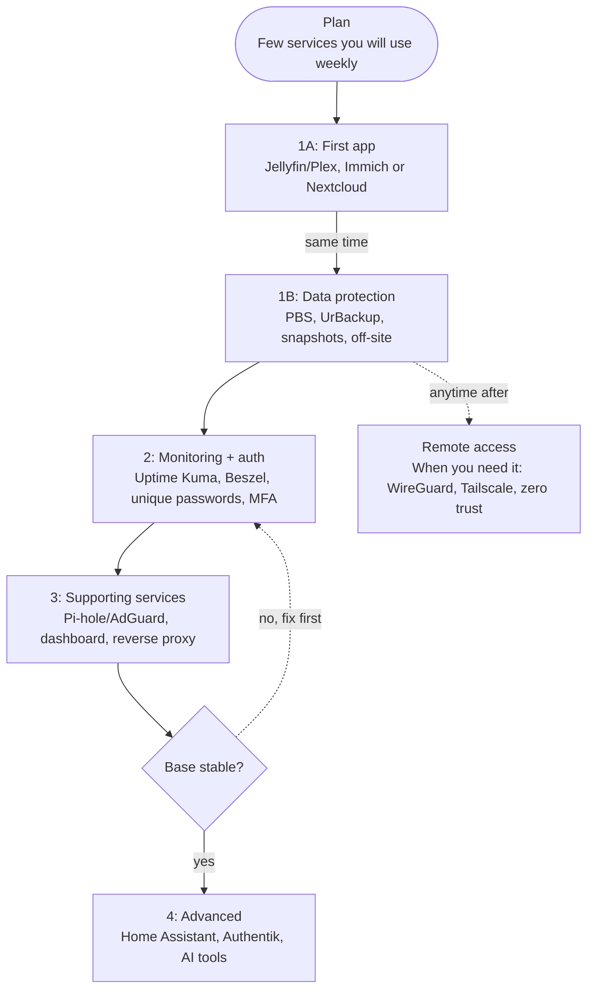
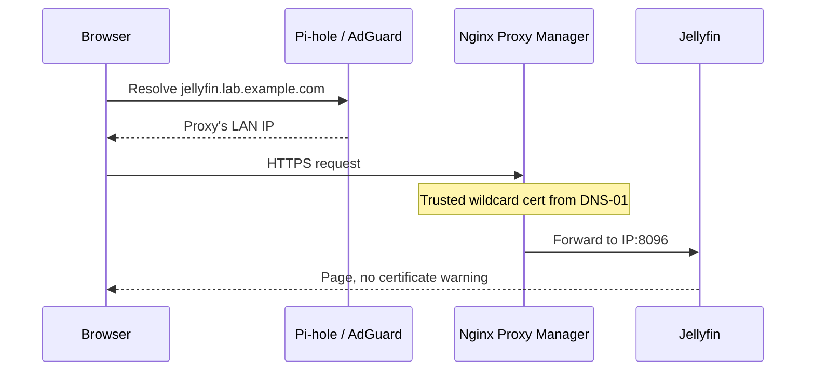
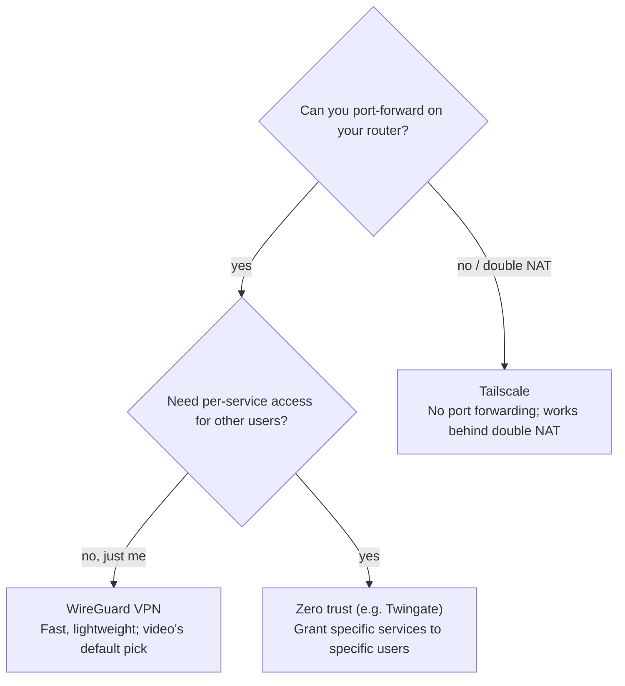

# Home Lab Services: Step-by-Step Build Guide

**PDF:** [Download this guide (PDF)](guide.pdf)

## Overview

| | |
| --- | --- |
| **Video** | Self-Hosted Apps That Replace Everything You Pay For in 2026 |
| **Channel** | WunderTech (Part 2 of the Home Lab Starter series) |
| **Published** | 16 Apr 2026, 15:37 long |
| **Link** | [https://youtu.be/Pp-OuIpXF90](https://youtu.be/Pp-OuIpXF90) |
| **Assumes** | Hardware and an OS (Proxmox, Docker or a NAS) are already running, in Part 1 |

!!! note "Core principle"

    Install useful apps first, protect them, add remote access once stable, and save the advanced stuff for later. The best home lab runs a few services you trust, use, and understand (15:02).

Items marked "Beyond the video" are best-practice additions from the cited standards, not claims made by the presenter.

## Build roadmap

*The presenter's recommended order (13:17); remote access timing depends on your needs.*

## Prerequisites and tools

| Item | Purpose | Required? |
| --- | --- | --- |
| Hypervisor, Docker host or NAS | Runs the services (Part 1 of the series) | Yes |
| Admin access to your router | DNS settings, DHCP reservations, port forwards | Yes |
| Storage for media, photos, files | Libraries for Jellyfin, Immich, Nextcloud | Yes |
| Second backup target | Separate disk, NAS or off-site location | Yes |
| Password manager | Unique credentials per service | Yes |
| Your own domain name | Clean names and valid SSL via reverse proxy | Optional |
| UPS | Clean shutdowns during power loss (beyond the video) | Recommended |

Skills assumed: basic Linux and container use, and knowing your LAN's IP range.

## Before you start: cautions

!!! warning "Protect data before you trust a service with it"

    A new photo or file server is not a backup. Set up backups at the same time first app, and never expose admin interfaces directly to the internet.

- DNS changes affect every device; keep a rollback plan before changing router DNS.
- Back up before every major upgrade, and pin image versions.
- Change all default credentials the day you install a service.

## Service map

*Effort is the presenter's characterisation where given; otherwise a general estimate.*

| Need | Video's pick | Alternatives | Effort | When |
| --- | --- | --- | --- | --- |
| Media streaming | Jellyfin | Plex | Low | Phase 1 |
| Photo backup | Immich | Synology Photos | Low | Phase 1 |
| Files and sync | Nextcloud | Syncthing, Synology Drive | High | Phase 1 |
| VM backups | Proxmox Backup Server |  | Medium | Phase 1 |
| PC backups | UrBackup | Active Backup for Business | Low | Phase 1 |
| Uptime alerts | Uptime Kuma |  | Low | Phase 2 |
| Host metrics | Beszel |  | Low | Phase 2 |
| Ad blocking + DNS | Pi-hole | AdGuard Home | Low | Phase 3 |
| Dashboard | Homarr | Heimdall, Homepage | Low | Phase 3 |
| Reverse proxy + SSL | Nginx Proxy Manager |  | Medium | Phase 3 |
| Smart home | Home Assistant |  | Medium | Phase 4 |
| Single sign-on | Authentik |  | High | Phase 4 |
| Remote access | WireGuard | Tailscale, Twingate, OpenVPN | Low | When needed |

## Step-by-step

*Each step lists what, how, why, common mistakes, and additions beyond the video.*

How to do it

Common mistakes

Beyond the video: standards and best practice

### Step 0: Plan a small, purposeful service list

**Phase:** Phase 1  
**What:** Decide which few services you will actually open every week before installing anything.  
**Why:** More containers do not make a better home lab; they only add more things that can break (0:42).  
**Watch:** [0:37](https://youtu.be/Pp-OuIpXF90?t=37)

**How to do it**

1. **List real problems** — Write down what you pay for or struggle with today: streaming, photo storage, file sync, ads, smart-home sprawl.
2. **Map each problem to one service** — Use the service map table below. One service per problem; skip anything that does not replace something you use.
3. **Defer everything else** — Park nice-to-haves (SSO, AI tools, extra dashboards) on a later list.
4. **Start an inventory** — Record host, IP, port, purpose, data location and admin account for each service in a simple doc or spreadsheet.

**Common mistakes**

- Installing a 40-app list at once and wondering why nothing feels stable.
- Choosing apps because they are popular rather than because they solve your problem.

**Beyond the video**

- Keeping an inventory of hardware and software is CIS Controls 1 and 2, the first two of the CIS Critical Security Controls.
- Give every server a DHCP reservation or static IP before you build on it, so DNS names and bookmarks never break.

### Step 1: Deploy your first high-value app

**Phase:** Phase 1  
**What:** Install one app that gives immediate value: Jellyfin or Plex (media), Immich (photos), or Nextcloud / Syncthing / Synology Drive (files).  
**Why:** It makes the lab feel worth it right away; then live with it for a week to see if it sticks (13:23).  
**Watch:** [1:09](https://youtu.be/Pp-OuIpXF90?t=69)

**How to do it**

1. **Media: Jellyfin or Plex** — Point it at your movie/TV folders to get posters, metadata and watch history on most devices. Jellyfin is fully free and open source; Plex has a free tier with paid features (1:15).
2. **Photos: Immich** — Self-hosted Google Photos alternative; the phone app handles automatic backup and photos stay on your network (1:51).
3. **Files: Nextcloud or lighter options** — Nextcloud covers sync, shares, calendar and contacts but needs the most upkeep; for plain sync use Synology Drive or Syncthing (4:31).
4. **Use it for one week** — Only move on once the app is stable and actually used.

**Common mistakes**

- Picking Nextcloud for simple file sync and then fighting its maintenance load (4:49).
- Treating the new app as the only copy of photos or files.
- Running the latest image tag blindly; a surprise major-version update can break the app.

**Beyond the video**

- Immich's own documentation warns it should not be the only copy of your photos; back up both the upload library and a database dump.
- Pin container image versions and read release notes before upgrading (Docker security guidance: least privilege, trusted images, no unnecessary docker.sock mounts).
- Enable hardware transcoding for Jellyfin/Plex if your CPU or GPU supports it; the video's description links a Jellyfin-on-Proxmox tutorial for this.

### Step 2: Set up data protection (do it alongside Step 1)

**Phase:** Phase 1  
**What:** Back up VMs with Proxmox Backup Server, back up PCs with UrBackup or Synology Active Backup for Business, and enable NAS snapshots.  
**Why:** Backups let you experiment without fear; restore and be back in minutes. The video calls this 1B: in a perfect world done at the same time as Step 1 (13:41).  
**Watch:** [6:52](https://youtu.be/Pp-OuIpXF90?t=412)

**How to do it**

1. **Proxmox VMs: Proxmox Backup Server (PBS)** — Schedule incremental, deduplicated VM backups. The presenter reports a dedup factor of 30: 100 GB stored holds about 3 TB of logical backups (7:34).
2. **Computers: UrBackup or Active Backup for Business** — Full OS backups of Windows, macOS and Linux machines. Active Backup is often better if you own a Synology; UrBackup runs on any hardware (7:49).
3. **NAS: snapshots** — Turn on scheduled snapshots if your file system supports them (e.g. Btrfs, ZFS) to roll data back to a point in time (8:33).
4. **Copy off site** — RAID is not a backup. Send a copy of NAS data to a separate location (8:51).
5. **Test a restore** — Restore one VM and a few files now, and repeat on a schedule.

**Common mistakes**

- Running VMs with no backup strategy at all (7:23).
- Believing RAID protects against deletion, ransomware, misconfiguration or file-system corruption; it only covers drive failure (8:54).
- Keeping the only backup on the same box (or same house) as the data.

**Beyond the video**

- Follow the 3-2-1 rule (CISA): 3 copies, 2 media types, 1 off site; encrypt backups and test full and partial restores.
- In PBS, add verify jobs plus prune and garbage-collection schedules so backups are checked and storage is reclaimed.
- Ideally run PBS on separate hardware (or at least separate disks) from the Proxmox host it protects.
- Keep at least one copy offline or immutable; CISA notes ransomware can reach always-connected drives.

### Step 3: Add monitoring

**Phase:** Phase 2  
**What:** Run Uptime Kuma for service up/down checks and Beszel for host metrics (CPU, memory, disk, network).  
**Why:** You get alerted instead of discovering two days later that a service is down; Beszel catches a disk at 94% or a pegged CPU (9:20).  
**Watch:** [9:20](https://youtu.be/Pp-OuIpXF90?t=560)

**How to do it**

1. **Install Uptime Kuma** — Add an HTTP(S) or TCP check for each service in your inventory.
2. **Configure notifications** — Send alerts to a channel you actually read (email, push, chat).
3. **Install Beszel** — Deploy the hub, then the lightweight agent on each host; set thresholds for disk, CPU and memory.
4. **Fire a test alert** — Stop a test container and confirm the alert arrives.

**Common mistakes**

- Monitoring only that a service responds and missing a disk quietly filling up.
- Hosting the monitor on the same machine it watches, so it dies with it.

**Beyond the video**

- Also monitor backup job success (PBS and UrBackup can email on failure) and drive SMART health.
- If you can, run the uptime monitor on separate hardware or a small cloud instance so it can report a whole-host outage.

### Step 4: Make authentication solid

**Phase:** Phase 2  
**What:** Give every service its own strong, unique admin credentials and turn on MFA wherever it is supported.  
**Why:** No service should share an admin password; important services need real authentication, MFA and separate accounts (10:20).  
**Watch:** [10:14](https://youtu.be/Pp-OuIpXF90?t=614)

**How to do it**

1. **Use a password manager** — Generate a unique long password or passphrase for every admin account.
2. **Enable MFA** — Turn on TOTP or passkeys / security keys on Proxmox, the NAS, router, Home Assistant and anything reachable remotely.
3. **Separate accounts** — Create day-to-day user accounts; keep admin accounts for admin work only.
4. **Remove defaults** — Change or disable default usernames and passwords on every new service.

**Common mistakes**

- Reusing one admin password across the lab.
- Skipping authentication and regretting it later (10:16).

**Beyond the video**

- NIST SP 800-63B-4: favour length over complexity (at least 15 characters when a password is the only factor, 8 with MFA), no forced periodic changes, block known-breached passwords.
- CISA recommends phishing-resistant MFA (FIDO2 security keys or passkeys) where available.

### Step 5: Network-wide ad blocking and internal DNS

**Phase:** Phase 3  
**What:** Run Pi-hole or AdGuard Home, point your router's DNS at it, and add local DNS names for your services.  
**Why:** Blocks ads and trackers for every device with nothing installed on them, and lets you type a name instead of an IP and port (2:40, 3:09).  
**Watch:** [2:32](https://youtu.be/Pp-OuIpXF90?t=152)

**How to do it**

1. **Give the DNS server a fixed IP** — Static IP or DHCP reservation for the Pi-hole / AdGuard Home host.
2. **Install and pick upstream resolvers** — Choose upstream DNS providers (optionally encrypted DNS).
3. **Point the router's DHCP DNS at it** — Clients then receive it automatically (2:44).
4. **Add local DNS records** — Create names for each service in the built-in local DNS (3:35).
5. **Test and keep a rollback** — Confirm blocking and name resolution; know how to switch the router back if the DNS host is down.

**Common mistakes**

- Configuring DNS carelessly; the video warns you do not want DNS problems (3:50).
- Setting a public resolver as the secondary DNS, which lets clients bypass blocking.
- Running a single DNS server with no fallback, so one reboot takes the whole house offline.

**Beyond the video**

- Video departure: it uses `jellyfin.home` as an example. `.home` is not reserved and its queries leak to the root servers; RFC 8375 reserves `home.arpa` for home networks, or use a subdomain of a domain you own (e.g. `jellyfin.lab.example.com`).
- For resilience, run a second Pi-hole/AdGuard instance and sync settings, or keep a documented manual fallback.

### Step 6: Add a dashboard

**Phase:** Phase 3  
**What:** Install Homarr, Heimdall or Homepage as one start page that links every service.  
**Why:** Not essential, but once you run 5-6 services it is convenient and most show online status; takes about 20-30 minutes (5:17).  
**Watch:** [5:17](https://youtu.be/Pp-OuIpXF90?t=317)

**How to do it**

1. **Install one dashboard** — Pick one; do not stack several.
2. **Add a tile per service** — Use the internal DNS names from Step 5, not raw IPs.
3. **Turn on status checks** — Enable the built-in online indicators.

**Common mistakes**

- Building the dashboard before there is anything worth linking (5:41).
- Granting a dashboard full Docker socket access when read-only status is enough.

**Beyond the video**

- Keep the dashboard internal-only and behind authentication if it reveals your service map.

### Step 7: Local reverse proxy with valid SSL

**Phase:** Phase 3  
**What:** Use Nginx Proxy Manager to give services clean domain names and trusted HTTPS certificates.  
**Why:** No more browser certificate warnings; works best when you own a domain name (3:54, 4:16).  
**Watch:** [3:54](https://youtu.be/Pp-OuIpXF90?t=234)

**How to do it**

1. **Own a domain** — Register one (any registrar) and choose an internal subdomain such as `lab.example.com`.
2. **Deploy Nginx Proxy Manager** — Run it on a fixed internal IP.
3. **Issue a wildcard certificate via DNS challenge** — Use Let's Encrypt's DNS-01 challenge so internal-only hosts get trusted certs without opening any ports.
4. **Point names at the proxy** — In Pi-hole / AdGuard, resolve each service name to the proxy's IP.
5. **Create proxy hosts** — Map each name to the service's internal IP and port; force HTTPS.

**Common mistakes**

- Port-forwarding 80/443 to the proxy just to get certificates; DNS-01 avoids exposing it.
- Committing DNS-provider API tokens to shared configs; scope them to DNS edits on one zone.

**Beyond the video**

- Let's Encrypt documents DNS-01 as the only challenge type that issues wildcard certificates.
- Certificates are public in Certificate Transparency logs; a wildcard avoids publishing every internal hostname.

### Step 8: Remote access

**Phase:** Phase 4  
**What:** Reach the lab from anywhere with a VPN (WireGuard or OpenVPN), Tailscale, or zero-trust networking (e.g. Twingate).  
**Why:** Turns the lab into something you can rely on wherever you are. Timing is personal: some need it right away, others can wait (14:47).  
**Watch:** [11:24](https://youtu.be/Pp-OuIpXF90?t=684)

**How to do it**

1. **Check your network** — WireGuard and OpenVPN need a port forward; if you are behind double NAT or an ISP router you cannot control, they will not work well (11:48).
2. **Pick a tool** — Use the decision diagram below: WireGuard if you can port-forward, Tailscale if you cannot, zero trust for per-service access.
3. **Grant least access** — With zero trust, give specific users access to specific services or ports only (12:20).
4. **Test from outside** — Use a phone on cellular data, and confirm admin UIs are not reachable from the open internet.

**Common mistakes**

- Port-forwarding admin interfaces (Proxmox, NAS, router) directly to the internet.
- Giving every remote user full network access when they need one service.

**Beyond the video**

- NIST SP 800-207 defines zero trust as granting per-resource, per-session access instead of trusting network location, which matches the video's description.
- Disclosure: the Twingate segment of the video is sponsored (12:09); evaluate it against Tailscale ACLs, Cloudflare Tunnel/Access, and WireGuard on its merits.
- Prefer WireGuard over OpenVPN for new setups, as the video does; only the VPN port should be forwarded.

### Step 9: Advanced add-ons

**Phase:** Phase 4  
**What:** Add Home Assistant, Authentik single sign-on, and AI tools only on top of a stable base.  
**Why:** These are nicer-to-have than necessary and carry the steepest learning curves (14:28).  
**Watch:** [5:52](https://youtu.be/Pp-OuIpXF90?t=352)

**How to do it**

1. **Home Assistant** — Consolidate lights, thermostats, sensors and locks from different ecosystems with richer automations than vendor apps (5:52).
2. **Authentik (SSO)** — One strongly protected account logs into many apps; improves security but has a big learning curve, not a day-one task (10:43).
3. **Everything else** — AI tools and other complex services come last (14:34).

**Common mistakes**

- Starting SSO before you have a solid base of services (11:13).
- Making SSO a single point of failure with no break-glass local admin account.

**Beyond the video**

- Use Home Assistant's built-in scheduled backups and copy them off the host.
- Keep one local emergency admin login per critical system outside SSO, stored in your password manager.

## Visual: backup coverage

*Which layer protects against which failure; based on the video (8:51) and CISA 3-2-1 guidance.*

| Threat | RAID | Snapshots | Local backup | Off-site |
| --- | --- | --- | --- | --- |
| Single drive fails | Yes | No | Yes | Yes |
| Accidental deletion | No | Yes | Yes | Yes |
| Ransomware | No | Partial | Partial | Yes |
| Misconfiguration | No | Yes | Yes | Yes |
| File-system corruption | No | Partial | Yes | Yes |
| Fire, flood, theft | No | No | No | Yes |

Partial: snapshots and always-connected backups on the same system can be encrypted or deleted by an attacker with admin access; an offline or immutable copy closes that gap.

## Visual: how a request flows

*After Steps 5 and 7; example names use a domain you own.*

## Visual: choosing remote access

*Decision logic from 11:24 to 13:17.*

| Option | Port forward | Access scope | Note |
| --- | --- | --- | --- |
| WireGuard | Yes | Whole network | Fast, modern |
| OpenVPN | Yes | Whole network | Older, slower, widely supported |
| Tailscale | No | Network, ACLs optional | Easiest path |
| Twingate | No | Per service or port | Sponsor of the video |

## Best practices and standards

| Area | Standard or guidance | What it means here |
| --- | --- | --- |
| Backups | CISA 3-2-1 rule | 3 copies, 2 media, 1 off site; encrypt; test restores |
| Passwords | NIST SP 800-63B-4 | Long unique passwords, no forced rotation, breached-password checks |
| MFA | CISA MFA guidance | Turn on MFA; prefer phishing-resistant keys or passkeys |
| Remote access | NIST SP 800-207 | Per-resource, least-privilege access |
| Local names | IETF RFC 8375 | Use home.arpa or your own domain, not .home |
| Certificates | Let's Encrypt DNS-01 | Trusted and wildcard certs without open ports |
| Inventory | CIS Controls 1 and 2 | Know every device and service you run |
| Containers | Docker security docs | Least privilege, trusted images, pinned versions |

Where the video departs from best practice: the `.home` example name (use `home.arpa` or a subdomain you own), and it does not mention restore testing or an off-site copy for VM backups, which CISA guidance calls for. The order otherwise matches common guidance of protecting data before expanding.

## Troubleshooting

| Symptom | Likely cause | Fix |
| --- | --- | --- |
| Whole house has no internet | DNS host down or unreachable | Restart Pi-hole/AdGuard or set router DNS back temporarily; add a second instance |
| Some ads still appear | Secondary DNS is a public resolver, or devices use hard-coded or encrypted DNS | Remove public secondary DNS; block outbound DNS except from the DNS host |
| Name does not resolve | Missing local record or client DNS cache | Check the local DNS entry; flush client cache |
| Browser certificate warning | Proxy host not using the issued cert, or name outside the wildcard | Assign the certificate and force SSL on the proxy host |
| Certificate will not issue | DNS API token or propagation issue | Check token scope; raise propagation wait time |
| WireGuard will not connect | No port forward, CGNAT or double NAT | Verify the UDP forward and public IP; otherwise use Tailscale |
| Backups fill the datastore | No prune or garbage collection schedule | Set retention, prune and GC jobs in PBS |
| Too many alerts | Thresholds too tight | Tune Beszel thresholds and Uptime Kuma retry counts |
| Lab feels unstable | Too many services at once | Remove unused containers; go back to the core list |

## Video timestamps

| Time | Chapter | Link |
| --- | --- | --- |
| 0:00 | Best home lab services to run | [https://youtu.be/Pp-OuIpXF90?t=0](https://youtu.be/Pp-OuIpXF90?t=0) |
| 0:37 | Common mistakes | [https://youtu.be/Pp-OuIpXF90?t=37](https://youtu.be/Pp-OuIpXF90?t=37) |
| 1:09 | Media: Jellyfin/Plex and Immich | [https://youtu.be/Pp-OuIpXF90?t=69](https://youtu.be/Pp-OuIpXF90?t=69) |
| 2:32 | DNS: Pi-hole / AdGuard Home | [https://youtu.be/Pp-OuIpXF90?t=152](https://youtu.be/Pp-OuIpXF90?t=152) |
| 3:54 | Local reverse proxy (SSL) | [https://youtu.be/Pp-OuIpXF90?t=234](https://youtu.be/Pp-OuIpXF90?t=234) |
| 4:29 | Productivity apps | [https://youtu.be/Pp-OuIpXF90?t=269](https://youtu.be/Pp-OuIpXF90?t=269) |
| 5:17 | Home lab dashboard | [https://youtu.be/Pp-OuIpXF90?t=317](https://youtu.be/Pp-OuIpXF90?t=317) |
| 5:52 | Smart home: Home Assistant | [https://youtu.be/Pp-OuIpXF90?t=352](https://youtu.be/Pp-OuIpXF90?t=352) |
| 6:52 | Backups | [https://youtu.be/Pp-OuIpXF90?t=412](https://youtu.be/Pp-OuIpXF90?t=412) |
| 9:20 | Monitoring | [https://youtu.be/Pp-OuIpXF90?t=560](https://youtu.be/Pp-OuIpXF90?t=560) |
| 10:14 | Authentication (SSO) | [https://youtu.be/Pp-OuIpXF90?t=614](https://youtu.be/Pp-OuIpXF90?t=614) |
| 11:24 | Remote access | [https://youtu.be/Pp-OuIpXF90?t=684](https://youtu.be/Pp-OuIpXF90?t=684) |
| 13:17 | Best order to configure | [https://youtu.be/Pp-OuIpXF90?t=797](https://youtu.be/Pp-OuIpXF90?t=797) |
| 15:12 | Final thoughts | [https://youtu.be/Pp-OuIpXF90?t=912](https://youtu.be/Pp-OuIpXF90?t=912) |

## Final checklist

*Status 12 Nov 2026: nothing recorded yet. Tell me finish items and I will update this page.*

- [ ] Service list limited to apps used weekly; inventory started — Step 0
- [ ] Fixed IPs for every server — Step 0
- [ ] First app running and used for a week — Step 1
- [ ] VM, PC and NAS backups scheduled; snapshots on — Step 2
- [ ] Off-site copy in place and a restore tested — Step 2
- [ ] Uptime Kuma and Beszel alerting, test alert received — Step 3
- [ ] Unique passwords and MFA on every admin account — Step 4
- [ ] Pi-hole or AdGuard Home serving the network with a fallback — Step 5
- [ ] Local names under home.arpa or your own domain — Step 5
- [ ] Dashboard linking all services — Step 6
- [ ] Reverse proxy with trusted certificates, no open ports — Step 7
- [ ] Remote access tested from outside; no admin UI exposed — Step 8
- [ ] Advanced add-ons only after the base is stable — Step 9

## Sources

- [Self-Hosted Apps That Replace Everything You Pay For in 2026](https://youtu.be/Pp-OuIpXF90) — WunderTech on YouTube
- [Back Up Business Data (3-2-1 rule)](https://www.cisa.gov/audiences/small-and-medium-businesses/secure-your-business/back-up-business-data) — CISA
- [Data Backup Options](https://www.cisa.gov/sites/default/files/publications/data_backup_options.pdf) — CISA
- [SP 800-63B-4 Authentication guidelines](https://pages.nist.gov/800-63-4/sp800-63b.html) — NIST
- [More than a password (MFA)](https://www.cisa.gov/MFA) — CISA
- [SP 800-207 Zero Trust Architecture](https://csrc.nist.gov/pubs/sp/800/207/final) — NIST
- [RFC 8375: Special-Use Domain home.arpa](https://www.rfc-editor.org/rfc/rfc8375.html) — IETF
- [Challenge types (DNS-01)](https://letsencrypt.org/docs/challenge-types/) — Let's Encrypt
- [CIS Critical Security Controls](https://www.cisecurity.org/controls/cis-controls-list) — CIS
- [Docker Engine security](https://docs.docker.com/engine/security/) — Docker
- [Backup and restore](https://docs.immich.app/administration/backup-and-restore) — Immich docs
- [Maintenance tasks (verify, prune, GC)](https://pbs.proxmox.com/docs/maintenance.html) — Proxmox Backup Server docs
- [Prerequisites](https://docs.pi-hole.net/main/prerequisites/) — Pi-hole docs
