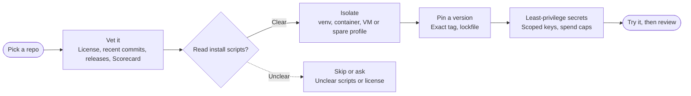
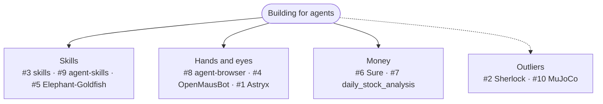

# This Week’s Top 10 GitHub Repos: Step-by-Step Try-It Guide

**PDF:** [Download this guide (PDF)](guide.pdf)

## At a glance

| | |
| --- | --- |
| **Video** | Top 10 GitHub Repos This Week \| Nov 9 – Nov 15 \| Built for Your Agent |
| **Channel** | Full Stack · uploaded Nov 17, 2026 · 24:17 |
| **Watch** | [https://youtu.be/Blo_TXR-S-4](https://youtu.be/Blo_TXR-S-4) |
| **Video’s thesis** | “The agent is not the product anymore, it is the customer.” (23:58) |
| **Guide type** | A roundup turned into a try-it workflow. Steps come from the video and each repo’s README, with Beyond the video additions marked. |

!!! warning "Read this first"

    Four of these tools hand an AI agent real power: a browser (#8), a whole computer (#4), your API keys (#7) or your financial data (#6). The video focuses on what they can do. This guide adds a vetting step and isolation before you try any of them.

## Before you install anything (Beyond the video)

*One workflow for all 10 repos, based on OpenSSF Scorecard, SLSA and GitHub Actions hardening guidance.*



**How to do it**

1. **Check health signals** — License, last commit, release cadence, open security issues. Run `scorecard --repo=github.com/<owner>/<repo>` or look it up at scorecard.dev.
2. **Read what runs on install** — `npx`, `pip install -r` and plugin installers run someone else’s code. Skim package.json scripts, setup files and any SKILL.md scripts.
3. **Isolate** — Python in a venv, Node tools in a dev container, agents in a VM or a browser profile with no saved logins.
4. **Pin versions** — Use exact versions or tags and commit the lockfile. Run `npm audit` or `pip-audit` after installing.
5. **Scope secrets** — Use a separate API key per tool with a spending limit. Put keys in GitHub Actions secrets or a .env that’s in .gitignore, never in code.
6. **Keep a human in the loop** — Leave approvals on for agent tools and review what they changed (OWASP LLM06, Excessive Agency).

## All 10 compared

*Stars: in the video, and from the GitHub API on Nov 19, 2026.*

| # | Repo | What it is | Lang | License | Stars (video → now) | Risk | Jump to |
| --- | --- | --- | --- | --- | --- | --- | --- |
| 10 | google-deepmind/mujoco | Physics engine for robots, biomechanics and anything with joints and contact. | C++ | Apache-2.0 | 18,106 → 18,317 | Low risk · local library | [https://youtu.be/Blo_TXR-S-4?t=52](https://youtu.be/Blo_TXR-S-4?t=52) |
| 9 | addyosmani/agent-skills | A senior engineer’s workflow packaged and slash commands for coding agents. | JavaScript | MIT | 118,037 → 119,094 | Medium risk · instructions your agent follows | [https://youtu.be/Blo_TXR-S-4?t=176](https://youtu.be/Blo_TXR-S-4?t=176) |
| 8 | vercel-labs/agent-browser | A Rust CLI that lets an AI agent drive a real browser one command at a time. | Rust | Apache-2.0 | 51,740 → 52,800 | High risk · acts on live websites | [https://youtu.be/Blo_TXR-S-4?t=300](https://youtu.be/Blo_TXR-S-4?t=300) |
| 7 | ZhuLinsen/daily_stock_analysis | An LLM bot that studies your watchlist every day and sends a buy, watch or sell dashboard. | Python | MIT | 72,601 → 73,463 | Medium risk · API keys and money decisions | [https://youtu.be/Blo_TXR-S-4?t=419](https://youtu.be/Blo_TXR-S-4?t=419) |
| 6 | we-promise/sure | A self-hosted personal finance app for budgets, net worth and cash flow; the community fork of Maybe Finance. | Ruby | AGPL-3.0 | 15,791 → 16,632 | High sensitivity · your financial data | [https://youtu.be/Blo_TXR-S-4?t=545](https://youtu.be/Blo_TXR-S-4?t=545) |
| 5 | google/elephant-goldfish-model | A plugin where one agent with context drafts the design and fresh-context reviewers check it. | Python | Apache-2.0 | 19,942 → 21,336 | Low risk · review workflow | [https://youtu.be/Blo_TXR-S-4?t=669](https://youtu.be/Blo_TXR-S-4?t=669) |
| 4 | milind-soni/OpenMausBot | An open-source chat app where every contact is an agent with its own computer. | TypeScript | Apache-2.0 | 23,648 → 25,677 | High risk · agents with a computer | [https://youtu.be/Blo_TXR-S-4?t=786](https://youtu.be/Blo_TXR-S-4?t=786) |
| 3 | anthropics/skills | Anthropic’s public home for Agent Skills, folders an agent loads only when a task needs them. | Python | Apache-2.0 for many skills (check each folder) | 195.5K → 197,560 | Low–medium risk · reference content | [https://youtu.be/Blo_TXR-S-4?t=916](https://youtu.be/Blo_TXR-S-4?t=916) |
| 2 | sherlock-project/sherlock | Finds accounts that use a given username across 400+ sites. | Python | MIT | 112,676 → 114,454 | Ethical/legal care needed | [https://youtu.be/Blo_TXR-S-4?t=1072](https://youtu.be/Blo_TXR-S-4?t=1072) |
| 1 | meta/astryx | Meta’s design system: 150+ accessible React components, themes and templates, built to be read by agents. | TypeScript | MIT | 29,094 → 30,826 | Low risk · UI library | [https://youtu.be/Blo_TXR-S-4?t=1219](https://youtu.be/Blo_TXR-S-4?t=1219) |

## The 10 repositories

### #1 Astryx

Meta’s design system: 150+ accessible React components, themes and templates, built to be read by agents.

**Repo:** [meta/astryx](https://github.com/meta/astryx)  
**Language:** TypeScript · **License:** MIT  
**Stars (video → now):** 29,094 → 30,826  
**Risk:** Low risk · UI library  
**Watch:** [20:19](https://youtu.be/Blo_TXR-S-4?t=1219)

**How to try it**

1. **Check React version** — React 19 or later is required as a peer dependency, which the video doesn’t mention.
2. **Install core, a theme and StyleX** — Plus the CLI as a dev dependency (22:26).
3. **Run init once** — `npx @astryxdesign/cli init` prints setup steps and writes the guide into AGENTS.md or CLAUDE.md so your agents build with Astryx.
4. **Import CSS and wrap in a theme** — No build plugin. A theme is just CSS variables, so designers can rebrand without forking (21:22).
5. **Swizzle only when needed** — `swizzle` ejects a component’s full source into your project for you to own (21:40).

```bash
npm install @astryxdesign/core @astryxdesign/theme-neutral @stylexjs/stylex
npm install -D @astryxdesign/cli
npx @astryxdesign/cli init
```

**Common mistakes**

- Swizzling early. Ejected components stop getting upstream fixes.
- Installing into a React 18 app.

**Beyond the video**

- Still pre-1.0 (v0.7.16 on Nov 14, 2026), so pin exact versions and read release notes.
- “Accessible components” doesn’t make your page accessible. Still test against WCAG 2.2 AA (contrast, focus order, labels).
- The nightly benchmark shows Astryx 98, a Tailwind kit 95 and raw HTML 82 on one good night, but Meta’s own write-up admits the baseline wins the most nights (22:01).

### #2 Sherlock

Finds accounts that use a given username across 400+ sites.

**Repo:** [sherlock-project/sherlock](https://github.com/sherlock-project/sherlock)  
**Language:** Python · **License:** MIT  
**Stars (video → now):** 112,676 → 114,454  
**Risk:** Ethical/legal care needed  
**Watch:** [17:52](https://youtu.be/Blo_TXR-S-4?t=1072)

**How to try it**

1. **Install with pipx or Docker** — One line either way (19:26). The README warns that third-party ParrotOS and Ubuntu 24.04 packages appear broken.
2. **Search a username** — `sherlock user123`. Results go to `user123.txt`, or CSV or Excel if you prefer (19:06).
3. **Narrow and control the run** — Limit to certain sites, use a proxy, set a timeout, open hits in the browser, or check several names (19:13).
4. **Verify every hit by hand** — Sherlock’s own help text warns about false positives (19:51).

```bash
pipx install sherlock-project
# or
docker run -it --rm sherlock/sherlock user123
sherlock user123
sherlock user1 user2 --csv --timeout 10
sherlock --help
```

**Common mistakes**

- Treating a hit as proof of identity. A matching handle can belong to someone else.
- Searching people you have no legitimate reason to look up.

**Beyond the video**

- Start with your own handles. It’s the best defensive use (19:45).
- For anyone else, follow OSINT ethics. Have a lawful purpose, collect the minimum, respect site terms, and remember GDPR or state privacy laws may apply to what you store.
- Created Dec 24, 2018 (confirmed on GitHub), so it really is a nearly eight-year-old tool rediscovered.

### #3 skills

Anthropic’s public home for Agent Skills, folders an agent loads only when a task needs them.

**Repo:** [anthropics/skills](https://github.com/anthropics/skills)  
**Language:** Python · **License:** Apache-2.0 for many skills (check each folder)  
**Stars (video → now):** 195.5K → 197,560  
**Risk:** Low–medium risk · reference content  
**Watch:** [15:16](https://youtu.be/Blo_TXR-S-4?t=916)

**How to try it**

1. **Understand the format** — A skill is a folder with a SKILL.md whose frontmatter has a name and a description. The agent reads those up front and loads the rest when a task matches (16:01).
2. **Add the marketplace** — In Claude Code: `/plugin marketplace add anthropics/skills` (17:02).
3. **Install a bundle** — `document-skills` (docx, pdf, pptx, xlsx) or `example-skills`.
4. **Use it by mentioning it** — For example, ask it to use the PDF skill to pull the form fields from a file (17:11).
5. **Write your own from the template** — Use skill-creator and the spec at agentskills.io (16:48).

```bash
/plugin marketplace add anthropics/skills
/plugin install document-skills@anthropic-agent-skills
/plugin install example-skills@anthropic-agent-skills
```

**Common mistakes**

- Relying on a demo skill in production without testing it. The README says they are “for demonstration and educational purposes only” (17:26).
- Writing vague descriptions. The description is what decides when a skill loads.

**Beyond the video**

- Verified count: 19 skills under skills/, matching the video.
- Licensing varies by folder. The README says many are Apache 2.0, so check each skill’s LICENSE before you reuse it.
- Keep SKILL.md short and move detail into referenced files. This progressive disclosure is the core idea of the Agent Skills spec.

### #4 OpenMausBot

An open-source chat app where every contact is an agent with its own computer.

**Repo:** [milind-soni/OpenMausBot](https://github.com/milind-soni/OpenMausBot)  
**Language:** TypeScript · **License:** Apache-2.0  
**Stars (video → now):** 23,648 → 25,677  
**Risk:** High risk · agents with a computer  
**Watch:** [13:06](https://youtu.be/Blo_TXR-S-4?t=786)

**How to try it**

1. **Pick the install path** — Desktop download for Mac, Windows or Ubuntu, or for developers, a clone with pnpm or a global npm install (14:30).
2. **Connect a CLI agent you already have** — Each bot runs on a command-line agent already on your machine, such as Codex, Grok or Claude Code, using your existing logins (13:52).
3. **Choose each bot’s computer** — A cloud Linux desktop, an isolated local VM, or your own Mac if you opt in (14:13).
4. **Keep approvals on** — Shell commands and file edits show up as allow-or-deny approval cards (14:20).
5. **Know where data lives** — Transcripts, keys and events sit in a folder in your home directory (14:09).

```bash
git clone https://github.com/milind-soni/OpenMausBot && cd OpenMausBot
pnpm install
pnpm dev:server    # harness server on 127.0.0.1:8799
pnpm dev           # app on http://127.0.0.1:5199
# or
npm install -g openmausbot
```

**Common mistakes**

- Opting a bot into your own Mac before you’ve tried it on the isolated VM.
- Approving cards without reading them, which defeats the point of having them.

**Beyond the video**

- Caption fix: the auto-captions say “PNPM div”. The real command is `pnpm dev`, plus `pnpm dev:server`, per the README.
- Least privilege (OWASP LLM06 Excessive Agency, NIST AI RMF “Manage”): start bots in the isolated VM, give each the fewest connectors, and back up and protect the home-directory folder, since it holds keys.
- The README calls it “early but real”, so expect rough edges.

### #5 Elephant-Goldfish Model

A plugin where one agent with context drafts the design and fresh-context reviewers check it.

**Repo:** [google/elephant-goldfish-model](https://github.com/google/elephant-goldfish-model)  
**Language:** Python · **License:** Apache-2.0  
**Stars (video → now):** 19,942 → 21,336  
**Risk:** Low risk · review workflow  
**Watch:** [11:09](https://youtu.be/Blo_TXR-S-4?t=669)

**How to try it**

1. **Install the plugin** — Two commands in Codex or Claude Code, or `agy plugin install` for Antigravity (12:24).
2. **Start a new session** — The README says skills load after a restart.
3. **Run the 60-second review** — Point `/egm:egm-review` at an existing design doc or PR plan. No new spec needed (12:35).
4. **Use the elephant for new specs** — The elephant drafts with your context. Goldfish reviewers see only the document and its sources, and you approve the trade-offs (11:50).
5. **Run a drift report** — Compares design docs to today’s code and lists where they disagree, so you decide whether to fix the doc or the code (12:14).

```bash
# Claude Code
claude plugin marketplace add google/elephant-goldfish-model
claude plugin install egm@egm
# Codex CLI
codex plugin marketplace add google/elephant-goldfish-model
codex plugin add egm@egm
# then, in a new session
/egm:egm-review docs/designs/webhooks.md
```

**Common mistakes**

- Running it in an agent that can’t start sub-agents. It stops on purpose rather than faking the review (12:08).
- Accepting goldfish findings without resolving the trade-offs yourself. You are the approver.

**Beyond the video**

- Google labels it “not an officially supported product” (11:34). Treat it as experimental.
- This matches the independent review principle in NIST SSDF (SP 800-218, PW.7): a reviewer without the author’s context catches unstated assumptions.

### #6 Sure

A self-hosted personal finance app for budgets, net worth and cash flow; the community fork of Maybe Finance.

**Repo:** [we-promise/sure](https://github.com/we-promise/sure)  
**Language:** Ruby · **License:** AGPL-3.0  
**Stars (video → now):** 15,791 → 16,632  
**Risk:** High sensitivity · your financial data  
**Watch:** [9:05](https://youtu.be/Blo_TXR-S-4?t=545)

**How to try it**

1. **Decide: self-host or develop** — For everyday use, the README sends you to its Docker hosting guide. The bin/ commands are for contributors (10:27).
2. **Self-host with Docker** — Follow docs/hosting/docker.md. It runs as a Rails app on Postgres and Redis (10:13).
3. **Dev setup (contributors)** — Copy `.env.local.example`, run `bin/setup` and `bin/dev`, then open localhost:3000 (10:32).
4. **Optionally load demo data** — `rake demo_data:default`, then log in with the README’s demo account.
5. **Try the AI assistant last** — It answers from your own numbers (10:20). There are one-click deploys with or without the AI features (10:50).

```bash
# contributors only; needs Ruby (see .ruby-version), PostgreSQL, Redis
cd sure
cp .env.local.example .env.local
bin/setup
bin/dev
rake demo_data:default   # optional
# then open http://localhost:3000
```

**Common mistakes**

- Leaving the demo account on an instance that holds real data.
- Exposing port 3000 straight to the internet with no TLS or authentication proxy.

**Beyond the video**

- The video skips the prerequisites. The dev path needs the Ruby version in `.ruby-version`, PostgreSQL and Redis.
- On the license: AGPL-3.0 makes you share source if you distribute it or offer a modified version to others over a network. Purely private self-hosting doesn’t force you to publish anything.
- Back up the Postgres volume 3-2-1 style and test a restore. Turning on the AI assistant sends your financial data to whichever model provider you configure.

### #7 daily_stock_analysis

An LLM bot that studies your watchlist every day and sends a buy, watch or sell dashboard.

**Repo:** [ZhuLinsen/daily_stock_analysis](https://github.com/ZhuLinsen/daily_stock_analysis)  
**Language:** Python · **License:** MIT  
**Stars (video → now):** 72,601 → 73,463  
**Risk:** Medium risk · API keys and money decisions  
**Watch:** [6:59](https://youtu.be/Blo_TXR-S-4?t=419)

**How to try it**

1. **Fork the repo** — The main path is a fork that GitHub Actions runs for you, which is why it has 57,601 forks (7:14).
2. **Add secrets, not files** — Settings → Secrets and variables → Actions. Add an LLM key (Gemini, Claude, DeepSeek or a local model) and `STOCK_LIST`, for example `AAPL,600519,hk00700` (8:24).
3. **Enable Actions on the fork** — The default schedule is every weekday at 6:00 PM Beijing time, after the close. That’s 5:00 AM Eastern during standard time (8:35).
4. **Pick where reports go** — Telegram, Discord, Slack, email, or WeCom and Feishu (8:00).
5. **Or run it locally** — Clone, `pip install -r requirements.txt`, copy `.env.example` to `.env`, and run `python main.py`.

```bash
git clone https://github.com/ZhuLinsen/daily_stock_analysis.git && cd daily_stock_analysis
python3 -m venv .venv && source .venv/bin/activate
pip install -r requirements.txt
cp .env.example .env   # add your keys here; never commit this file
python main.py --dry-run
python main.py --stocks AAPL,MSFT
```

**Common mistakes**

- Committing `.env` or keys to a fork. Forks of public repos are public.
- Treating the score as advice. Both the video (8:42) and the README disclaimer say it is for research only.

**Beyond the video**

- GitHub disables scheduled workflows in public repos after 60 days with no repo activity, so the daily report can stop without warning. Check the Actions tab.
- Workflows don’t run on a new fork until you enable them in its Actions tab.
- Use a dedicated LLM key with a spend cap, and remember free data sources can be rate-limited (8:47).
- Read FINRA’s and the SEC’s investor alerts on AI investing claims before acting on any AI signal.

### #8 agent-browser

A Rust CLI that lets an AI agent drive a real browser one command at a time.

**Repo:** [vercel-labs/agent-browser](https://github.com/vercel-labs/agent-browser)  
**Language:** Rust · **License:** Apache-2.0  
**Stars (video → now):** 51,740 → 52,800  
**Risk:** High risk · acts on live websites  
**Watch:** [5:00](https://youtu.be/Blo_TXR-S-4?t=300)

**How to try it**

1. **Install globally** — Install from npm, then run `agent-browser install` to download Chrome for Testing the first time (6:19).
2. **Open and snapshot** — `snapshot` returns the page as compact text with a short ref like `@e1` for each element (5:38).
3. **Act on a ref, then re-read** — Click the ref, check the result, repeat. A background process keeps the browser open between commands (5:50).
4. **Rely on honest failures** — If the target is hidden, disabled, off-screen or under a cookie banner, the click fails instead of pretending (6:06).
5. **Add its skill to your agent** — It ships its own skill through the same skills tool as #9.

```bash
npm install -g agent-browser
agent-browser install        # Chrome for Testing, first run only
agent-browser open example.com
agent-browser snapshot -i    # interactive elements with refs
agent-browser click @e1
agent-browser get url
agent-browser close
npx skills add vercel-labs/agent-browser
```

**Common mistakes**

- Reusing stale refs after the page changes. Take a new snapshot after every action.
- Pointing it at your everyday Chrome, which is signed into everything.

**Beyond the video**

- The video mentions driving “the Chrome you already have open”. Best practice is a separate browser profile with no saved logins, since web pages can carry prompt-injection text (OWASP LLM01) and an agent with your sessions can act as you.
- Releases move fast (v0.43.0 on Nov 12, 2026). Pin a version in CI.

### #9 agent-skills

A senior engineer’s workflow packaged as skills and slash commands for coding agents.

**Repo:** [addyosmani/agent-skills](https://github.com/addyosmani/agent-skills)  
**Language:** JavaScript · **License:** MIT  
**Stars (video → now):** 118,037 → 119,094  
**Risk:** Medium risk · instructions your agent follows  
**Watch:** [2:56](https://youtu.be/Blo_TXR-S-4?t=176)

**How to try it**

1. **Browse before installing** — List the skills first so you know what you’re adding to your agent’s instructions.
2. **Install all or pick a few** — `npx skills add addyosmani/agent-skills` installs the set into Cursor, Codex, Copilot and 70+ agents (4:18).
3. **Learn the six phases** — Define, plan, build, verify, review and ship, each with a slash command like spec, plan, build, test, review, ship (3:38).
4. **Start with interview-me** — It asks one question at a time until it’s about 95% sure what you want (4:05).
5. **Turn on TDD and the reviewer personas** — Red-green-refactor is enforced. There are also code reviewer, test engineer, security auditor and web performance personas (4:31).

```bash
npx skills add addyosmani/agent-skills --list
npx skills add addyosmani/agent-skills --skill interview-me
npx skills add addyosmani/agent-skills --skill test-driven-development
# Claude Code alternative
/plugin marketplace add addyosmani/agent-skills
/plugin install agent-skills@addy-agent-skills
```

**Common mistakes**

- Installing all of them at once and then not knowing which skill changed how the agent behaves.
- Assuming skills replace CI. They guide the agent, but tests and branch protection still enforce the rules.

**Beyond the video**

- Count check: the video says 25 skills, while the README now says “install all 26 skills”. The repo has grown since filming.
- A skill is instructions plus optional scripts that your agent will run, so read any third-party skill before you install it (OWASP LLM Top 10: supply chain, excessive agency).

### #10 MuJoCo

Physics engine for robots, biomechanics and anything with joints and contact.

**Repo:** [google-deepmind/mujoco](https://github.com/google-deepmind/mujoco)  
**Language:** C++ · **License:** Apache-2.0  
**Stars (video → now):** 18,106 → 18,317  
**Risk:** Low risk · local library  
**Watch:** [0:52](https://youtu.be/Blo_TXR-S-4?t=52)

**How to try it**

1. **Try it in the browser first** — The video says the site runs a WebAssembly build where you can drag in your own models, so you can explore with nothing installed (1:58).
2. **Make an isolated Python env** — Python 3.11 or newer is required. Use a venv so it doesn’t touch system packages.
3. **Install the bindings** — `pip install mujoco` pulls the default package. Version 4 splits it into a minimal core, the studio/renderer, and the default that installs both (2:22).
4. **Load a model** — You describe a robot in an MJCF XML file; MuJoCo compiles it to compact data structures and steps the physics forward.
5. **Check what v4 changed** — Speculative contacts stop fast objects tunnelling through thin walls; plasticity lets things bend and stay bent (1:50).

```bash
python3 -m venv .venv && source .venv/bin/activate
pip install mujoco
python -c "import mujoco; print(mujoco.__version__)"
```

**Common mistakes**

- Using Python 3.10 or older; the wheels need 3.11+.
- Building from the tip of `main`: the README warns it may be unstable.

**Beyond the video**

- Confirmed on GitHub: 4.0.0 shipped Nov 6, 2026 and 4.0.1 on Nov 11, which matches the video’s “fix 5 days later”.
- Pin the version in requirements (`mujoco==4.0.1`). Version 4 is a major release, so expect breaking changes from 3.x.

## The three trends

*From the recap at https://youtu.be/Blo_TXR-S-4?t=1395*



> My verdict, the agent is not the product anymore, it is the customer.
>
> — Full Stack, 23:58

## Standards and best practices

*Each link was checked on Nov 19, 2026.*

| Standard or guidance | Applies to | What to do |
| --- | --- | --- |
| OWASP Top 10 for LLM Applications (LLM01 Prompt Injection, LLM03 Supply Chain, LLM06 Excessive Agency) | #4, #8, #9, #3, #5 | Treat web content and third-party skills, keep approvals on, and give agents the least access they need. |
| NIST AI Risk Management Framework (Govern, Map, Measure, Manage) | #4, #7, #8 | Write down what each agent may touch, test it before you trust it, and keep a way to shut it off. |
| NIST SSDF SP 800-218 (PW.7 code review) | #5, #9 | Use independent review and tests, which these skills put into practice. |
| OpenSSF Scorecard / SLSA | All 10 | Check repo health and provenance, and pin versions. |
| GitHub Actions security hardening and encrypted secrets | #7 | Keep keys in secrets, keep workflows to minimal permissions, and audit forks. |
| FINRA and SEC investor alerts on AI | #7, #6 | Treat AI stock signals, not advice. |
| WCAG 2.2 AA | #1 | Test your finished UI, not just the components. |
| 3-2-1 backups (CISA guidance) | #6, #4 | Back up the database and the agent’s data folder, and test restores. |
| Agent Skills specification | #3, #9, #5 | Keep SKILL.md short with clear descriptions and progressive disclosure. |

- [OWASP Top 10 for LLM Applications](https://genai.owasp.org/llm-top-10/) — genai.owasp.org
- [NIST AI Risk Management Framework](https://www.nist.gov/itl/ai-risk-management-framework) — nist.gov
- [OpenSSF Scorecard](https://scorecard.dev/) — scorecard.dev
- [SLSA supply-chain levels](https://slsa.dev/) — slsa.dev
- [Security hardening for GitHub Actions](https://docs.github.com/en/actions/security-for-github-actions/security-guides/security-hardening-for-github-actions) — docs.github.com
- [Using secrets in GitHub Actions](https://docs.github.com/en/actions/how-tos/write-workflows/choose-what-workflows-do/use-secrets) — docs.github.com
- [Events that trigger workflows (schedule, 60-day rule)](https://docs.github.com/en/actions/reference/workflows-and-actions/events-that-trigger-workflows) — docs.github.com
- [AI and investment fraud](https://www.finra.org/investors/insights/artificial-intelligence-and-investment-fraud) — finra.org
- [npm audit](https://docs.npmjs.com/cli/v10/commands/npm-audit) — docs.npmjs.com
- [Agent Skills specification](https://agentskills.io/specification) — agentskills.io
- [Sure Docker self-hosting guide](https://github.com/we-promise/sure/blob/main/docs/hosting/docker.md) — github.com
- [MuJoCo documentation](https://mujoco.readthedocs.io/en/stable/overview.html) — mujoco.readthedocs.io

## Troubleshooting

| Symptom | Likely cause | Fix |
| --- | --- | --- |
| `pip install mujoco` fails or finds no wheel | Python older than 3.11, or a non-manylinux2014 distro | Use Python 3.11+ in a venv, or build from source following the docs. |
| `npx skills add` installs but the agent ignores the skill | Session started before install, or a vague prompt | Restart the agent session and mention the skill by name. |
| agent-browser click fails | Element hidden, disabled, off-screen or under a banner (by design) | Take a new snapshot, dismiss the banner, scroll, then use the new ref. |
| Stock bot report stopped arriving | Scheduled workflow auto-disabled after 60 days idle, or rate-limited data source | Re-enable it in the Actions tab, push a commit, check the run logs. |
| Stock bot never ran on the fork | Actions not enabled on the fork, or secrets missing | Enable workflows on the fork and confirm the secret names match the README. |
| Sure `bin/setup` errors | Wrong Ruby version, or Postgres/Redis not running | Match `.ruby-version` and start both services. Use Docker for plain self-hosting. |
| EGM review stops immediately | Your agent can’t start fresh sub-agents (by design) | Use a harness that supports sub-agents, such Code, Codex or Antigravity. |
| OpenMausBot bot can’t run commands | Approval card pending, or no CLI agent logged in | Approve the card, and log into Codex, Claude Code or Grok in your terminal. |
| Sherlock shows obvious false hits | Site returns a generic page for unknown users | Verify by hand, and don’t use `--ignore-exclusions` unless you need it. |
| Astryx components unstyled or peer-dependency errors | Missing CSS import or theme wrapper, or React below 19 | Run `astryx init` again, import the CSS, wrap the app in the theme, and upgrade to React 19. |

## Caption fixes

*This guide uses the corrected names wherever the YouTube auto-captions misheard them.*

| Auto-caption said | Actually | Where |
| --- | --- | --- |
| Mujo Co | MuJoCo | 0:53, 23:50 |
| Adios Mani / Adi Osmani | Addy Osmani | 2:56, 23:25 |
| Shore, buy, re-promise / show | Sure by we-promise | 9:05, 23:41 |
| skins format | skills format | 12:55 |
| anti-gravity | Antigravity (Google’s agent IDE) | 12:33 |
| Open Mouse Bot / Milind Sony | OpenMausBot by Milind Soni | 13:06 |
| the eye and boats | the AI bots | 14:20 |
| PNPM div | pnpm dev | 14:36 |
| one marked on file | one Markdown file (SKILL.md) | 16:04 |
| agents can standard | Agent Skills standard | 16:48 |
| Asterisks / folks | Astryx / forks | 20:19, 20:36 |

## Final checklist

*Nothing done yet, Nov 19, 2026.*

- [ ] Pick one or two repos to try instead of all ten — Start low-risk: #10, #5 or #1
- [ ] Check license, recent activity and Scorecard — 5 min per repo
- [ ] Set up an isolated venv, container, VM or spare browser profile
- [ ] Pin the exact version or tag you install
- [ ] Create scoped API keys with spend caps (#7, #4, #6 AI)
- [ ] Keep keys in secrets or a gitignored .env
- [ ] Leave agent approvals on (#4, #8)
- [ ] Back up any self-hosted data and test a restore (#6)
- [ ] Use Sherlock only with a lawful, legitimate purpose — Start with your own handles
- [ ] Re-check fast-moving repos’ release notes before upgrading

## Video chapters

- [Intro](https://youtu.be/Blo_TXR-S-4?t=0) — 0:00
- [#10 MuJoCo](https://youtu.be/Blo_TXR-S-4?t=52) — 0:52
- [#9 agent-skills](https://youtu.be/Blo_TXR-S-4?t=176) — 2:56
- [#8 agent-browser](https://youtu.be/Blo_TXR-S-4?t=300) — 5:00
- [#7 daily_stock_analysis](https://youtu.be/Blo_TXR-S-4?t=419) — 6:59
- [#6 Sure](https://youtu.be/Blo_TXR-S-4?t=545) — 9:05
- [#5 Elephant-Goldfish Model](https://youtu.be/Blo_TXR-S-4?t=669) — 11:09
- [#4 OpenMausBot](https://youtu.be/Blo_TXR-S-4?t=786) — 13:06
- [#3 skills](https://youtu.be/Blo_TXR-S-4?t=916) — 15:16
- [#2 Sherlock](https://youtu.be/Blo_TXR-S-4?t=1072) — 17:52
- [#1 Astryx](https://youtu.be/Blo_TXR-S-4?t=1219) — 20:19
- [Recap and trends](https://youtu.be/Blo_TXR-S-4?t=1395) — 23:15

This guide was built from the spoken transcript. Anything shown only on screen, such demo commands or benchmark charts, isn’t covered except where the repo READMEs confirm it.
