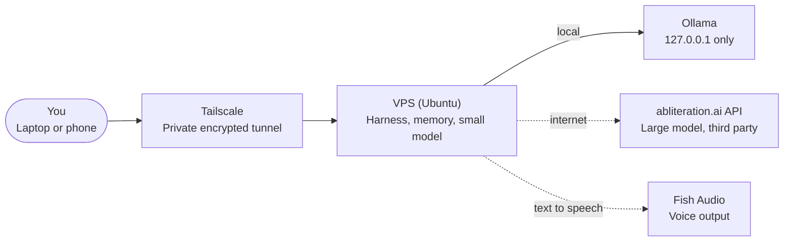
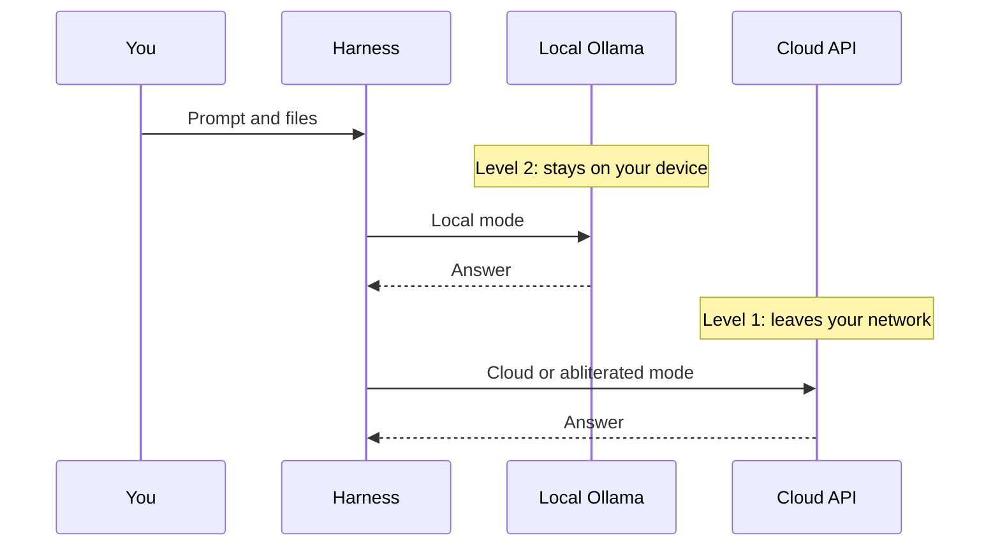

# Uncensored AI in 3 Levels: Step-by-Step Guide

**PDF:** [Download this guide (PDF)](guide.pdf)

## Overview

| | |
| --- | --- |
| **Video** | I Tested Uncensored AI... It Should Probably Be Illegal… |
| **Channel** | Jack Roberts |
| **Published** | 7 Nov 2026, 22:42 long |
| **Link** | [https://youtu.be/bc7QaDmLmoA](https://youtu.be/bc7QaDmLmoA) |
| **Sponsors and affiliates** | Hostinger (sponsored segment, coupon), Fish Audio, the presenter's paid course and community |

!!! note "The three levels"

    Level 1 uses an abliterated model through an API. Level 2 runs models locally with Ollama for privacy. Level 3 puts the system on a VPS reachable through Tailscale so it runs 24/7.

Items marked "Beyond the video" are additions from the cited standards and docs, not claims made by the presenter.

## Responsible use

!!! warning "No refusals does not mean no rules"

    Removing a model's guardrails moves all responsibility to you. Copyright, trademark, right-of-publicity, privacy and computer-misuse laws still apply to what you build and generate. Uncensored also does not mean private: in Level 1 your prompts go to a third party.

- Good fits: security research in a lab you control, red-teaming, frank medical or legal questions, private data analysis.
- Keep agents with tools on least privilege; an unrestricted model will also follow bad instructions.
- Do not use cloned voices or brand assets of real people or companies without permission.

## The uncensored quadrant

*The presenter's framework (12:10): two choices, where it runs and whether it refuses.*

Cloud gives the best performance; local gives privacy and no per-token bills; uncensored costs a little performance.

## Architecture by level

*Level 3 here, with model ports kept private.*



## Prerequisites and costs

| Item | Level | Cost or need |
| --- | --- | --- |
| abliteration.ai account | 1 | $5 minimum deposit |
| Agent harness (Claude Code, DeepSeek Harness) | 1 | Free or existing plan |
| Mac or PC with enough memory | 2 | 24 GB+ for a 27B model |
| Ollama | 2 | Free |
| Fish Audio API key | 2 | Paid per use |
| VPS (video: Hostinger KVM 2) | 3 | $210.96 for 24 months, renews $14.99/mo |
| Tailscale account | 3 | Free personal tier |
| Password manager | All | For API keys and server credentials |

Prices are from Hostinger's page on 19 Nov 2026 and change often; the coupon in the video takes a further 10% off.

## Step-by-step

*Each step covers what, how, why, common mistakes, and additions beyond the video.*

How to do it

Common mistakes

Beyond the video: standards and best practice

### Step 0: Read the three warnings and pick your quadrant

**Level:** Prep  
**What:** Decide whether you need cloud or local, and censored or uncensored, before you set anything up.  
**Why:** The presenter's warnings: you do not own these models, they will answer anything, and responsible use is on you (0:47).  
**Watch:** [0:39](https://youtu.be/bc7QaDmLmoA?t=39)

**How to do it**

1. **Accept the ownership risk** — Hosted models can be withdrawn at any time; keep a local fallback for anything you depend on (0:53).
2. **Write your purpose down** — List the legitimate tasks that a standard model refuses, such as security research, red teaming, or blunt medical and legal questions.
3. **Place yourself in the quadrant** — Cloud gives the best performance; local gives privacy; uncensored trades a little performance for no refusals (12:10).

**Common mistakes**

- Assuming uncensored means private; with an API your prompts still go to someone else's server (8:16).
- Assuming no refusals means no legal limits; the law still applies to what you do with the output.

**Beyond the video**

- Treat this as an AI risk decision: the NIST AI Risk Management Framework's Map and Govern steps mean writing down intended use, misuse risks and who can use the system.
- Check the terms of service of every provider in the chain (API host, Claude Code, voice service, VPS) before relying on it.

### Step 1: Understand what an abliterated model is

**Level:** Prep  
**What:** An abliterated model is an open-weight model with its refusal behaviour removed from the weights.  
**Why:** The presenter says this costs very little performance, so it is nearly as capable as the original (1:52).  
**Watch:** [1:52](https://youtu.be/bc7QaDmLmoA?t=112)

**How to do it**

1. **Know the mechanism** — Researchers found refusal is largely carried by one direction in the model's activations; abliteration projects that direction out of the weights.
2. **Expect side effects** — Removing refusals can also remove some safety-relevant caution and slightly change quality; test on your own tasks.
3. **Check provenance** — Download abliterated weights only from known publishers and verify the base model's licence.

**Common mistakes**

- Running random community weights with no idea who modified them or how.
- Assuming the base model's licence no longer applies after modification.

**Beyond the video**

- Background reading (beyond the video): Arditi et al. 2024, 'Refusal in Language Models Is Mediated by a Single Direction', and the Hugging Face abliteration explainer by Maxime Labonne.

### Step 2: Create an abliteration.ai API key

**Level:** Level 1  
**What:** Sign up at abliteration.ai, add credit, and create an API key, or use the Playground to chat in the browser.  
**Why:** It is the fastest way to use a large abliterated model without hardware; the presenter found it the easiest of several services (5:53).  
**Watch:** [5:53](https://youtu.be/bc7QaDmLmoA?t=353)

**How to do it**

1. **Create an account and deposit $5** — The minimum deposit is $5. Do not enable auto-billing (6:07).
2. **Create a key** — Go to API keys in the left sidebar and create one (6:02).
3. **Or try the Playground first** — Chat in the browser like ChatGPT before you wire anything up (6:14).
4. **Store the key safely** — Put it in a password manager or a local env file that is never committed to a repo.

**Common mistakes**

- Turning on auto-reload billing for an agent that can loop and burn credit.
- Pasting the key into a shared project file or a chat log.

**Beyond the video**

- abliteration.ai states it keeps no prompt or completion content by default and does not train on it; only token counts, timestamps and billing metadata are kept. That is the provider's claim, not independently audited.
- Its web search and dataset tools are exceptions to zero retention per its data-handling page; avoid them for sensitive data.
- Use one key per tool so you can revoke one without breaking the rest.

### Step 3: Swap the brain inside your agent harness

**Level:** Level 1  
**What:** Keep Claude Code (or another harness) but point it at the abliterated model instead of Claude.  
**Why:** The harness, prompts and tools stay the same and only the model changes; the presenter's builds cost about 20% of Opus 5.5 prices (4:52).  
**Watch:** [4:52](https://youtu.be/bc7QaDmLmoA?t=292)

**How to do it**

1. **Choose a harness** — Claude Code, the presenter's agentic OS, or DeepSeek Harness, described as an open-source Claude Code-like tool (7:10).
2. **Point it at the API** — abliteration.ai exposes OpenAI- and Anthropic-compatible endpoints; in Claude Code set `ANTHROPIC_BASE_URL` and the key in `~/.claude/settings.json` (beyond the video).
3. **Or follow the starter pack** — The video's route is pasting the free starter-pack instructions into Claude and letting it walk you through setup (6:21).
4. **Verify** — Run `/status` in Claude Code to confirm which endpoint and credential are active.

**Common mistakes**

- Putting the key in a project's shared `.claude/settings.json`, which gets committed.
- Forgetting the swap is active and sending work or client data to the uncensored endpoint.

**Beyond the video**

- Claude Code's gateway docs say to keep credentials in `~/.claude/settings.json` or a gitignored `settings.local.json`, never a shared project settings file.
- Using Claude Code with a non-Anthropic model may fall outside Anthropic's intended use; check the current terms.

### Step 4: Rebuild an app's behaviour (Reverse Engineer Anything)

**Level:** Level 1  
**What:** Use the Reverse Engineer Anything (REA) repo with the abliterated model to recreate how an app works.  
**Why:** The presenter rebuilt Linear, Granola and Screen Studio for $0.63, $0.32 and $0.55 (3:00, 5:11).  
**Watch:** [3:22](https://youtu.be/bc7QaDmLmoA?t=202)

**How to do it**

1. **Add the REA repo to your harness** — The video adds it as the last Level 1 step (6:54).
2. **Describe behaviour, not code** — The video's own rule: copy what an app does, never its code, and make something unique (7:03).
3. **Run it locally** — Ask for the result on localhost and review it before going further (3:42).

**Common mistakes**

- Keeping the original app's logo, name and colour palette, which the demo did (4:19); that is trademark and trade-dress territory.
- Shipping a clone commercially without checking the original's terms of service and licences.

**Beyond the video**

- Video departs from best practice: the demo copied logos and branding while saying 'not that you would do that'. Replace all branding before any use outside your own machine.
- Clean-room practice: work from public behaviour and documentation, not decompiled or leaked source code.
- Review generated code for security issues; OWASP's LLM Top 10 lists improper output handling as a top risk.

### Step 5: Install Ollama

**Level:** Level 2  
**What:** Install Ollama on your Mac or PC so models run on your own hardware.  
**Why:** Nothing leaves your machine, there are no per-token bills, and it is suited to health records, contracts and private research (8:07).  
**Watch:** [10:50](https://youtu.be/bc7QaDmLmoA?t=650)

**How to do it**

1. **Install** — Use the desktop app or the install command; the desktop app is optional and adds a chat window (11:00).
2. **Or let Claude do it** — The video pastes a prompt from its guide that installs everything (11:13).
3. **Confirm it runs** — Run `ollama --version` and `ollama list`.

**Common mistakes**

- Changing `OLLAMA_HOST` to `0.0.0.0` so other devices can connect, which can expose an open, unauthenticated model server.
- Letting an agent run install scripts you have not read.

**Beyond the video**

- Ollama's FAQ: it binds to `127.0.0.1:11434` by default. Keep it that way, or bind it only to a private (Tailscale) address.
- Ollama's API has no built-in login; never port-forward 11434 to the internet.

### Step 6: Pick the best model for your hardware

**Level:** Level 2  
**What:** Choose the best local model and the best abliterated local model your RAM, GPU memory and disk can hold.  
**Why:** The presenter's rule of thumb: the best open models are about 4 months behind the frontier, and ones that fit a Mac about 9 months (10:43).  
**Watch:** [11:17](https://youtu.be/bc7QaDmLmoA?t=677)

**How to do it**

1. **Check your specs** — Note GPU or unified memory, system RAM and free disk; the video's spreadsheet takes these as inputs (11:30).
2. **Pick two models** — One best local model and one best abliterated local model (12:00).
3. **Pull and test** — For example `ollama pull qwen3.8:27b` (an 18 GB download per the Ollama library), then compare answers on your real tasks.

**Common mistakes**

- Choosing a model larger than your memory, which makes it painfully slow or makes it fail to load.
- Trusting benchmark-to-date comparisons without testing your own workload.

**Beyond the video**

- Sizing estimate: a 4-bit model needs roughly its file size in memory plus a few GB for context. Qwen 3.8 27B at 18 GB suits a 24-32 GB GPU or Mac.
- Prefer models with clear licences and checksums from the official Ollama library.

### Step 7: Use it for private work and switch modes on purpose

**Level:** Level 2  
**What:** Run private questions on the local model, and switch between local, cloud and abliterated only deliberately.  
**Why:** The presenter demonstrates a blood-pressure question answered entirely on the Mac with local memory (9:42).  
**Watch:** [9:19](https://youtu.be/bc7QaDmLmoA?t=559)

**How to do it**

1. **Default to local for sensitive data** — Health, insurance, security logs and client contracts are the video's examples (9:02).
2. **Make the mode visible** — Use a clear on-screen indicator of which model is active, as the presenter's setup shows (10:02).
3. **Keep memory local** — Make sure the agent's memory and logs are stored on your disk, not synced to a cloud.

**Common mistakes**

- A one-click switch to cloud while sensitive files are still in context.
- Treating model medical answers as advice; verify with a professional.

**Beyond the video**

- OWASP LLM Top 10 lists sensitive information disclosure; local inference reduces it only if logs, memory and backups are also local and encrypted.

### Step 8: Give your agent a voice (Fish Audio)

**Level:** Level 2  
**What:** Create a Fish Audio API key and connect it so your agent can speak, with any library or designed voice.  
**Why:** Talking instead of typing makes the system faster and more fun; the presenter says it is cheaper than alternatives (13:00).  
**Watch:** [13:00](https://youtu.be/bc7QaDmLmoA?t=780)

**How to do it**

1. **Create a key** — Developer, then Create API key; name it and verify by email (14:23).
2. **Hand the key to your agent** — Store it in your agent's env config for real-time audio (14:37).
3. **Pick or design a voice** — Browse the voice library, design a voice, or clone your own in under a minute (14:01).

**Common mistakes**

- Using clones of real celebrities' voices, as the video demonstrates with a Morgan Freeman sound-alike (14:09).
- Cloning another person's voice without their consent.

**Beyond the video**

- Video departs from best practice: voice is a protected right of publicity in many US states, and Tennessee's ELVIS Act explicitly covers AI voice simulations. Use your own voice, a designed voice, or a licensed one.
- AI-generated voices used in calls count as artificial voices under the TCPA (FCC 24-17) and need prior consent.

### Step 9: Provision an always-on VPS

**Level:** Level 3  
**What:** Rent a Hostinger KVM 2 VPS running Ubuntu so your system keeps working when your laptop is closed.  
**Why:** Running on a laptop stops when you shut it; a server gives 24/7 continuity and access from anywhere (15:36).  
**Watch:** [16:34](https://youtu.be/bc7QaDmLmoA?t=994)

**How to do it**

1. **Choose the plan and term** — The video picks KVM 2 on a 24-month term with the presenter's coupon (17:13). Hostinger lists KVM 2 as 2 vCPU, 8 GB RAM and 100 GB NVMe.
2. **Pick location** — The video picks the lowest latency location (18:03).
3. **Choose Ubuntu** — The video selects Ubuntu 26.04 (18:32).
4. **Set credentials and finish** — The video generates a root password and adds the free malware scanner (18:48).

**Common mistakes**

- Expecting KVM 2 to run the 27B model from Step 6: it has 8 GB RAM and no GPU, so 18 GB of weights will not fit.
- Skipping backups; the presenter says he does not bother with daily backups (18:00).
- Committing to 24 months based on 'limited time' sale wording without checking the renewal price.

**Beyond the video**

- Video departs from best practice: size the VPS for the workload. On KVM 2, run a small model (up to about 7-8B at 4-bit, CPU-only and slow) or use it as an always-on harness calling the API from Level 1.
- Enable VPS backups or snapshots; the server will hold keys, memory and configuration.
- Hostinger lists KVM 2 at $210.96 for 24 months, renewing at $14.99/mo (checked 19 Nov 2026). The video's link is an affiliate link and the segment is a promotion.
- Choose the region with the law and data residency you want, not only the lowest latency.

### Step 10: Open the console and harden the server

**Level:** Level 3  
**What:** Use the Hostinger web console for first access, then lock the server down before installing anything else.  
**Why:** The video uses the browser console and a Claude prompt to walk through setup (19:40, 20:10).  
**Watch:** [19:40](https://youtu.be/bc7QaDmLmoA?t=1180)

**How to do it**

1. **Open the web console** — Select the VPS, then Web console in a new tab (20:12).
2. **Update first** — Run the full system upgrade (see commands below).
3. **Create a sudo user and use SSH keys** — Disable password and root SSH login once key login works (beyond the video).
4. **Turn on firewall and auto-updates** — Default-deny inbound with `ufw`, and enable unattended security upgrades.

**Common mistakes**

- Relying on a root password only, which is the video's setup.
- Pasting a long agent-written script into a root console without reading it.

**Beyond the video**

- Ubuntu's OpenSSH guidance and the CIS Ubuntu Benchmark: key-based login, no root SSH login, minimal open ports.
- OWASP LLM06 Excessive Agency: if an AI agent administers the server, give it a non-root user and approve each privileged command.

### Step 11: Connect everything with Tailscale

**Level:** Level 3  
**What:** Install Tailscale on your laptop or phone and on the VPS, and log the VPS into your tailnet.  
**Why:** Tailscale is a private tunnel between your devices and the VPS, so you can reach it from anywhere without exposing it (20:33).  
**Watch:** [20:33](https://youtu.be/bc7QaDmLmoA?t=1233)

**How to do it**

1. **Install on your devices** — Download for macOS, Windows or your phone (20:52).
2. **Install on the VPS** — Paste the Linux install command into the web console (21:00).
3. **Authenticate** — Run `tailscale up`, open the login link, and sign in (21:28).
4. **Close public ports** — Once reachable over Tailscale, allow SSH and model ports only on the `tailscale0` interface (beyond the video).

**Common mistakes**

- Leaving SSH and 11434 open to the internet alongside Tailscale.
- Using a tailnet with default allow-all rules when other people or devices share it.

**Beyond the video**

- Use Tailscale ACLs to allow only your devices to reach the VPS, and consider Tailscale SSH for key-free, identity-based logins.
- Turn on MFA for the identity provider you use to sign in to Tailscale.

### Step 12: Update it and run your workloads

**Level:** Level 3  
**What:** Bring the VPS fully up to date, then let your harness install the model or services you want.  
**Why:** Like a new phone, the hardware works but needs the latest software (21:54); then you can run anything within the VPS's capacity (22:10).  
**Watch:** [21:54](https://youtu.be/bc7QaDmLmoA?t=1314)

**How to do it**

1. **Update** — The video gives Claude a prompt to update the system (22:05).
2. **Install your stack** — Ollama with a small model, or the harness pointing to the API from Level 1.
3. **Monitor resources** — Watch RAM, CPU and disk; swap thrashing means the model is too large.

**Common mistakes**

- Running an unrestricted model as an always-on agent with tools and no logging or limits.
- Forgetting to patch the server after the first week.

**Beyond the video**

- Set spending caps on every API key used by always-on agents.
- Keep an audit log of agent actions and review it; the NIST AI RMF Manage function calls for ongoing monitoring.

## Commands

*Beyond the video: the presenter delegates these to Claude via his starter-pack prompts. Read every command before running it.*

**Point Claude Code at the API (Step 3)**

```json
// ~/.claude/settings.json  (never a shared project settings file)
{
  "env": {
    "ANTHROPIC_BASE_URL": "<Anthropic-compatible base URL from abliteration.ai docs>",
    "ANTHROPIC_AUTH_TOKEN": "<your abliteration.ai key>"
  }
}
```

**Install and run a local model (Steps 5–6)**

```bash
# Local machine or VPS
curl -fsSL https://ollama.com/install.sh | sh    # Linux; macOS/Windows use the app
ollama pull qwen3.8:27b     # 18 GB; needs 24 GB+ memory (not for KVM 2)
ollama run qwen3.8:27b
# Ollama listens on 127.0.0.1:11434 by default. Keep it that way.
```

**Harden the VPS and join Tailscale (Steps 10–11)**

```bash
# Run on the VPS (Ubuntu). Beyond the video; review before running.
sudo apt update && sudo apt full-upgrade -y
sudo apt install -y unattended-upgrades ufw
sudo dpkg-reconfigure -plow unattended-upgrades

# Non-root admin user with your SSH public key
sudo adduser will && sudo usermod -aG sudo will
# (copy your key to /home/will/.ssh/authorized_keys, test login, then:)
sudo sed -i 's/^#\?PasswordAuthentication.*/PasswordAuthentication no/; s/^#\?PermitRootLogin.*/PermitRootLogin no/' /etc/ssh/sshd_config
sudo systemctl restart ssh

# Tailscale, then allow SSH only over the tailnet
curl -fsSL https://tailscale.com/install.sh | sh
sudo tailscale up
sudo ufw default deny incoming
sudo ufw allow in on tailscale0
sudo ufw enable
```

## Where your data goes

*What each level sends off your machine.*



| Level | Leaves your device | Privacy depends on |
| --- | --- | --- |
| 1: API | Prompts, files in context | Provider's retention policy |
| 2: Local | Nothing, if offline | Ollama bound to localhost, local logs |
| 3: VPS | Everything to your VPS | Server hardening, host provider, region |

## Presenter's cost claims

*US dollars per app build, in the video (5:11); not independently reproduced.*

The Screen Studio comparison was given as "$2 plus".

## Where the video departs from best practice

| Video does | Issue | Better practice |
| --- | --- | --- |
| Runs the 27B model idea on KVM 2 | 8 GB RAM, no GPU; model is 18 GB | Small model on VPS, or VPS calls the API |
| Root password only | Brute-force and credential risk | SSH keys, sudo user, no root login |
| Skips daily backups | Keys, memory and config lost on failure | Enable VPS backups or snapshots |
| Celebrity sound-alike voices | Right of publicity, ELVIS Act | Own, designed or licensed voices |
| Clone keeps logos and palette | Trademark and trade dress | Rebrand; copy behaviour only |
| Agent runs setup | Excessive agency (OWASP LLM06) | Review commands; least privilege |
| 'Limited' sale, 24-month buy | Renews at $14.99/mo | Size first; check renewal price |
| Region by lowest latency only | Ignores data jurisdiction | Weigh law and residency too |

Where the video matches good practice: depositing a fixed $5 with auto-billing off, copying behaviour rather than code, keeping sensitive data local, and using a private tunnel instead of open ports.

## Best practices and standards

| Area | Source | Applies to |
| --- | --- | --- |
| AI risk governance | NIST AI RMF 1.0 | Steps 0, 12 |
| LLM app security | OWASP Top 10 for LLM Apps | Steps 4, 7, 10 |
| Model server exposure | Ollama FAQ (localhost default) | Steps 5, 11 |
| Server hardening | CIS Ubuntu Benchmark, Ubuntu OpenSSH docs | Step 10 |
| Private access | Tailscale ACLs and Tailscale SSH docs | Step 11 |
| Credential handling | Claude Code LLM gateway docs | Step 3 |
| Voice likeness | Tennessee ELVIS Act, FCC 24-17 | Step 8 |
| Impersonation | FTC Impersonation Rule (16 CFR 461) | Steps 4, 8 |

## Troubleshooting

| Symptom | Likely cause | Fix |
| --- | --- | --- |
| API returns 401 or 402 | Wrong key, or no credit | Check key and balance; deposit again |
| Claude Code still uses Claude | Base URL not loaded | Set it in ~/.claude/settings.json; check /status |
| Model loads very slowly | Model larger than memory | Pick a smaller or more quantized model |
| VPS freezes running a model | RAM exhausted, swapping | Use a model of 8B or less, or the API |
| Cannot reach VPS on Tailscale | Not logged in, or ACL blocks | Run tailscale status; check ACLs |
| Locked out after SSH change | Key not installed before disabling passwords | Use Hostinger web console to revert |
| Voice does not play | Fish Audio key missing or unverified | Re-create key; confirm email verification |
| Agent answers from wrong model | Mode switch state unclear | Show the active model in the UI |

## Video timestamps

| Time | Chapter | Link |
| --- | --- | --- |
| 0:39 | 3 levels + 3 warnings | [https://youtu.be/bc7QaDmLmoA?t=39](https://youtu.be/bc7QaDmLmoA?t=39) |
| 1:52 | What is an abliterated model? | [https://youtu.be/bc7QaDmLmoA?t=112](https://youtu.be/bc7QaDmLmoA?t=112) |
| 2:11 | Level 1: API | [https://youtu.be/bc7QaDmLmoA?t=131](https://youtu.be/bc7QaDmLmoA?t=131) |
| 3:22 | Rebuild Granola + Screen Studio | [https://youtu.be/bc7QaDmLmoA?t=202](https://youtu.be/bc7QaDmLmoA?t=202) |
| 4:52 | Swap the brain in Claude Code | [https://youtu.be/bc7QaDmLmoA?t=292](https://youtu.be/bc7QaDmLmoA?t=292) |
| 5:11 | Cost against Opus 5.5 | [https://youtu.be/bc7QaDmLmoA?t=311](https://youtu.be/bc7QaDmLmoA?t=311) |
| 5:53 | Set up abliteration.ai | [https://youtu.be/bc7QaDmLmoA?t=353](https://youtu.be/bc7QaDmLmoA?t=353) |
| 6:54 | Reverse Engineer Anything | [https://youtu.be/bc7QaDmLmoA?t=414](https://youtu.be/bc7QaDmLmoA?t=414) |
| 7:10 | Agentic OS or DeepSeek Harness | [https://youtu.be/bc7QaDmLmoA?t=430](https://youtu.be/bc7QaDmLmoA?t=430) |
| 8:07 | Level 2: Local | [https://youtu.be/bc7QaDmLmoA?t=487](https://youtu.be/bc7QaDmLmoA?t=487) |
| 10:08 | How far behind are local models? | [https://youtu.be/bc7QaDmLmoA?t=608](https://youtu.be/bc7QaDmLmoA?t=608) |
| 10:50 | Install Ollama | [https://youtu.be/bc7QaDmLmoA?t=650](https://youtu.be/bc7QaDmLmoA?t=650) |
| 11:17 | Pick your best model | [https://youtu.be/bc7QaDmLmoA?t=677](https://youtu.be/bc7QaDmLmoA?t=677) |
| 12:10 | The uncensored quadrant | [https://youtu.be/bc7QaDmLmoA?t=730](https://youtu.be/bc7QaDmLmoA?t=730) |
| 13:00 | Fish Audio | [https://youtu.be/bc7QaDmLmoA?t=780](https://youtu.be/bc7QaDmLmoA?t=780) |
| 15:36 | Level 3: Jarvis anywhere | [https://youtu.be/bc7QaDmLmoA?t=936](https://youtu.be/bc7QaDmLmoA?t=936) |
| 16:34 | Hostinger VPS (promotion) | [https://youtu.be/bc7QaDmLmoA?t=994](https://youtu.be/bc7QaDmLmoA?t=994) |
| 18:40 | Set up your VPS | [https://youtu.be/bc7QaDmLmoA?t=1120](https://youtu.be/bc7QaDmLmoA?t=1120) |
| 20:10 | Open the web console | [https://youtu.be/bc7QaDmLmoA?t=1210](https://youtu.be/bc7QaDmLmoA?t=1210) |
| 20:33 | Connect with Tailscale | [https://youtu.be/bc7QaDmLmoA?t=1233](https://youtu.be/bc7QaDmLmoA?t=1233) |
| 21:54 | Update it + run anything | [https://youtu.be/bc7QaDmLmoA?t=1314](https://youtu.be/bc7QaDmLmoA?t=1314) |

## Final checklist

*Status 19 Nov 2026: nothing recorded yet. Tell me finish items and I will update this page.*

- [ ] Purpose and quadrant written down — Step 0
- [ ] API key created, $5 deposit, auto-billing off — Step 2
- [ ] Key stored outside any shared repo — Step 3
- [ ] Harness points to the intended model, checked with /status — Step 3
- [ ] Rebuilt apps carry no original logos or code — Step 4
- [ ] Ollama installed and bound to localhost — Step 5
- [ ] Model fits available memory — Step 6
- [ ] Voices are your own, designed or licensed — Step 8
- [ ] VPS sized for the workload, backups on — Step 9
- [ ] SSH keys, no root login, firewall, auto-updates — Step 10
- [ ] Tailscale connected with ACLs; no public model ports — Step 11
- [ ] Spending caps and agent logs in place — Step 12

## Sources

- [I Tested Uncensored AI... It Should Probably Be Illegal…](https://youtu.be/bc7QaDmLmoA) — Jack Roberts on YouTube
- [Refusal in Language Models Is Mediated by a Single Direction](https://arxiv.org/abs/2406.11717) — arXiv
- [Uncensor any LLM with abliteration](https://huggingface.co/blog/mlabonne/abliteration) — Hugging Face blog
- [Data handling and zero retention](https://abliteration.ai/data-handling) — abliteration.ai
- [Connect Claude Code to an LLM gateway](https://code.claude.com/docs/en/llm-gateway-connect) — Claude Code docs
- [Ollama FAQ (network binding)](https://docs.ollama.com/faq) — Ollama docs
- [qwen3.8 model tags and sizes](https://ollama.com/library/qwen3.8/tags) — Ollama library
- [VPS hosting plans](https://www.hostinger.com/vps-hosting) — Hostinger
- [OpenSSH server](https://ubuntu.com/server/docs/openssh-server) — Ubuntu docs
- [CIS Ubuntu Linux Benchmark](https://www.cisecurity.org/benchmark/ubuntu_linux) — CIS
- [Tailscale ACLs](https://tailscale.com/kb/1018/acls) — Tailscale docs
- [Tailscale SSH](https://tailscale.com/kb/1193/tailscale-ssh) — Tailscale docs
- [OWASP Top 10 for LLM Applications](https://genai.owasp.org/llm-top-10/) — OWASP
- [AI Risk Management Framework](https://www.nist.gov/itl/ai-risk-management-framework) — NIST
- [The Voice (ELVIS Act)](https://www.americanbar.org/groups/communications_law/resources/magazine/2026-fall/voice-as-property-utilizing-right-publicity-for-protection/) — American Bar Association
- [Rule on Impersonation of Government and Businesses](https://www.federalregister.gov/documents/2026/10/01/2026-20143/rule-on-impersonation-of-government-and-businesses) — Federal Register
