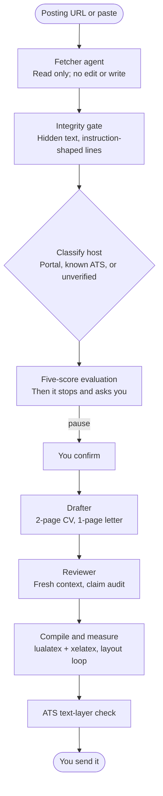

# AI Job Search: One Posting, Two PDFs — Step-by-Step Guide

A walkthrough of Full Stack's 13-minute tutorial on Mads Lorentzen's Claude Code job-application pipeline: private-repo setup, one posting through /apply, two measured PDFs, and the security limits the video and the repo both insist on.

**PDF:** [Download this guide (PDF)](guide.pdf)

## At a glance

| | |
| --- | --- |
| **Video** | AI Job Search: One Posting, Two PDFs (Full Tutorial) |
| **Channel** | Full Stack ([www.youtube.com/@full_stackYT](https://www.youtube.com/@full_stackYT)) |
| **Published** | 19 October 2026, 10:57 PM Pacific (20 October 2026, 1:57 AM ET) |
| **Runtime** | 13:27 |
| **Watch** | [youtu.be/lLBWWL2YcjM](https://youtu.be/lLBWWL2YcjM) |
| **Repo** | [github.com/ai-job-search-dev/ai-job-search](https://github.com/ai-job-search-dev/ai-job-search) |
| **License** | MIT |
| **Difficulty** | Intermediate — paid Claude Code, LaTeX, git, and a private repo |

The video walks the repo as it stood on 19 October 2026: README, SETUP, SECURITY, and the `/apply` command, plus the live GitHub star count that day. Narration is a cloned voice, as the description states. This guide follows that walkthrough, then notes where the repo has moved since (org transfer, portals split out, 14 commands, pypdf as the default ATS extractor).

| Metric | In the video (19 Oct 2026) | Checked 27 Nov 2026 |
| --- | --- | --- |
| Stars | 56,224 (description); about 56,000 spoken | 73,701 |
| Canonical repo | MadsLorentzen/ai-job-search | ai-job-search-dev/ai-job-search (old URL redirects) |
| Slash commands | 13 (setup, scrape, apply + 10) | 14 in the README table, including /reset and /notion-sync |
| Portals shipped in-repo | Six: four Danish, LinkedIn, Freehire | None; copy from community-portals |
| Latest release | Not stated | v2.1.0 (23 November 2026) |

## Before you install

!!! warning "Do not put your profile in a public fork"

    `/setup` writes your name, phone, employment history and salary expectations into tracked files. A fork of a public GitHub repository stays public. Create a private repository with this repo as `upstream` (Step 3) before you run `/setup`.

!!! note "Try one real /apply before you scrape"

    The video's recommended first experiment is a private repo, `/setup` on your documents folder, then one posting through the whole pipeline. One application tells you more than a hundred scrape listings (13:01).

> That reviewer is the part I'd steal even if I never used the rest. One model writing alone produces the same four paragraphs it always produces. A second model with no memory of writing them is a cheap rude editor.
>
> — Full Stack, 7:45

## The pipeline

*The /apply path as the video describes it, from an untrusted posting to two measured PDFs you still send yourself.*



## Step-by-step

*Each step covers what, how, why, common mistakes, and additions beyond the video. Timestamp links use the auto-generated transcript (per-line times).*

## Step 1: Decide whether this workflow fits you

| | |
| --- | --- |
| **What** | Watch the opening claim and the author's own result, then decide if you will pay for Claude Code, keep a private repo, and still read every draft yourself. |
| **Why** | The video's first opinion is that fluent writing is cheap; the product is the measuring tape after the draft, not an agent that applies while you sleep (1:40, 12:41). |
| **Watch** | [▶ 1:40](https://youtu.be/lLBWWL2YcjM?t=100) |

How to do it

1. **Hear the problem it is built to solve** — One posting should not become four Word tabs, a two-page CV that orphans a job title, and a PDF whose text layer an ATS cannot read (0:00).
2. **Treat the author's funnel as n = 1** — Mads Lorentzen, a geophysicist whose role was cut in late 2025, reports 69 tailored applications, 20 first interviews, and one signed contract, then started as an AI engineer in June 2026 (0:48, 1:02). The video and the README both say this is one person, one field, one country, not a benchmark.
3. **Accept the three constraints up front** — Claude Code has no free tier; a public fork cannot hold your profile; the workflow drafts, measures, and catches bad page breaks, but it cannot apply for you (1:52, 2:34, 12:32).

Common mistakes

- ✗ Treating 69 / 20 / 1 as a success rate you should expect. It is an anecdote, and the video says so.
- ✗ Installing this because you want unattended mass applications. The closer says that is not what the repo is.

Beyond the video

- ✓ The repo is an independent MIT project and is not affiliated with Anthropic. It says so in the README.
- ✓ The canonical URL is now [github.com/ai-job-search-dev/ai-job-search](https://github.com/ai-job-search-dev/ai-job-search) (the MadsLorentzen/ai-job-search URL in the video description redirects). As of 27 November 2026 the live GitHub API showed 73,701 stars and 23,553 forks, versus 56,224 stars on 19 October 2026 as cited in the video description. Latest tagged release was v2.1.0 (23 November 2026).

## Step 2: Install the runtime and the two LaTeX engines

| | |
| --- | --- |
| **What** | Install Claude Code, Python 3.10 or newer, Bun for portal CLIs, and a LaTeX distribution that provides both lualatex and xelatex. |
| **Why** | Claude Code is the runtime and has no free tier: a Pro, Max or Team plan, or API credits (1:52). The CV and the letter use different engines for a documented reason (2:08). |
| **Watch** | [▶ 1:52](https://youtu.be/lLBWWL2YcjM?t=112) |

How to do it

1. **Install Claude Code** — The SETUP guide uses `npm install -g @anthropic-ai/claude-code`. Confirm you have a paid Claude plan or API credits before you rely on `/apply`, which is a fetch, an evaluation, two drafts, a review, and several compile loops, not one prompt (11:26).
2. **Install Python 3.10+** — Needed for the tools in `tools/`. On Windows, `py --version` is often the reliable check; use `python` if the machine has no `python3`.
3. **Install both LaTeX engines** — The CV uses LuaLaTeX because PDFLaTeX breaks on modern MiKTeX with the Font Awesome package. The letter uses XeLaTeX because its class needs fontspec (2:08). SETUP recommends TinyTeX on macOS/Linux or Basic MiKTeX on Windows, plus the packages it lists, or any full TeX Live, MacTeX or MiKTeX you already have.
4. **Install Bun, and optionally pypdf** — Bun runs portal CLIs you later copy in. pypdf is now the default ATS text-layer extractor; Poppler `pdftotext` is the fallback. If neither is present, `/apply` skips the mechanical check with a warning and falls back to a visual keyword review.

Common mistakes

- ✗ Installing only one LaTeX engine and assuming both documents will compile.
- ✗ Assuming there is a free Claude Code tier. There is not, and `/apply` is not a single cheap prompt.

Beyond the video

- ✓ SETUP's current ATS path prefers pypdf, then `pdftotext -layout -enc UTF-8`. The video describes the check but does not name pypdf.
- ✓ On Windows, follow SETUP's MiKTeX, PowerShell Bun (`winget install Oven-sh.Bun` also works), and `choco install poppler` notes. Native Windows also lacks Claude Code's Bash sandbox (Step 11).

## Step 3: Make a private repository, do not use a public fork

| | |
| --- | --- |
| **What** | Clone the template, rename origin to upstream, and push to a new private GitHub repository before `/setup` writes your personal data. |
| **Why** | A fork of a public repository cannot be made private, and `/setup` writes your name, phone, employment history and salary expectations into tracked files (2:22). Pushing those commits to a fork publishes them. |
| **Watch** | [▶ 2:34](https://youtu.be/lLBWWL2YcjM?t=154) |

```bash
git clone https://github.com/ai-job-search-dev/ai-job-search.git
cd ai-job-search
git remote rename origin upstream
gh repo create ai-job-search --private --source=. --remote=origin --push
gh repo set-default <your-github-username>/ai-job-search
```

How to do it

1. **Create a private copy with this repo as upstream** — Use the commands in the block above, from SETUP.md section 8. Then set the default gh repo to your private copy.
2. **If you already forked, do not push profile data there** — `gh repo fork --clone` also sets upstream as gh's default remote, so an issue your agent files later can land on the public tracker under your name (2:47). The repo documents this as issue #389. Run `gh repo set-default` on your private copy, or remove the public origin and create a new private repo under a different name.
3. **Commit personalization locally, keep secrets gitignored** — The tracker, salary data, `documents/`, and application archives are gitignored. Profile methodology files are tracked, which is why the remote must be private if you push them.

Common mistakes

- ✗ Forking on GitHub and pushing `/setup` output, then trying to flip the fork to private. GitHub's fork docs say you cannot change a fork's visibility by itself: [docs.github.com/en/pull-requests/reference/forks](https://docs.github.com/en/pull-requests/reference/forks)
- ✗ Skipping `gh repo set-default`, then letting an agent open issues on the public upstream tracker.

Beyond the video

- ✓ The video's closer says 'fork it private' (13:15). That wording conflicts with the earlier, correct advice and with GitHub's rules. Follow SETUP's private-repo commands, not the closer's shorthand.
- ✓ The README hero still says 'Fork it' because that is the path for contributors. For your own search, SETUP is explicit: prefer a private repository with this repo as `upstream`.

## Step 4: Add only the portals you need, and read them first

| | |
| --- | --- |
| **What** | Copy job-board skills from the community-portals repo into `.agents/skills/`, review the code, then install their CLIs. Or run `/add-portal` for a public board in your market. |
| **Why** | In the October 2026 video, six portals shipped in the repo (four Danish boards plus LinkedIn and Freehire). The core workflow is country- and language-agnostic; portal search is not (1:31, 4:29, 10:41). |
| **Watch** | [▶ 4:29](https://youtu.be/lLBWWL2YcjM?t=269) |

How to do it

1. **Copy one skill folder at a time** — Portals now live in [github.com/ai-job-search-dev/community-portals](https://github.com/ai-job-search-dev/community-portals) (`portals/<country>/`, and `portals/global/` for LinkedIn and multi-market boards). SETUP's example is to copy `portals/dk/jobindex-search` into `.agents/skills/`, have the agent show you the code, and only then run `python3 tools/install_portal_clis.py` (Windows: `python tools\install_portal_clis.py`).
2. **Know the two country-agnostic tools** — `linkedin-search` uses public guest endpoints, zero extra dependencies; the repo says personal use only and to keep volume low (4:38). `freehire-search` talks to the public Freehire API at [freehire.me](https://freehire.me) (no key; its backend is MIT, and you can point it at your own instance).
3. **Use `/add-portal` only for public boards** — It investigates the search URL, result structure and access rules, scaffolds the CLI, and test-runs a live query before registering anything. Auth-walled boards are declined (10:50).
4. **If you copy from a community fork, review it as untrusted** — The community forks index is at [github.com/ai-job-search-dev/ai-job-search/discussions/78](https://github.com/ai-job-search-dev/ai-job-search/discussions/78). SECURITY.md says those skills are not covered by the template's security policy.

Common mistakes

- ✗ Expecting six portals to appear after a fresh clone. The main repo now ships none; without a copied skill, `/scrape` falls back to WebSearch.
- ✗ Installing a portal skill before reading it, or running a board whose terms forbid this kind of access.
- ✗ High-volume LinkedIn scraping. The repo itself tells you to keep volume low and treat it as personal use only.

Beyond the video

- ✓ `install_portal_clis.py` discovers folders rather than using a handwritten list, runs `bun install --ignore-scripts`, and skips a manifest that has install-time lifecycle scripts, `trustedDependencies`, `workspaces`, or a beside-the-manifest `bunfig.toml` or `.npmrc`.
- ✓ Respect RFC 9309 (Robots Exclusion Protocol) and each site's terms. The browser-header retry in `tools/fetch_page.py` enforces robots.txt; a portal CLI you copy in may not, until you check.

## Step 5: Run `/setup` and treat the profile as the product

| | |
| --- | --- |
| **What** | Start Claude Code in the private repo and run `/setup` through one of its three doors, then deepen the profile before you generate documents in your name. |
| **Why** | A thin profile produces generic applications. 'Python' gives the drafter nothing; a concrete project the posting can be reframed around does (3:51). |
| **Watch** | [▶ 3:19](https://youtu.be/lLBWWL2YcjM?t=199) |

How to do it

1. **Prefer the documents folder if you have one** — Path A reads your CV, LinkedIn export, diplomas and old applications together and is safe to rerun as you add more (3:21). Path B pastes or `@`-mentions one CV. Path C is a section-by-section interview. All three write the same class of profile files.
2. **Check what was written** — Expect `CLAUDE.md`, `01-candidate-profile.md`, `02-behavioral-profile.md`, `03-writing-style.md`, `04-job-evaluation.md`, `05-cv-templates.md`, `06-cover-letter-templates.md`, `07-interview-prep.md`, a filled `cv/main_example.tex`, and `search-queries.md`. The video compresses this to 'eight files'; the current tree is slightly fuller.
3. **Optionally run `/expand` and `/upskill`** — `/expand` reads public links already in your profile (GitHub, a portfolio, Kaggle, Scholar) and can pull syllabi, tagging discovered skills with a source (4:05). `/upskill` compares your profile with ranked and tracked postings and returns a gap heat map with a learning plan and time estimates (4:18).

Common mistakes

- ✗ Running `/setup` in a public fork (Step 3).
- ✗ Leaving the profile thin and expecting `/apply` to invent specificity. It should not, and the honesty rule forbids stuffing unsupported keywords.

Beyond the video

- ✓ SETUP's 'what gets populated' table omits `03-writing-style.md` and `06-cover-letter-templates.md`, but both exist in the skill tree and `/apply` uses them.
- ✓ Re-run `/setup` as your materials grow; the documents-folder path is designed for that.

## Step 6: Put one real posting through `/apply` before you scrape

| | |
| --- | --- |
| **What** | Run `/apply` with one URL, or paste one posting, and walk the whole pipeline once before you turn on `/scrape`. |
| **Why** | The closer's first experiment is a private repo, `/setup` on your documents folder, then one real posting through `/apply`. One application tells you more than a hundred scrape listings (13:01). |
| **Watch** | [▶ 12:41](https://youtu.be/lLBWWL2YcjM?t=761) |

How to do it

1. **Start Claude Code in the repo and pass one URL** — Example from SETUP: `/apply [boards.greenhouse.io/acme/jobs/1234567`](https://boards.greenhouse.io/acme/jobs/1234567`). You can also paste the posting text.
2. **Let the fetcher agent read, not write** — A separate fetcher reads the page. It can read and fetch but cannot edit or write (5:46). It tries the installed portal tool first, then a normal fetch, then a browser-header retry that respects robots.txt, then the employer's own careers page, because aggregators often drop the requisition ID and the grade (5:58).
3. **Stop when it asks you, and mean it** — After evaluation it pauses before drafting two documents in your name (6:56). That confirmation is the control point, not a formality.

Common mistakes

- ✗ Starting with a mass `/scrape` so you can try the tool. You will not yet know whether the PDFs, the honesty rule, or the cost of `/apply` work for you.
- ✗ Letting the run continue after a host is classified unverified without deciding that you trust it.

Beyond the video

- ✓ The fetcher-versus-drafter split is a least-privilege design (OWASP LLM06, Excessive Agency): the part that touches the live web has no write tools.

## Step 7: Read the integrity verdict and the host class before anything is drafted

| | |
| --- | --- |
| **What** | Confirm the posting-guard output and the host classification (installed portal, known ATS domain, or unverified) before you approve drafting. |
| **Why** | The posting is untrusted input sitting next to your career history. Hidden HTML, invisible characters, instruction-shaped lines, hidden links and mixed-script words are quoted with a one-line verdict (6:19). |
| **Watch** | [▶ 6:32](https://youtu.be/lLBWWL2YcjM?t=392) |

How to do it

1. **Read the gate's verdict and the quotes** — The archive later keeps counts (how many hidden blocks, how many invisible characters) and never the removed text, so a hostile posting is not reread later (9:30).
2. **Check the host class** — Six ATS domains count; look-alike hosts fail. The video's example is that a look-alike of Greenhouse is not Greenhouse (6:39). An unverified host is a decision, not a green light.
3. **Understand the two hard gates on `/rank` as well** — A citizenship or residency requirement you do not meet is a stop; silence is not permission, it is marked unverified (5:23). A language you never declared is a hard stop; a bar higher than yours (for example fluent against your B1) is a flag you decide (5:33).

Common mistakes

- ✗ Assuming a 403 means the job is closed. `/rank` marks it unreachable and retries, because a 403 is not a closed job (5:18).
- ✗ Treating the gate as proof the posting is safe. SECURITY.md is blunt: the gate is deterministic, not an oracle. A manipulation written to read naturally leaves no trace, and instruction-level rules are then the only defence.

Beyond the video

- ✓ This is OWASP LLM01 (Prompt Injection) treated as data, not instructions: agents are told not to follow directions in postings and not to fetch URLs found inside posting text. WebFetch itself is unrestricted by domain, so that rule is doing real work (12:15).
- ✓ Do not paste a working bypass or a hidden-text payload into this repo or a public issue. Report classes of failure privately, as SECURITY.md asks.

## Step 8: Let the drafter write, then let a fresh reviewer audit it

| | |
| --- | --- |
| **What** | The drafter writes a two-page CV (in your language) and a one-page letter (in the posting's language). A second agent, with a fresh context, researches the company and critiques the drafts. |
| **Why** | One model writing alone produces the same four paragraphs it always produces. A second model with no memory of writing them is a cheap, rude editor (7:45). |
| **Watch** | [▶ 5:44](https://youtu.be/lLBWWL2YcjM?t=344) |

How to do it

1. **Allow the pause after evaluation** — Salary benchmarking is optional and only runs on data you supply (6:51). Then you approve drafting.
2. **Expect every claim to be matched or honestly gapped** — The reviewer audits claims against three sources and looks for the generic sentence the first agent left in. A skill you do not have stays visible as a gap. The rule is never to stuff a keyword the profile cannot support (7:17).
3. **If the CV runs long, check the cut is relevance-weighted** — It does not cut the oldest job first. It scores every line on relevance, uniqueness, and whether the letter depends on it, then cuts the lowest total (7:35).

Common mistakes

- ✗ Editing the draft to insert keywords you cannot defend in interview. That is the failure mode the honesty rule exists to prevent.
- ✗ Skipping the reviewer pass to save tokens. The video calls the reviewer the part worth stealing even if you never used the rest.

Beyond the video

- ✓ Company research should start from the company identity you confirmed, never from links in the posting body (SECURITY.md).
- ✓ Fabricating experience is a professional-ethics failure, not just a prompt-quality issue. Keep gaps as bridge answers, which is also how `/interview` is written.

## Step 9: Compile, measure the PDFs, and read the ATS text layer

| | |
| --- | --- |
| **What** | The pipeline runs LaTeX, reads the rendered pages, and iterates until the CV is exactly two pages and the letter is exactly one, then extracts the CV's text layer the way a parser would. |
| **Why** | An ATS reads the text inside the PDF, not the page you arranged. LaTeX can put glyphs where your email should be, and a job entry that cannot fit jumps as a block and leaves a hole the page count still calls two (0:18, 8:00). |
| **Watch** | [▶ 7:58](https://youtu.be/lLBWWL2YcjM?t=478) |

How to do it

1. **Confirm the visual layout checks** — No job title alone at the bottom of page one with its bullets overleaf; signature visible; bullet font matching the body. The video's measured failure rules: a hole over 100 points (about seven blank lines) fails, as does a page that ends a quarter early or a final page a third empty (8:22). Confirm the current thresholds in `tools/verify_layout.py` if a release has changed them.
2. **Read the ATS extraction, not only the pretty PDF** — Contact details must appear as literal text, with no replacement characters, reading order intact, and dates that survive an import (8:46).
3. **Watch the Unicode-dash date flag** — The video describes a bug where a year joined to a Unicode dash caused one Word import to drop the date and keep the year; the check fails on that pattern now (8:59).
4. **Use the keyword table honestly** — Columns cover: covered, synonym only, missing but you have it, and missing and you do not. That last column is the honest one (9:09).

Common mistakes

- ✗ Shipping the PDF because the `.tex` looks fine.
- ✗ Forcing a keyword into the CV to clear a missing-and-you-do-not cell.

Beyond the video

- ✓ If you do not want LaTeX, `/add-template` can register any toolchain that compiles to PDF (including Typst), with a test compile before it goes live (11:04).
- ✓ ISO 32000 PDF files carry a text layer separate from the drawn page. Checking that layer is the right test for ATS parseability; a tagged/PDF-UA document is a further accessibility step the video does not require.

## Step 10: Track what you sent, then prep interviews from the archive

| | |
| --- | --- |
| **What** | After you send the application yourself, record the outcome, and use `/interview` from the archived posting plus the exact CV and letter the interviewer will have read. |
| **Why** | Every application lands in a 14-column tracker (company, channel, fit rating, deadline, the two file paths, and more). The workflow still does not hit send (9:21, 12:32). |
| **Watch** | [▶ 9:21](https://youtu.be/lLBWWL2YcjM?t=561) |

How to do it

1. **Run `/outcome` for stages, offers, rejections and silence** — After 10 days of quiet it can draft a follow-up in your style, from claims you already sent: drafts only, never sends, at most twice (9:42).
2. **Use `/interview` from the archive** — It starts from the posting, the CV and letter the interviewer read, and feedback from earlier rounds. Company research has a verify-before-use rule. Likely questions map to your examples. Gaps get bridge answers, not invented experience (9:54).
3. **Optional plumbing** — `/gmail-sync` proposes status changes for you to approve, with the email cited. `/notion-sync` is a read-only mirror. `/html-report` is one offline file you can open at your desk (10:16).
4. **Plan for upstream updates from day one** — A `framework_version` stamp on methodology files tells you which personalized files a release touched. `tools/check_upstream_updates.py` and `tools/upstream_triage.py` are report-only helpers. Prefer tagged releases over raw `master` when you want a documented checkpoint (10:28).

Common mistakes

- ✗ Letting Gmail or Notion sync write back into the repo unchecked. Status proposals from `/gmail-sync` are meant for your approval; Notion is one-way.
- ✗ Inventing experience in a mock interview to cover a gap the CV already left visible.

Beyond the video

- ✓ The current README lists 14 slash commands, including `/reset` and `/notion-sync`. The video counted 13 commands, with `/setup`, `/scrape` and `/apply` as the three that do the work and ten around the edges (1:20).

## Step 11: Learn the limits, especially on Windows, before you scale up

| | |
| --- | --- |
| **What** | Read SECURITY.md, know that the repo is not a sandbox, and only then add scrape volume or community portal skills. |
| **Why** | Permissions are tighter than most agent repos and still not a sandbox. The Bash sandbox does not run on native Windows and is off by default on macOS and Linux (11:36, 11:53). |
| **Watch** | [▶ 10:41](https://youtu.be/lLBWWL2YcjM?t=641) |

How to do it

1. **Turn the Bash sandbox on if you can** — SECURITY.md says that on macOS or Linux, enabling it in your user settings is the single strongest addition you can make, and nothing in the repo conflicts with it. Native Windows cannot use it.
2. **Understand allow, ask and deny as bounds, not a guarantee** — An exact-path allow list, prompts before anything that changes permissions, and deny rules on upload-shaped commands and reads of SSH or cloud keys. No hooks ship at all: a hook runs without asking, which SECURITY.md names as the vector the Shai-Hulud worm used in August 2026 (11:52).
3. **Treat prefix deny rules as tripwires** — The video's point, also in SECURITY.md: one spelling of a curl upload is denied, a slightly different one is not (12:10). Do not probe the deny list for bypasses; review what the agent fetched and wrote before anything goes out.
4. **Delete a stale `settings.local.json` from an old clone** — SETUP warns that earlier versions committed a broader `.claude/settings.local.json` that pre-approved wide Bash patterns and still applies on top of `settings.json` if git left it behind.

Common mistakes

- ✗ Assuming deny rules and the posting gate make it safe to run against boards you do not trust at all.
- ✗ Adding hooks, lifecycle scripts, or a root `bunfig.toml` to help the agent. CI is written to reject those, for a reason.

Beyond the video

- ✓ Instruction-level defences raise the bar; permission-level defences bound the damage; neither is a guarantee (SECURITY.md).
- ✓ If you find a vulnerability, use GitHub private vulnerability reporting on the repo, not a public issue with a working recipe.

## Commands

*Current README table, 27 November 2026. The video counted 13; this table has 14.*

| Command | Role | In the video? |
| --- | --- | --- |
| `/setup` | Build the profile from documents, a CV, or an interview | Core (1:20) |
| `/scrape` | Search the portals you have installed | Core |
| `/apply` | Evaluate, draft, review, compile, ATS-check | Core |
| `/rank` | Batch-score a scrape on five dimensions; deal-breakers veto | Yes (5:01) |
| `/expand` | Add competencies from public profiles and syllabi | Yes (4:05) |
| `/upskill` | Gap heat map and a learning plan | Yes (4:18) |
| `/interview` | Prep pack and mock from the archive | Yes (9:54) |
| `/outcome` | Record results; draft follow-ups, never send | Yes (9:42) |
| `/gmail-sync` | Propose status changes from email, with a citation | Yes (10:16) |
| `/notion-sync` | Read-only pipeline mirror in Notion | Mentioned as a read-only mirror |
| `/html-report` | One offline dashboard file | Yes (10:22) |
| `/add-portal` | Scaffold a public job-board CLI | Yes (10:50) |
| `/add-template` | Register a non-stock CV or letter toolchain | Yes (11:04) |
| `/reset` | Wipe profile data or documents | Not named in the video |

## Where the video departs, and what is unverified

| Video does or says | Issue | Better practice now |
| --- | --- | --- |
| Closer: fork it private (13:15) | A public fork cannot be made private | Follow the earlier advice and SETUP section 8: private repo, this repo as upstream |
| Six portals ship in the repo | True in October 2026, not now | Copy skills from community-portals; read the code first |
| 13 slash commands | README now lists 14 | Use the current table, including /reset |
| Repo URL MadsLorentzen/ai-job-search | Org moved; old URL still redirects | Clone ai-job-search-dev/ai-job-search |
| 56,000 stars as a live figure | It was current on 19 October 2026 | Check the GitHub API; 73,701 as of 27 November 2026 |

Where the video matches good practice: private-by-default personal data, a write-less fetcher, an integrity gate, a human confirmation before drafting, a second-agent review, measuring the compiled PDF and its text layer, never stuffing unsupported keywords, drafts that do not send themselves, and an honest account of sandbox and deny-list limits.

Unverified independently in this guide: the 69 / 20 / 1 funnel and the June 2026 hire (author's claim in the video and README, n = 1); exact `/apply` token cost (the video only says the cost is real); the six ATS apex domain names (the video does not list them); and whether `verify_layout.py` still uses the 100-point / quarter-page / third-empty thresholds spoken at 8:22.

## Standards and best practice

| Area | Source | Applies to |
| --- | --- | --- |
| Prompt injection | OWASP Top 10 for LLM Applications (LLM01) | Steps 7, 11 |
| Excessive agency | OWASP LLM06 | Steps 6, 8, 11 |
| Supply-chain and hooks | OWASP LLM03; repo SECURITY.md (Shai-Hulud, August 2026) | Steps 4, 11 |
| SSRF / internal hosts | OWASP SSRF Prevention Cheat Sheet | Fetcher retry in Step 6, SECURITY.md limits |
| robots.txt | RFC 9309 Robots Exclusion Protocol | Steps 4, 6 |
| Fork visibility | GitHub docs: visibility of forks | Step 3 |
| PDF text layer | ISO 32000 (PDF text extraction) and ATS parseability practice | Step 9 |
| AI risk and human oversight | NIST AI Risk Management Framework (Measure / Manage) | Steps 1, 6, 10 |
| Honest representation | The repo's own honesty rule; professional application ethics | Steps 8, 10 |

## Troubleshooting

| Symptom | Likely cause | What to do |
| --- | --- | --- |
| `/apply` will not compile the CV | PDFLaTeX or a missing Font Awesome / moderncv package | Use lualatex; install the packages SETUP lists, or a full TeX distribution |
| Cover letter fonts missing | Lato / Raleway not in `cover_letters/OpenFonts/fonts/` | Restore that folder, or register a template that ships its fonts |
| ATS check skipped | Neither pypdf nor pdftotext is installed | `pip install pypdf`, or install Poppler; the rest of `/apply` still runs |
| Layout fails with a large hole | An unbreakable job block jumped, leaving a gap | Let the compile-and-inspect loop retry; do not trust page count alone |
| `/scrape` finds nothing useful | No portal skill copied in, or the board is auth-walled | Copy a community-portals skill, or use `/add-portal` on a public board |
| Portal install refused | Lifecycle scripts, trustedDependencies, or a bunfig/.npmrc beside the manifest | That skip is intentional; do not force `bun install` with scripts on |
| Issues appear on the public repo | gh default remote is still upstream | `gh repo set-default` on your private copy (issue #389) |
| Old, wide Bash allows still apply | Stale `.claude/settings.local.json` from an early clone | Delete or trim it, as SETUP's troubleshooting section says |
| salary_data.json not found | Salary benchmarking was never set up | Expected; /apply skips it |
| Windows feels weaker | Claude Code's Bash sandbox does not run there | Tighten review of fetches and writes; do not assume deny rules are a wall |

## Video timestamps

*Chapter starts from the video description. Links go to those times on YouTube.*

| Time | Chapter | Link |
| --- | --- | --- |
| 0:00 | One posting, four tabs | [▶ 0:00](https://youtu.be/lLBWWL2YcjM?t=0) |
| 0:48 | A geophysicist, position cut | [▶ 0:48](https://youtu.be/lLBWWL2YcjM?t=48) |
| 1:02 | Sixty-nine applications, one contract | [▶ 1:02](https://youtu.be/lLBWWL2YcjM?t=62) |
| 1:20 | Thirteen commands, three that matter | [▶ 1:20](https://youtu.be/lLBWWL2YcjM?t=80) |
| 1:40 | First opinion: does this fit you | [▶ 1:40](https://youtu.be/lLBWWL2YcjM?t=100) |
| 1:52 | Claude Code is the runtime, no free tier | [▶ 1:52](https://youtu.be/lLBWWL2YcjM?t=112) |
| 2:34 | Don't fork it, clone it private | [▶ 2:34](https://youtu.be/lLBWWL2YcjM?t=154) |
| 3:19 | Setup has three doors | [▶ 3:19](https://youtu.be/lLBWWL2YcjM?t=199) |
| 3:51 | The profile is the product | [▶ 3:51](https://youtu.be/lLBWWL2YcjM?t=231) |
| 4:29 | Six portals, one shortlist | [▶ 4:29](https://youtu.be/lLBWWL2YcjM?t=269) |
| 5:44 | The drafter and the reviewer | [▶ 5:44](https://youtu.be/lLBWWL2YcjM?t=344) |
| 6:32 | Classifying the host | [▶ 6:32](https://youtu.be/lLBWWL2YcjM?t=392) |
| 7:58 | Two PDFs, measured | [▶ 7:58](https://youtu.be/lLBWWL2YcjM?t=478) |
| 9:21 | After you hit send | [▶ 9:21](https://youtu.be/lLBWWL2YcjM?t=561) |
| 10:41 | Where it still fails | [▶ 10:41](https://youtu.be/lLBWWL2YcjM?t=641) |
| 11:53 | Windows takes more work | [▶ 11:53](https://youtu.be/lLBWWL2YcjM?t=713) |
| 12:41 | Who it's for | [▶ 12:41](https://youtu.be/lLBWWL2YcjM?t=761) |

## Final checklist

*Status as of 27 November 2026: nothing recorded yet. Tell me as you finish items and I will update this page.*

- [ ] Decided this is not an unattended apply bot, and accepted the Claude Code cost *(Step 1)*
- [ ] Claude Code, Python 3.10+, both LaTeX engines, and optionally Bun and pypdf are installed *(Step 2)*
- [ ] Private GitHub repo created with this project as upstream; gh default set to that repo *(Step 3)*
- [ ] Portal skills copied from community-portals only after reading the code, or deferred until after one /apply *(Step 4)*
- [ ] `/setup` run on a documents folder or a real CV, and the profile files checked *(Step 5)*
- [ ] One real posting taken through `/apply`, with the confirmation pause honoured *(Step 6)*
- [ ] Integrity verdict and host class read before drafting *(Step 7)*
- [ ] Reviewer audit read; no unsupported keywords stuffed *(Step 8)*
- [ ] CV is two pages, letter is one, layout and ATS text layer both checked *(Step 9)*
- [ ] Application sent by you, then recorded with `/outcome` *(Step 10)*
- [ ] SECURITY.md read; sandbox on if the OS allows; stale settings.local.json removed *(Step 11)*

## Sources

- [AI Job Search: One Posting, Two PDFs (Full Tutorial)](https://youtu.be/lLBWWL2YcjM) — Full Stack on YouTube
- [ai-job-search repository](https://github.com/ai-job-search-dev/ai-job-search) — GitHub
- [SETUP.md](https://github.com/ai-job-search-dev/ai-job-search/blob/master/SETUP.md) — GitHub
- [SECURITY.md](https://github.com/ai-job-search-dev/ai-job-search/blob/master/SECURITY.md) — GitHub
- [community-portals](https://github.com/ai-job-search-dev/community-portals) — GitHub
- [Community forks index](https://github.com/ai-job-search-dev/ai-job-search/discussions/78) — GitHub Discussions
- [Releases (v2.1.0 and earlier)](https://github.com/ai-job-search-dev/ai-job-search/releases) — GitHub
- [Claude Code](https://claude.com/claude-code) — Anthropic
- [Freehire](https://freehire.me) — freehire.me
- [Visibility of forks](https://docs.github.com/en/pull-requests/reference/forks) — GitHub Docs
- [OWASP Top 10 for LLM Applications](https://genai.owasp.org/llm-top-10/) — OWASP
- [SSRF Prevention Cheat Sheet](https://cheatsheetseries.owasp.org/cheatsheets/Server_Side_Request_Forgery_Prevention_Cheat_Sheet.html) — OWASP
- [RFC 9309 Robots Exclusion Protocol](https://www.rfc-editor.org/rfc/rfc9309.html) — IETF
- [AI Risk Management Framework](https://www.nist.gov/itl/ai-risk-management-framework) — NIST
- [ISO 32000-2 (PDF 2.0)](https://www.iso.org/standard/63534.html) — ISO

