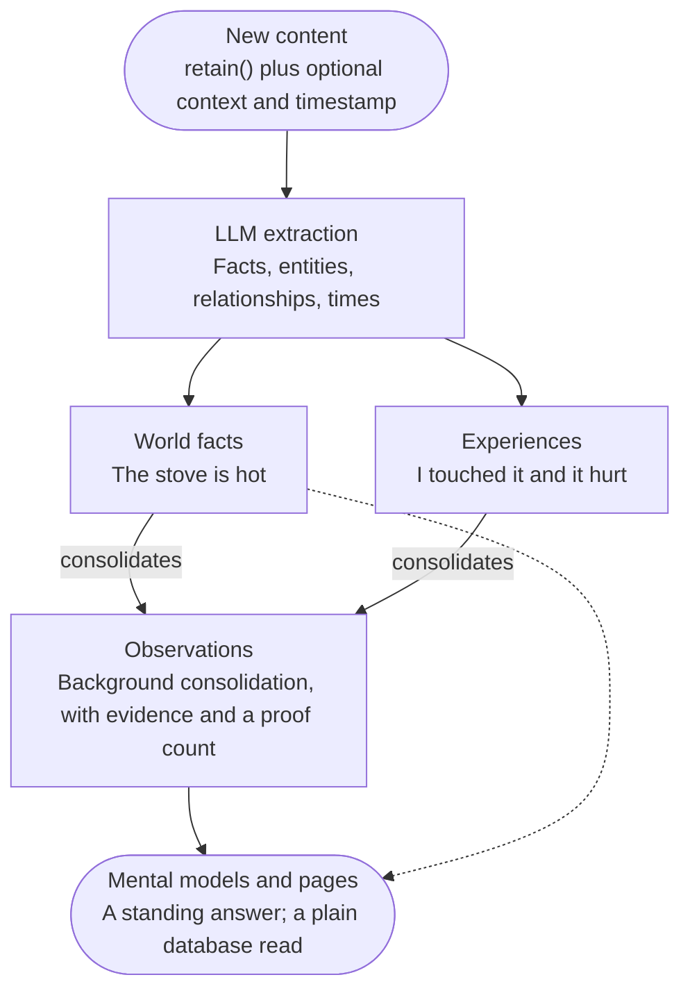
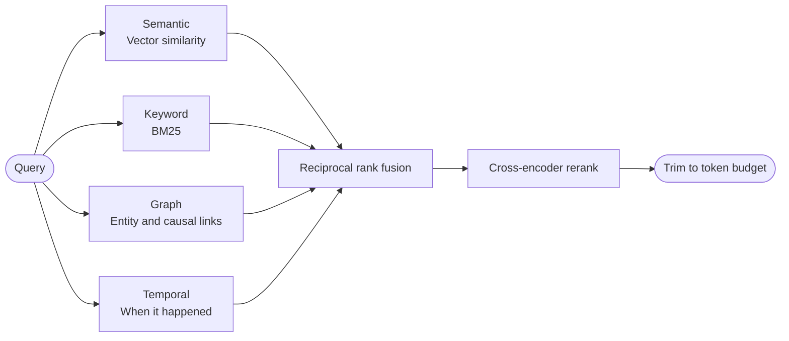

# Hindsight: Agent Memory That Learns

A step-by-step guide to installing Vectorize’s Hindsight, using retain, recall and reflect, and wiring it into an existing agent. Built from Full Stack’s 11-minute tutorial and checked against the current docs, the paper, and the live benchmark page.

**PDF:** [Download this guide (PDF)](guide.pdf)

## Source and how to use this guide

| | |
| --- | --- |
| **Video** | Hindsight - Agent Memory That Learns (Full Tutorial) |
| **Channel** | Full Stack, [www.youtube.com/@full_stackYT](https://www.youtube.com/@full_stackYT) |
| **Published** | 26 Sep 2026 |
| **Length** | 11:35 |
| **Watch** | [youtu.be/_fxrvOrLSvQ](https://youtu.be/_fxrvOrLSvQ) |
| **Repository** | [github.com/vectorize-io/hindsight](https://github.com/vectorize-io/hindsight) |
| **License** | MIT |
| **Docs** | [hindsight.vectorize.io/](https://hindsight.vectorize.io/) |
| **Paper** | [arxiv.org/abs/2512.12818](https://arxiv.org/abs/2512.12818) |
| **Difficulty** | Intermediate. You need Docker or Python, plus an LLM provider. |

Each step below says what to do, how to do it, why it matters, and the mistakes that usually follow. Timestamp links go to the video’s chapter starts, not to individual sentences. YouTube blocked a caption download from this machine (HTTP 429), so the transcript was taken from youtubetotranscript.com, which does not expose per-line times. Commands and version numbers in this guide follow the official docs and GitHub as of 27 Nov 2026, and they are flagged when they have moved on from what the video showed.

| Time | Chapter | Open at |
| --- | --- | --- |
| 0:00 | Cold open | [▶ 0:00](https://youtu.be/_fxrvOrLSvQ?t=0) |
| 0:28 | The problem | [▶ 0:28](https://youtu.be/_fxrvOrLSvQ?t=28) |
| 1:39 | What Hindsight is | [▶ 1:39](https://youtu.be/_fxrvOrLSvQ?t=99) |
| 2:35 | How it works | [▶ 2:35](https://youtu.be/_fxrvOrLSvQ?t=155) |
| 4:44 | Install | [▶ 4:44](https://youtu.be/_fxrvOrLSvQ?t=284) |
| 5:54 | Retain and recall | [▶ 5:54](https://youtu.be/_fxrvOrLSvQ?t=354) |
| 6:44 | Two lines into your agent | [▶ 6:44](https://youtu.be/_fxrvOrLSvQ?t=404) |
| 7:35 | Coding agents and MCP | [▶ 7:35](https://youtu.be/_fxrvOrLSvQ?t=455) |
| 8:34 | The numbers | [▶ 8:34](https://youtu.be/_fxrvOrLSvQ?t=514) |
| 9:36 | What it costs to run | [▶ 9:36](https://youtu.be/_fxrvOrLSvQ?t=576) |
| 10:37 | Recap | [▶ 10:37](https://youtu.be/_fxrvOrLSvQ?t=637) |
| 11:09 | Start here | [▶ 11:09](https://youtu.be/_fxrvOrLSvQ?t=669) |

## The problem the video opens with

> Every chat product on the market has the same disease. The model is brilliant inside one session, then completely blank in the next one.
>
> — Full Stack, 0:28

The usual patch is to chunk the conversation, embed the chunks, fetch the top few, and paste them back into the prompt. That works until you need to tell evidence from a guess, ask what happened last spring, or connect two facts logged months apart. Nothing in a flat retrieval stack understands a date. Nothing consolidates, so the same belief is stored many times, slightly differently, and session 12 is as naive as session 1. A longer context window does not fix this: the history is still pasted in, and you still pay for those tokens on every turn. Hindsight’s pitch is that memory and learning are different problems, and only learning compounds.

## How Hindsight is put together

Hindsight, from Vectorize, is an MIT-licensed agent memory system, written mostly in Python with TypeScript, Rust and other supporting code. The video’s one-line version still holds: most memory systems recall chat history; Hindsight builds a structured model of the world and of the agent’s own experience. Knowledge lives in a bank. One bank is one brain for one user, one agent, or one project. Isolation is strict; nothing leaks between banks. Disposition traits on a bank (skepticism, literalism and empathy, each on a 1–5 scale in the current docs) shape how `reflect` reasons. They do not change what `recall` returns.



| Kind | What it is | Example |
| --- | --- | --- |
| World fact | An objective claim the bank was told | Alice works at Google |
| Experience | Something the agent itself did | I recommended Python to Bob |
| Observation | A belief merged from many facts, with quotes and a proof count | The user preferred React and later switched to Vue |
| Mental model | A standing answer you define once; rewritten as the bank learns | Where does our documentation keep failing customers? |

Three operations run the system. `retain` is how information gets in: an LLM extracts facts, entities, relationships and timestamps, then normalizes entities to a canonical name and wires them into a graph. `recall` is lookup, not reasoning. `reflect` reasons across the bank to answer a question that needs thinking, and can form new connections that persist as observations.



Recall never returns the whole bank. Four searches run in parallel, their lists are merged with reciprocal rank fusion, a cross-encoder re-ranks the winners, and the result is cut to the token budget you set. The prompt stays small no matter how large the bank grows. That last point is the operational reason to prefer this over stuffing a longer window.

## Before you install

!!! warning "Treat every retain as an LLM call, and assume nothing is redacted until you turn that on"

    Every retain uses an external LLM, even when Hindsight itself runs on your machine. Memory Defense is opt-in, per bank, and off by default. It scans against 45 secret and PII patterns and can redact or block a match, but it is not retroactive: memories already stored are left alone. Do not retain production secrets, customer data or credentials into a default bank. The LiteLLM wrapper in the current docs also defaults to Hindsight Cloud unless you pass `hindsight_api_url` for a self-hosted server.

You will need the following within reach.

- Docker, or Python 3 with pip. Kubernetes (Helm) and Hindsight Cloud are also supported, and are covered under Beyond the video.
- An LLM provider. The server supports 25+ providers, including Ollama, LM Studio, llama.cpp, and any OpenAI-compatible endpoint. ChatGPT Plus or Pro (openai-codex), Claude Pro or Max (claude-code), Cursor, and GitHub Copilot can be used without a separate API key.
- On Intel Macs, the slim package or slim image. The full bundle’s local ML wheels are not published for that architecture, and `pip install hindsight-all` can silently backtrack to an old release.
- Disk and time for the first run. The full image pulls local embedder and cross-encoder weights from Hugging Face on first use. The video quotes about 9 GB for the full Docker image; current install docs do not publish a size, so budget a large pull and confirm it on your machine.
- A throwaway bank for the first walk-through. Do not point this at real user data until Memory Defense and bank isolation are configured.

## Step 1. Install a local server

What: start a Hindsight API on port 8888 and the control-plane UI on port 9999. How: Docker is the path the docs recommend. Why: you can browse banks and test queries by hand in the UI before you touch application code. Chapter: [▶ 4:44](https://youtu.be/_fxrvOrLSvQ?t=284)

1. **Choose a route** — Docker with the embedded database (pg0) for a first look, pip (`hindsight-api`) if you do not want Docker, or Hindsight Cloud if you do not want to run a server at all. The embedded database is for development, not production.
2. **Export a provider key, then run the official Docker command** — Publish 8888 and 9999, pass `HINDSIGHT_API_LLM_API_KEY`, and persist the embedded database in a volume. Bind the ports to localhost if this machine is shared.
3. **Confirm both ports** — API at [localhost:8888](http://localhost:8888), UI at [localhost:9999](http://localhost:9999). Use the UI to create a bank and run a test query by hand.
4. **If you are on an Intel Mac, take the slim path instead** — Docs: use `hindsight-api-slim` or `hindsight-all-slim`, with a hosted embeddings and reranker provider or the in-process ONNX backend. ONNX Runtime on Intel Mac supports Python 3.10–3.13; on 3.14 only hosted providers work.
5. **Or install with pip** — `pip install hindsight-api`, set `HINDSIGHT_API_LLM_API_KEY`, and run `hindsight-api`. It creates an embedded database under your home directory. Do not `pip install hindsight`: that name is a different, unrelated project on PyPI.

```bash
export OPENAI_API_KEY=sk-xxx

docker run -it --pull always --name hindsight --restart unless-stopped -p 8888:8888 -p 9999:9999 \
  -e HINDSIGHT_API_LLM_API_KEY=$OPENAI_API_KEY \
  -v hindsight-data:/home/hindsight/.pg0 \
  ghcr.io/vectorize-io/hindsight:latest
```

That command is the current README form, not a verbatim frame from the video. Set `HINDSIGHT_API_LLM_PROVIDER` and `HINDSIGHT_API_LLM_MODEL` if you are not using OpenAI. The pip equivalent is below.

```bash
pip install hindsight-api
export HINDSIGHT_API_LLM_API_KEY=sk-xxx
hindsight-api
```

Common mistakes

- ✗ Installing the full package on an Intel Mac, or accepting a months-old release that pip silently selected.
- ✗ Publishing 8888 and 9999 on a public interface during a first test.
- ✗ Treating pg0 as a production database. Official docs say use external PostgreSQL 14+ with pgvector (or a supported vector extension), or Oracle AI Database 23ai.
- ✗ Assuming no LLM key is required because the server is local. Retain still calls a model.

## Step 2. Retain and recall one person

What: teach one bank a single person, then ask it questions that a vector store usually fumbles. How: install the Python client, retain a dated fact, and recall by meaning and by time. Why: this is the smallest test that shows entity extraction, evidence, and the temporal filter. Chapter: [▶ 5:54](https://youtu.be/_fxrvOrLSvQ?t=354)

1. **Install the client and point it at your server** — `pip install hindsight-client -U`. Clients also exist for Node.js (`@vectorize-io/hindsight-client`), Go, and a CLI.
2. **Retain one sentence, then a dated promotion** — Keep a context label and a timestamp on the second retain. The June query later depends on that timestamp, not on the wording.
3. **Recall what Alice does for a living** — You should get the fact, the entity it belongs to, and where the evidence came from.
4. **Ask what happened in June** — This is the part plain vector search cannot do reliably. If the date was not stored, the temporal arm has nothing to filter on.
5. **Add more ordinary lines and watch the bank thicken** — Entities link, relationships accumulate, and duplicate facts collapse. Recall should get sharper as you add lines, not noisier.

```bash
from hindsight_client import Hindsight

client = Hindsight(base_url="http://localhost:8888")

client.retain(
    bank_id="my-bank",
    content="Alice works at Google as a software engineer",
)
client.retain(
    bank_id="my-bank",
    content="Alice got promoted to senior engineer",
    context="career update",
    timestamp="2025-06-15T10:00:00Z",
)

print(client.recall(bank_id="my-bank", query="What does Alice do?"))
print(client.recall(bank_id="my-bank", query="What happened in June?"))
```

Common mistakes

- ✗ Omitting the timestamp, then blaming recall when a ‘what happened in June’ query misses.
- ✗ Putting every user in one bank with no tags, or the opposite: using tags when you needed a bank per user. Per-user banks are the stronger isolation default; a shared bank with metadata filters is for cross-user analysis.
- ✗ Expecting an observation immediately. Consolidation is asynchronous. A fact you retained seconds ago is not an observation yet.

## Step 3. Drop memory into an existing client

What: stop calling `recall` and `retain` yourself. How: wrap an existing OpenAI or Anthropic client so every call recalls relevant memories first and retains the conversation afterwards. Why: your agent code can stay as it is, and LiteLLM underneath covers 100+ models. Chapter: [▶ 6:44](https://youtu.be/_fxrvOrLSvQ?t=404)

1. **Install the wrapper** — `pip install hindsight-litellm`.
2. **Wrap the client and pass your server URL** — `wrap_openai()` or `wrap_anthropic()`. In the current package, the wrapper defaults to Hindsight Cloud. Pass `hindsight_api_url` set to [localhost:8888](http://localhost:8888) for the server you just started.
3. **Keep one bank per user or session** — Set `bank_id` to a stable identifier such as `user-123`. Banks, recall budgets and fact types can be overridden per call with `hindsight_*` keyword arguments.
4. **Run a normal chat completion** — Ask ‘What do you know about me?’ after a few turns. The memories should come from the bank, not from a hand-built prompt.

```bash
from openai import OpenAI
from hindsight_litellm import wrap_openai

client = wrap_openai(
    OpenAI(),
    bank_id="user-123",
    hindsight_api_url="http://localhost:8888",
)

response = client.chat.completions.create(
    model="gpt-4.1-mini",
    messages=[{"role": "user", "content": "What do you know about me?"}],
)
```

Common mistakes

- ✗ Leaving out `hindsight_api_url` and silently sending memory traffic to Hindsight Cloud.
- ✗ Wrapping a client that already logs raw prompts, including secrets, into the same bank you just created.
- ✗ Using this wrapper when you need explicit control over when memories are stored. In that case the SDK or REST API is the better fit.

## Step 4. Reflect and mental models

What: ask a question that needs thinking, not lookup, and optionally define a standing question the bank keeps answering. How: call `reflect`, then create a mental model for a question you will ask often. Why: `recall` returns memories; `reflect` returns an answer assembled from them. A mental model is a plain database read, with no retrieval and no LLM call at read time, so an agent can boot already knowing what it knows. Chapter: [▶ 5:54](https://youtu.be/_fxrvOrLSvQ?t=354) and the later walk-throughs through [▶ 6:44](https://youtu.be/_fxrvOrLSvQ?t=404)

1. **Ask reflect a question that spans many memories** — Call `reflect` on the bank with a question such as what risks this project is carrying. The point is an answer composed from separate memories, not a paragraph of retrieved text glued together.
2. **Name a mental-model question you actually keep asking** — The video’s example is a support team asking where the documentation keeps failing customers. You define the question once; Hindsight rewrites the answer as new tickets arrive.
3. **Read the model as a database record, not as a search** — If you are doing a lookup on every boot, you have not used this part of the system yet.
4. **Learn pages when you want the same idea as a wiki** — Pages are mental models with the mechanics hidden: folders, search, and a markdown tree you can project onto disk with `hindsight fs mount`. The video mentions this; the current docs go further.

```bash
response = client.reflect(
    bank_id="my-bank",
    query="What should I know about Alice?",
)
print(response)
```

Common mistakes

- ✗ Calling `reflect` for a simple fact lookup. Docs put simple lookup and tight latency on `recall` (tens to hundreds of milliseconds) and multi-step reasoning on `reflect` (seconds).
- ✗ Expecting a new fact to change an observation or a mental model in the same second you retained it. Both update in the background.
- ✗ Assuming disposition traits change retrieval. They shape `reflect` only.

## Step 5. Coding agents and MCP

What: give the coding agents already on the machine a per-repository bank, or expose retain, recall and reflect as MCP tools. How: one npx installer detects agents and wires each one natively; every Hindsight server also ships an MCP endpoint per bank, enabled by default. Why: yesterday’s decisions can survive into today’s session without you pasting a recap. Chapter: [▶ 7:35](https://youtu.be/_fxrvOrLSvQ?t=455)

1. **Install into every detected agent, or just one** — `npx @vectorize-io/hindsight-coding-agents install all`, or `install claude-code` for a single harness. Current docs list Claude Code, Codex CLI, Cursor CLI, GitHub Copilot CLI, opencode and several others.
2. **Let it build a bank from git history and past sessions** — Each repository gets its own bank, injected before the agent starts work. There is no separate ingest command in the current coding-agents docs.
3. **Or point any MCP client at the built-in endpoint** — `http://localhost:8888/mcp/{bank_id}/`. Retain, recall and reflect become tools.
4. **Use a first-class package when you already have a framework** — The project ships integrations for LangChain and LangGraph, CrewAI, n8n, Zapier, Obsidian, ChatGPT, Pydantic AI, Google ADK, the OpenAI Agents SDK, the Vercel AI SDK, and more. The auto-caption ‘Graph Crew AI’ in the transcript is a garble of LangGraph and CrewAI.

```bash
npx @vectorize-io/hindsight-coding-agents install all
# or one agent:
npx @vectorize-io/hindsight-coding-agents install claude-code

# MCP, one endpoint per bank, enabled by default:
# http://localhost:8888/mcp/{bank_id}/
```

Common mistakes

- ✗ Wiring a coding agent to a shared bank that already holds another project’s decisions.
- ✗ Pasting API keys or `.env` contents into a session that is being retained. Turn Memory Defense on for any bank that sees real tool output.
- ✗ Expecting the installer to replace review. Memory of a bad decision will be recalled with as much confidence as a good one until you correct it.

## Beyond the video

These are additions from the current official docs, the paper, and production guidance. They are not in the 11-minute tour, or they have changed since 26 Sep 2026.

- The current release is v1.3.0, published 24 Nov 2026. The video was shot against the 0.10 line (v0.10.0 on 14 Sep 2026, v0.10.1 on 21 Sep 2026).
- GitHub counts as of 27 Nov 2026: 63,814 stars, 7,411 forks, 146 open issues, and 291 contributors on the anonymous-inclusive contributors API. The video said 29,600 stars and 263 contributors.
- Turn Memory Defense on before real data. Existing memories are not re-scanned when you enable it. Docs: [hindsight.vectorize.io/developer/memory-defense](https://hindsight.vectorize.io/developer/memory-defense)
- Settings are hierarchical: global environment variables, then per tenant, then per bank. One server can serve several products without settings leaking.
- For production, use external PostgreSQL 14+ with pgvector (or pgvectorscale, vchord, or AlloyDB ScaNN), or Oracle AI Database 23ai. Watch Prometheus metrics, and use the admin CLI for migrations and stuck operations. Webhooks fire on retain, consolidation and refresh, so the rest of the stack does not need to poll.
- Helm is a first-class install: `helm install hindsight oci://ghcr.io/vectorize-io/charts/hindsight`. The video only walks Docker, pip and Cloud.
- Decision models (`hs-decide-1-flash`, plus `hs-rerank-1` and `hs-embed-1`) shipped after the video, in a 3 Nov 2026 launch post. They take over small judgments inside recall, consolidation, reflect and page refresh so fewer of those calls hit your LLM.
- The LLM wrapper defaults to Hindsight Cloud. Always pass `hindsight_api_url` for a self-hosted server.
- Do not `pip install hindsight`. That PyPI name is a different project. The packages you want are `hindsight-api`, `hindsight-client`, `hindsight-all` (or the `-slim` variants), and `hindsight-litellm`.

## The numbers, checked

The video says Hindsight is number one on the agent memory benchmark and leads every dataset on it. It then quotes 94.6% on LongMemEval, 92% on LoCoMo, 86.6% on PersonaMem 32K, 75% at 100,000 tokens, and 73.9% at one million tokens. Those first three figures match the vendor’s later Agent Memory Benchmark results, not the December 2025 paper. The long-context pair is BEAM, and the 100K figure is slightly off.

| Claim | Video | What to cite instead |
| --- | --- | --- |
| LongMemEval | 94.6% | Paper (arXiv:2512.12818): 83.6% with GPT-OSS-20B, 89.0% with OSS-120B, 91.4% with Gemini-3 as the final answer generator (S setting). The 94.6% figure is the later LongMemEval-S score on the vendor site and in the March 2026 AMB post. |
| LoCoMo | 92% | Paper: up to 89.61% (vs. 75.78% for the strongest prior open system cited there). 92.0% is the later AMB figure. The site spells the row ‘LoComo’. |
| PersonaMem 32K | 86.6% | Matches the current vendor site and the March 2026 AMB post. Not a headline number in the original paper abstract. |
| 100K / 1M tokens | 75% and 73.9% | These are BEAM tiers, not LongMemEval. The 2 Apr 2026 Hindsight BEAM post lists 73.4% at 100K (not 75%) and 73.9% at 1M. At 10M the same post lists 64.1%. |
| 20B open model vs. full context | 39% to 83.6%, beating full-context GPT-4o; scale-up 91.4% | Confirmed in the paper abstract and in Vectorize’s 16 Dec 2025 post. Full-context GPT-4o is listed there at 60.2%. The 91.4% scale-up uses Gemini-3 for answer generation, not a larger open 20B model alone. |
| Outside reproduction | Virginia Tech Sanghani Center and The Washington Post ran the scores; other vendor scores are self-reported | Those institutions are named affiliations of the paper’s co-authors (Gaurav Srivastava, Xuan Wang, Naren Ramakrishnan at Virginia Tech; Andrew Neeser at The Washington Post). That is collaborator reproduction, not an arms-length third-party audit. The paper itself says several competitor baselines were taken from other reports and were not independently reproduced. |

| Item | Value |
| --- | --- |
| Full-context OSS-20B (paper) | 39.0% |
| Full-context GPT-4o (paper) | 60.2% |
| Hindsight OSS-20B (paper) | 83.6% |
| Hindsight Gemini-3 (paper) | 91.4% |
| Hindsight LongMemEval-S (site, later) | 94.6% |

Read the bars as two generations of results, not as one experiment. The first four are the paper’s LongMemEval-S table. The last bar is the later vendor-site figure. Hindsight scores used a GPT-OSS-120B LLM-as-a-judge; some baselines used a different judge. Live tables: [benchmarks.hindsight.vectorize.io/](https://benchmarks.hindsight.vectorize.io/) and the paper at [arxiv.org/abs/2512.12818](https://arxiv.org/abs/2512.12818)

## What it costs to run

The video is unusually direct here, and the official hardware table still agrees in outline. Every retain calls an LLM, and that model is always external, even when Hindsight runs locally. In production traffic the local reranker is the bottleneck: give it a GPU, or move reranking to a hosted provider. First run downloads the embedder and cross-encoder from Hugging Face. The video also says this is overkill if your agent answers one question from one document; plain retrieval is enough in that case. Chapter: [▶ 9:36](https://youtu.be/_fxrvOrLSvQ?t=576)

| Component | Minimum RAM | Recommended | Notes |
| --- | --- | --- | --- |
| API, full image | 1.5 GB | 2 GB | Matches the video’s ‘API asks for 2 GB’. Loads a local embedder and MiniLM cross-encoder. |
| API, slim image | 512 MB | 1 GB | No local models; needs external embeddings and reranking. |
| Control-plane UI | 128 MB | 256 MB | Port 9999. |
| PostgreSQL | 512 MB | 1 GB+ | The video’s extra gigabyte. Scales with memories and indexes. |
| Full Docker image on disk | Video: about 9 GB | Confirm locally | Not published as a current figure in the install guide I opened. Budget the first Hugging Face download on top. |

## Industry standards and sources

The video does not walk compliance or security standards. These are the references this guide used to check the architecture, the scores, and the production advice.

| Standard or source | Why it matters here | Where |
| --- | --- | --- |
| OWASP Top 10 for LLM Applications | Memory stores amplify LLM01 Prompt Injection, LLM02 Sensitive Information Disclosure, LLM04 Data and Model Poisoning, and LLM08 Vector and Embedding Weaknesses. Turn on Memory Defense, isolate banks, and do not retain secrets. | [owasp.org/www-project-top-10-for-large-language-model-applications/](https://owasp.org/www-project-top-10-for-large-language-model-applications/) |
| NIST AI Risk Management Framework (AI 100-1) | Govern, Map, Measure, and Manage apply once an agent keeps durable beliefs about people. Log what was retained, who can recall it, and how a belief is updated. | [www.nist.gov/itl/ai-risk-management-framework](https://www.nist.gov/itl/ai-risk-management-framework) |
| Reciprocal rank fusion | The documented merge step for the four recall arms. Classic IR method: Cormack, Clarke and Buettcher, SIGIR 2009. | [dl.acm.org/doi/10.1145/1571941.1572114](https://dl.acm.org/doi/10.1145/1571941.1572114) |
| LongMemEval (Wu et al., 2024) | The long-horizon conversational benchmark behind the 83.6 / 91.4 / later 94.6 figures. | [arxiv.org/abs/2410.10870](https://arxiv.org/abs/2410.10870) |
| LoCoMo (Maharana et al., 2024) | The very long-term conversation benchmark behind the 89.61 / later 92 figures. | [arxiv.org/abs/2402.17753](https://arxiv.org/abs/2402.17753) |
| Hindsight is 20/20 (arXiv:2512.12818) | Architecture and the original LongMemEval and LoCoMo tables. Also published as an ACL 2026 system demonstration. | [arxiv.org/abs/2512.12818](https://arxiv.org/abs/2512.12818) |
| Model Context Protocol | The MCP endpoint the video enables by default is a standard tool interface, not a Hindsight-only protocol. | [modelcontextprotocol.io/](https://modelcontextprotocol.io/) |
| PostgreSQL 14+ and pgvector | The default production store. Oracle AI Database 23ai is the documented enterprise alternative. | [hindsight.vectorize.io/developer/storage](https://hindsight.vectorize.io/developer/storage) |

## Troubleshooting

| What you see | Likely cause | What to try |
| --- | --- | --- |
| Recall works, but observations or mental models look stale | Consolidation and rewrites run in the background | Wait, then re-read. `reflect` is documented to treat stale observations carefully, but a fact from a few seconds ago is not an observation yet. |
| ‘What happened in June?’ returns nothing useful | The retain had no timestamp, or the query arm has no time window | Pass `timestamp` (and `context`) on retain. Check the fact in the UI. |
| pip installs an old release on an Intel Mac, or the full wheel fails | No current Intel-Mac wheels for the full ML stack | Install `hindsight-api-slim` or `hindsight-all-slim` and follow the Intel Mac section of the install guide. |
| The wrapper ‘works’ but the local UI stays empty | `hindsight_litellm` defaults to Hindsight Cloud | Pass `hindsight_api_url` set to [localhost:8888](http://localhost:8888). |
| `pip install hindsight` installs the wrong project | That name is taken on PyPI | Use `hindsight-api`, `hindsight-client`, or `hindsight-all`. |
| First start is slow, or recall is the bottleneck | Model download, or the local cross-encoder on CPU | Budget the Hugging Face pull. For production, give the reranker a GPU or point `HINDSIGHT_API_RERANKER_PROVIDER` at a hosted reranker. |
| Retain returns 422 after you enable Memory Defense | The bank policy is set to `block`, and a pattern matched | Inspect the pattern, switch that bank to `redact`, or add an `exclude` list. Defense is not retroactive. |
| One user’s memories appear in another user’s answer | A shared bank without filters, or a reused `bank_id` | Use one bank per user for isolation, or tag on retain and filter on recall. |
| Ports 8888 or 9999 already in use | Another Hindsight container or local process | Stop the other process, or remap the published ports. |

## Where the video departs, and what is unverified

The walk-through of retain, recall, reflect, the four retrieval arms, bank isolation, Memory Defense as opt-in, the wrapper, MCP, and the hardware outline all match the current official docs. The gaps are mostly numbers, framing, and things that shipped later.

- Version and popularity figures are outdated, which is expected: 0.10 and 29,600 stars as of 26 Sep 2026, versus v1.3.0 and 63,814 stars as of 27 Nov 2026. ‘Version 0.10 shipped four days ago’ is also loose: v0.10.0 was 12 days before the video, v0.10.1 was 5 days before.
- The headline accuracy figures in the video are the later vendor AMB numbers, not the paper table. That is easy to miss if you open arXiv:2512.12818 and look for 94.6% or 92%.
- The 75% at 100,000 tokens is not the published BEAM 100K score (73.4%). The 73.9% at 1M is correct for BEAM.
- ‘Independently reproduced by Virginia Tech and The Washington Post’ describes work by named co-authors of the Vectorize paper, not an outside audit. The paper is more careful than the README and the video about competitor baselines that were not re-run.
- ‘Leads every single dataset’ is a claim about the vendor’s own leaderboard. Treat it as vendor-reported unless you re-run the public harness yourself. A later independent write-up has also noted that related benchmark repositories live in the Vectorize GitHub organization.
- The full Docker image size of about 9 GB was not confirmed against a current public manifest in this guide. Verify with `docker images` after the pull.
- Auto-captions garble a few names: ‘CodeX, Cloud Code’ are Codex and Claude Code; ‘Graph Crew AI’ is LangGraph and CrewAI; ‘sang Honey Center’ is the Sanghani Center.
- Unverified from this pass: the exact provider count behind ‘25 providers’ and the exact integration count behind ‘60+’ on any given day (the README still uses both phrases). Also unverified: any cost-per-retain figure, because that depends on the model you point it at.

## Final checklist

*Work through these as you install. Status as of 27 Nov 2026: not started on this page; the ticks cannot be changed here.*

- [ ] Watched, or jumped, the chapter that matches the step you are on
- [ ] Picked Docker, pip or Cloud, and used a slim package on an Intel Mac
- [ ] Server is up: API on 8888, UI on 9999, ports not exposed more widely than needed
- [ ] Created a throwaway bank and retained a fact with a timestamp
- [ ] Recalled by meaning and by date, and confirmed the evidence in the UI
- [ ] Wrapped a client with `hindsight_api_url` pointed at that server, or used the SDK explicitly
- [ ] Tried `reflect` on a question that needs more than a lookup
- [ ] Enabled Memory Defense before any real user or repository data
- [ ] Gave each user, agent or repository its own bank
- [ ] Budgeted LLM cost on every retain, RAM, the first model download, and reranker capacity
- [ ] Read the paper table and the current benchmark page, and did not treat co-author reproduction as an outside audit
- [ ] Skipped Hindsight if the job is one question over one document

## Links

- [Hindsight - Agent Memory That Learns (Full Tutorial)](https://youtu.be/_fxrvOrLSvQ) — YouTube · Full Stack
- [vectorize-io/hindsight](https://github.com/vectorize-io/hindsight) — GitHub
- [Hindsight documentation](https://hindsight.vectorize.io/) — hindsight.vectorize.io
- [Installation guide](https://hindsight.vectorize.io/developer/installation) — hindsight.vectorize.io
- [Memory Defense](https://hindsight.vectorize.io/developer/memory-defense) — hindsight.vectorize.io
- [Hindsight is 20/20](https://arxiv.org/abs/2512.12818) — arXiv:2512.12818
- [Live benchmark tables](https://benchmarks.hindsight.vectorize.io/) — benchmarks.hindsight.vectorize.io
- [OWASP Top 10 for LLM Applications](https://owasp.org/www-project-top-10-for-large-language-model-applications/) — owasp.org
- [NIST AI Risk Management Framework](https://www.nist.gov/itl/ai-risk-management-framework) — nist.gov

Guide built on 27 Nov 2026 from the Full Stack tutorial, the Hindsight README and install docs, arXiv:2512.12818, and the public benchmark pages cited above. Commands can change with new releases.

