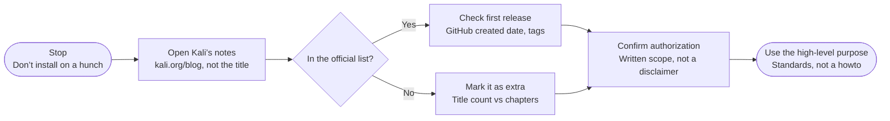

# Kali 2026.1 New Tools, Fact-Checked: A Verification Guide

Based on Ministry Of Hacking’s “8 New Kali Linux Tools Released in 2026 That Nobody Is Talking” (14:38, uploaded 2 June 2026). Kali 2026.1 did add eight tools to its network repositories on 24 March 2026, but most are older projects newly packaged, the video then covers two extras that were not in that official eight, and the claim that nobody is talking about them does not hold. This guide verifies each claim, maps the tools to standards, and stays at a high level: it does not include attack procedures, payloads, or reproduction steps.

**PDF:** [Download this guide (PDF)](guide.pdf)

## At a glance

| Metric | Value | Detail |
| --- | --- | --- |
| Official 2026.1 tools | **8** | Named in Kali’s 24 March 2026 notes |
| Tools in the video | **10** | The title says eight; two extras follow |
| Runtime | **14:38** | 878 seconds; chapters start at official marks |
| After the release | **10 wk** | Uploaded 2 June 2026, after March coverage |

| | |
| --- | --- |
| **Video** | 8 New Kali Linux Tools Released in 2026 That Nobody Is Talking |
| **Channel** | Ministry Of Hacking · uploaded 2 June 2026 · 14:38 |
| **Watch** | [youtu.be/PvtJkbnU-3M](https://youtu.be/PvtJkbnU-3M) |
| **The video’s promise** | Kali “just dropped 8 brand-new tools in 2026” that “most people in the cybersecurity community haven’t even heard of yet.” |
| **This guide’s verdict** | The official eight-tool list is real. “Brand-new” and “nobody is talking” are not. Several projects date to 2015–2022, and the March 2026 release was already covered by Kali and the trade press. |

!!! warning "Read this first"

    Several of these programs are offensive security tools. This page is a fact-check and a legal-use briefing, not a howto. It does not include attack procedures, payloads, scanner command lines, or steps for standing up a rogue access point, a command-and-control server, or an AI-driven exploit loop. Using any of these tools against a system, network, or person you are not explicitly authorized to test is illegal.

## How to verify a Kali tools roundup

*A working method before you treat a “new Kali tools” video as a shopping list or a skill path. Timestamp links use official YouTube chapter starts unless noted.*

1. **Start from the official notes, not the title** — What: Kali publishes a “New Tools in Kali” list with every quarterly release. How: Open the matching post on [www.kali.org/blog/](https://www.kali.org/blog/) and the tool pages on [www.kali.org/tools/](https://www.kali.org/tools/). Why: A YouTube title is marketing. The 2026.1 post of 24 March 2026 is the primary source for “eight new tools.” Common mistake: Treating the video description as equivalent to the release notes.
2. **Split “new in Kali’s repos” from “new software”** — What: Packaging a program into kali-rolling is not the same as inventing it. How: Check the upstream repository’s created date and first tagged release, then the Kali package tracker. Why: The video’s “released in 2026” line is easy to hear as “written in 2026.” Fluxion, XSStrike and GEF are much older. Common mistake: Quoting the title as if the projects themselves shipped in 2026.
3. **Count the tools against the official eight** — What: The title and the official notes both say eight; the chapters list ten. How: Write the official eight down, then tick which chapters match. Why: Pentest Copilot and Betterleaks are discussed after GEF and were not in the 2026.1 highlighted eight, nor in the 2026.2 or 2026.3 new-tool lists. Common mistake: Calling every chapter a “Kali 2026.1 new tool.”
4. **Confirm written authorization before any use** — What: NIST SP 800-115 and the Penetration Testing Execution Standard start with permission, rules of engagement, and scope. How: A signed statement of work that names the systems, the techniques allowed, and what is out of scope. A YouTube “educational purposes” disclaimer is not permission. Why: Several tools in this video are useful only as active tests (wireless social engineering, a C2 framework, an exploitation-framework bridge). Common mistake: Pointing a scanner or a wireless tool at a network you do not own because it is “just research.”
5. **Prefer defensive and purple-team paths on systems you own** — What: Atomic Operator and a secrets scanner can be used to test your own detections and to find credentials accidentally committed to your own repositories. How: Run authorized Atomic Red Team tests in a lab you control, and scan your own repos in CI. Why: That is the use that maps cleanly to MITRE ATT&CK coverage and to standard secrets-management practice. Common mistake: Jumping first to the tools whose only ordinary use is attacking someone else’s environment.
6. **Treat AI-to-exploitation bridges as high risk** — What: MetasploitMCP and Pentest Copilot connect a language model to security tooling. How: Read the actual project’s safety model, and do not assume a later official server’s defaults apply to an earlier community package. Why: OWASP’s LLM Top 10 flags excessive agency and supply-chain risk when a model can take actions. Common mistake: Hearing “AI-integrated” as automatically safer or more precise than a human operator.
7. **Check whether anyone was already talking about it** — What: The subtitle is “that nobody is talking.” How: Search the official Kali blog, trade press (BleepingComputer, Help Net Security, 9to5Linux all covered 2026.1 in March), and threat-intel notes for C2 frameworks. Why: A claim like that is a slogan, not a measurement. Common mistake: Repeating “underrated” or “secret” after a tool has been in public repos and news posts for months or years.
8. **Map the claim to a standard, then stop** — What: A verified purpose is enough for this kind of roundup. How: XSS maps to OWASP WSTG and the OWASP Top 10, Atomic Operator to MITRE ATT&CK, secrets scanning to CISA and NIST credential guidance. Why: You do not need a reproduction procedure to decide whether a packaging announcement was accurate. Common mistake: Following a tools video into a hands-on attack walkthrough on a target that was never in scope.

## Official eight vs the video’s ten

Kali’s 2026.1 notes are unambiguous: eight programs were added to the network repositories, alongside 25 new packages in total, 9 removals, 183 updates, and a kernel bump to 6.18. The video’s own early chapters agree that 2026.1 included eight new tools ([▶ 0:45](https://youtu.be/PvtJkbnU-3M?t=45)), then continue through ten named projects.

| Tool | Chapter | In official 8? | Upstream first appeared |
| --- | --- | --- | --- |
| Fluxion | [▶ 1:38](https://youtu.be/PvtJkbnU-3M?t=98) | Yes | GitHub project from 2017 |
| AdaptixC2 | [▶ 3:06](https://youtu.be/PvtJkbnU-3M?t=186) | Yes | Public repo, August 2024 |
| MetasploitMCP | [▶ 4:24](https://youtu.be/PvtJkbnU-3M?t=264) | Yes | GH05TCREW project, April 2025 |
| XSStrike | [▶ 5:38](https://youtu.be/PvtJkbnU-3M?t=338) | Yes | GitHub project from 2017 |
| SSTImap | [▶ 6:55](https://youtu.be/PvtJkbnU-3M?t=415) | Yes | v1.0 in 2022 |
| WPProbe | [▶ 8:15](https://youtu.be/PvtJkbnU-3M?t=495) | Yes | First release, February 2025 |
| Atomic Operator | [▶ 9:18](https://youtu.be/PvtJkbnU-3M?t=558) | Yes | Executor in 2021; Atomic Red Team in 2017 |
| GEF | [▶ 10:23](https://youtu.be/PvtJkbnU-3M?t=623) | Yes | GitHub project from 2015 |
| Pentest Copilot | [▶ 11:33](https://youtu.be/PvtJkbnU-3M?t=693) | No | bugbasesecurity repo, March 2025 |
| Betterleaks | [▶ 12:48](https://youtu.be/PvtJkbnU-3M?t=768) | Not in the eight | A Kali package exists; not in the highlighted 2026.1, 2026.2 or 2026.3 lists |

| Item | Value |
| --- | --- |
| Official 2026.1 eight, older than 2024 | 5 |
| Official eight, first seen 2024–2025 | 3 |
| In the video, not in the official eight | 2 |

## Tool by tool

*What each tool is, why Kali added it, and what the video oversells. No usage or reproduction steps.*

## Fluxion

Watch [▶ 1:38](https://youtu.be/PvtJkbnU-3M?t=98). Kali describes Fluxion as a security auditing and social-engineering research tool. The video correctly places it in the wireless-auditing category and notes that it relies on social engineering rather than a classic brute-force password guess. The official package page is [www.kali.org/tools/fluxion/](https://www.kali.org/tools/fluxion/).

- Why Kali added it: it is one of the eight programs listed in the 2026.1 notes. Packaging is new; the FluxionNetwork project dates to 2017, and the technique class is older still.
- Common mistakes: treating “now in Kali” as permission to test a neighbor’s or a café’s Wi-Fi; leaving wireless and social-engineering techniques out of the written rules of engagement, then running them anyway; calling it a 2026 invention.
- Beyond the video: many organizations explicitly exclude rogue-access-point and captive-portal tests unless the statement of work names them. This class of test is legally sensitive in the United States and elsewhere. This guide does not describe how to perform it.

## AdaptixC2

Watch [▶ 3:06](https://youtu.be/PvtJkbnU-3M?t=186). Kali’s one-line description is an “extensible post-exploitation and adversarial emulation framework.” That matches the project’s own framing of authorized red-team use. The public GitHub repository Adaptix-Framework/AdaptixC2 was created on 21 August 2024. Documentation lives at the project’s GitBook.

- Why Kali added it: it is in the official eight. Relative to Fluxion or GEF, this one is actually recent.
- Common mistakes: hearing only the “professional red team” pitch and missing that open-source C2 frameworks are also used by criminals; standing one up outside a tightly scoped, authorized engagement.
- Beyond the video: Palo Alto Networks Unit 42 published AdaptixC2 indicators on 20 May 2025, and later 2025 reporting described use by groups linked to ransomware operations. Defenders should treat it as a tracked command-and-control family, not as an obscure lab toy. The video does not mention that criminal use.

## MetasploitMCP

Watch [▶ 4:24](https://youtu.be/PvtJkbnU-3M?t=264). Kali packaged a project called MetasploitMCP, documented at [www.kali.org/tools/metasploitmcp/](https://www.kali.org/tools/metasploitmcp/). The packaged upstream is the community repository GH05TCREW/MetasploitMCP, created on 13 April 2025. A git snapshot dated 5 February 2026 is what entered kali-rolling around 6 February 2026. It is an MCP server that sits in front of the Metasploit Framework.

- Why Kali added it: it is in the official eight, and MCP-based tool access was a live topic in 2025–2026.
- Common mistakes: assuming this package is Rapid7’s later first-party server; assuming dangerous actions are off by default because a different server made that choice; letting a model expand scope without a human gate.
- Beyond the video: Rapid7 shipped its own Metasploit MCP server, msfmcpd, with Metasploit Framework 6.5 on 30 July 2026 — after this video. That official server documents a dangerous-actions gate that is off unless an operator turns it on. The Kali 2026.1 package is the earlier community project, not that later official binary. Do not conflate the two, and do not treat “AI plus Metasploit” as a safe default.

## XSStrike

Watch [▶ 5:38](https://youtu.be/PvtJkbnU-3M?t=338). Kali calls XSStrike an “advanced XSS scanner.” The s0md3v/XSStrike repository dates to 2017 and has been a well-known open-source project for years. Official package documentation: [www.kali.org/tools/xsstrike/](https://www.kali.org/tools/xsstrike/).

- Why Kali added it: packaging a widely used scanner into the official repos, not introducing a new vulnerability class.
- Common mistakes: calling it unheard-of in 2026; treating a scanner finding as a confirmed, exploitable bug without manual review; pointing it at a site that is not in a signed scope, including in a bug-bounty program whose rules forbid that scanner or that path.
- Beyond the video: XSS testing belongs under OWASP WSTG and OWASP Top 10 (Injection / XSS), with a preference for fixing encoding, templating, and content-security policy rather than collecting scanner trophies. This guide does not include payloads or bypass recipes, including any “WAF bypass” walkthrough the video alludes to.

## SSTImap

Watch [▶ 6:55](https://youtu.be/PvtJkbnU-3M?t=415). Kali describes SSTImap as an automatic server-side template injection detection tool with an interactive interface ([www.kali.org/tools/sstimap/](https://www.kali.org/tools/sstimap/)). The vladko312/SSTImap project published a v1.0 in 2022. SSTI is a real vulnerability class and, when present, can be severe.

- Why Kali added it: to package a dedicated SSTI checker; the 2026.1 notes do not claim the project was invented that year.
- Common mistakes: treating “can lead to remote code execution” as a howto; testing template injection on applications you do not have written permission to assess.
- Beyond the video: developers reduce this risk with sandboxed template engines, least privilege in the rendering process, and not passing unsanitized user input into templates. OWASP’s guidance on injection and template misuse is the defensive reference. This guide does not describe how to exploit SSTI.

## WPProbe

Watch [▶ 8:15](https://youtu.be/PvtJkbnU-3M?t=495). WPProbe is a WordPress plugin enumeration tool, and of the official eight it is one of the genuinely recent projects: Chocapikk/wpprobe was created on 9 February 2025, with v0.1.0 tagged on 11 February 2025. Kali’s bug 0009201 requested the package and was resolved in 2026.1.

- Why Kali added it: a maintained, reasonably new enumerator for a very common CMS, added after an upstream request.
- Common mistakes: enumerating plugins on a WordPress site you do not have permission to test; treating a plugin name as proof of a CVE without checking versions and the actual advisory.
- Beyond the video: site owners should keep an inventory of installed plugins, remove what they do not need, and patch what they keep. That defensive work does not require this tool. WordPress’s own site health and plugin screens, plus a software bill of materials, are the starting point.

## Atomic Operator

Watch [▶ 9:18](https://youtu.be/PvtJkbnU-3M?t=558). Kali’s description is accurate: it executes Atomic Red Team tests across operating-system environments. The tests themselves are mapped to MITRE ATT&CK. The executor project (swimlane/atomic-operator) dates to 20 July 2021; Red Canary’s Atomic Red Team library has been public since 2017 ([github.com/redcanaryco/atomic-red-team](https://github.com/redcanaryco/atomic-red-team)).

- Why Kali added it: it is the packaging highlight that most clearly supports purple-team and detection-engineering work.
- Common mistakes: running ATT&CK tests on production systems without change control; confusing “the executor is new in Kali” with “Atomic Red Team is new.”
- Beyond the video: this is the strongest defensive use on the list. Run only on systems you own or are authorized to assess, in a lab when you can, and use the results to see whether your logging and detections actually fire. That is aligned with MITRE ATT&CK and with NIST’s emphasis on testing security controls, not with a public attack demo.

## GEF

Watch [▶ 10:23](https://youtu.be/PvtJkbnU-3M?t=623). GEF (GDB Enhanced Features) is a GDB plugin that improves the debugging interface. hugsy/gef has been on GitHub since 2015 and is standard reading in many binary-analysis courses. Kali’s short description is a “modern experience for GDB with advanced debugging capabilities.”

- Why Kali added it: packaging a long-standing debugger helper, not unveiling a secret 2026 tool.
- Common mistakes: describing GEF as something “nobody is talking about”; treating a nicer debugger as an exploit recipe.
- Beyond the video: GEF is a productivity layer on GDB. Using a debugger on software you are authorized to analyze is ordinary engineering. This guide does not cover exploit development.

## Pentest Copilot

Watch [▶ 11:33](https://youtu.be/PvtJkbnU-3M?t=693). The video presents Pentest Copilot as an AI assistant that helps plan and reason through assessments. The open-source project bugbasesecurity/pentest-copilot was created on 8 March 2025. It is a browser-based agent that can connect to a Kali environment. It was not one of Kali’s eight 2026.1 tools, and it does not appear in the 2026.2 (29 June 2026) or 2026.3 (26 October 2026) new-tool lists either.

- Why it is in the video: as a tenth, AI-themed add-on after the official eight. That is editorial, not a Kali packaging announcement.
- Common mistakes: listing it as a “Kali 2026.1 new tool”; letting an agent run tools autonomously against a live target without a human reviewing each action and the scope.
- Beyond the video: the project’s own disclaimer limits it to authorized testing. An agent that can install tools and iterate on its own is an excessive-agency risk under the OWASP LLM Top 10. It is not a substitute for a methodology such as PTES or OWASP WSTG.

## Betterleaks

Watch [▶ 12:48](https://youtu.be/PvtJkbnU-3M?t=768). The video describes Betterleaks as a secrets scanner for API keys and credentials, and claims better false-positive handling than TruffleHog. A package named golang-github-betterleaks-betterleaks is present on the Kali package tracker, but Betterleaks was not in the official 2026.1 eight, nor in the highlighted new-tool lists for 2026.2 or 2026.3.

- Why it is in the video: secrets exposure is a real and common finding. The editorial choice is understandable; the “official eight” framing is not accurate for this tool.
- Common mistakes: repeating the “better than TruffleHog” claim without a published comparison; scanning other people’s repositories or web apps without authorization.
- Beyond the video: scanning your own repositories and CI artifacts for accidentally committed secrets is a standard defensive practice. GitHub secret scanning, Gitleaks, TruffleHog, and pre-commit hooks are the widely documented options. The video’s accuracy claim versus TruffleHog is unverified in this guide. If a secret is found in your own repo, rotate it; do not leave it “for later.”

## Where the video departs from best practice

- The title says Kali released eight brand-new tools in 2026 that nobody is talking about. The official list of eight is real. “Brand-new” is true only as packaging. “Nobody is talking” is false: Kali’s own blog, BleepingComputer, Help Net Security and 9to5Linux all covered the 2026.1 tools in late March 2026, weeks before this 2 June upload.
- The spoken framing, per a public chapter summary, also calls them “ten powerful, underrated” tools ({V}25) after acknowledging the official eight ({V}45). The video never clearly labels Pentest Copilot and Betterleaks as extras.
- Several tools are described in operational attack language (rogue access points, leftover C2 sessions, WAF bypass, remote code execution) without a matching briefing on rules of engagement, logging, or what is out of scope. NIST SP 800-115 and PTES put that briefing first.
- AdaptixC2 is presented only as a professional red-team framework. By June 2026, public threat-intel notes had already documented real-world abuse. A responsible roundup would tell defenders it is being tracked.
- MetasploitMCP is presented as “the” AI bridge to Metasploit in an official Kali release. The packaged project is a community MCP server from 2025, not Rapid7’s later official msfmcpd with a documented default-off dangerous-actions gate.
- The description points at [www.kali.org/blog/](https://www.kali.org/blog/) generally, not at the specific 2026.1 post, which makes it easier to miss the official eight-tool wording.

## Common mistakes

- Using any of these tools on a network, application, or wireless environment you do not have written permission to test.
- Hearing “now in Kali” as “safe,” “legal,” or “new software.” Kali is a packaging distribution. Authorization still has to be written down.
- Repeating “nobody is talking about these” after the official release notes and multiple news posts already listed the same eight tools.
- Counting Pentest Copilot or Betterleaks as part of Kali’s 2026.1 eight.
- Connecting a language model to an exploitation framework and assuming a safety gate you have not read, or that belongs to a different server.
- Running purple-team tests on production without change control, or skipping the step where you check whether your detections actually fired.
- Following a tools video into payloads, bypasses, or C2 operator procedures. That is not how you verify a packaging claim, and it is not what this guide provides.

## Beyond the video

- Read the 2026.1 notes in full, not just the tools list. The same release added a 2026 theme, a BackTrack mode for kali-undercover, and a known-issue warning about the Software Defined Radio metapackage.
- Later releases added different tools: 2026.2 (29 June 2026) listed nine, including arsenal-ng, oletools and shell-gpt; 2026.3 (26 October 2026) listed six, including dalfox, katana and rustscan. If you are choosing what to learn next, use the current notes, not a June title.
- For wireless work, stay inside a written wireless scope. For web work, follow OWASP WSTG on applications you are authorized to test. For detection work, Atomic Red Team on systems you own is the cleanest path on this list.
- If you maintain WordPress, inventory and patch plugins; do not start with an enumerator aimed at someone else’s site.
- If you maintain code, turn on secret scanning in CI and rotate anything that has already leaked. Compare scanners yourself if you need to; do not take a YouTube accuracy claim as a benchmark.
- If you evaluate AI assistants for assessments, require a human approval step for every action that can touch a target, and keep a written scope the agent cannot widen.

## Standards and sources

These are the references used to check the video, not an invitation to run the tools.

| Standard or source | What it is used for here |
| --- | --- |
| Kali Linux 2026.1, 2026.2 and 2026.3 release notes | Primary source for which tools were officially added, and when |
| [www.kali.org/tools/](https://www.kali.org/tools/) and pkg.kali.org | Package names and short official descriptions |
| NIST SP 800-115 | Authorization, rules of engagement, and scoped security testing |
| Penetration Testing Execution Standard (PTES) | Pre-engagement, scoping, and reporting expectations |
| OWASP WSTG and OWASP Top 10 | Web testing methodology and the XSS / injection classes named in the video |
| MITRE ATT&CK and Atomic Red Team | Mapping Atomic Operator to detection validation |
| OWASP LLM Top 10 | Excessive agency and supply-chain risk for AI-connected tools |
| Rapid7 Metasploit MCP documentation | The later official msfmcpd dangerous-actions default, distinct from Kali’s 2026.1 package |
| Unit 42 timely intel, 20 May 2025 | Public AdaptixC2 abuse and indicator notes |
| CISA and NIST guidance on credentials | Why secrets scanning belongs on your own repositories first |

> It would not be a Kali release without some new tools! Here is a quick rundown of the 8 new tools which have been added (to the network repositories).
>
> — Kali Linux 2026.1 release notes, 24 March 2026

## Troubleshooting

| Problem | What to check |
| --- | --- |
| The video’s count does not match Kali’s | The official 2026.1 list has eight names. Chapters after GEF are extras. Later quarterly posts have different lists. |
| A tool feels “too new to be famous” | Look up the GitHub created date. GEF (2015), Fluxion (2017), XSStrike (2017) and Atomic Red Team (2017) were already well known. |
| You cannot find Pentest Copilot on the 2026.1 list | It is not there. It is a separate project. Do not treat the video chapter as a packaging record. |
| Two different Metasploit MCP servers appear in search results | Kali 2026.1 packaged GH05TCREW/MetasploitMCP. Rapid7’s msfmcpd shipped later, in Metasploit 6.5, on 30 July 2026. Read the one you actually have. |
| A news post from March already listed the same eight tools | That is expected. The “nobody is talking” line does not survive a search of Kali’s blog or the trade press. |
| You are asked to “just try it” on a live target | Stop. If it is not in a signed scope, do not proceed. A video disclaimer is not a contract. |

## Final checklist

*Recorded as not done. These are the checks this guide recommends before you act on the video, as of 27 November 2026.*

- [ ] Read Kali’s 2026.1 notes and confirm the official eight-tool list against the chapters
- [ ] Mark Pentest Copilot and Betterleaks as extras, not 2026.1 highlighted tools
- [ ] For each official tool, record the upstream first-release year so “new in 2026” is not repeated casually
- [ ] Do not describe these tools as something “nobody is talking about”; March 2026 coverage already existed
- [ ] Keep any testing inside a written authorization and scope; do not treat the video disclaimer as permission
- [ ] If you do authorized detection work, prefer Atomic Red Team tests on systems you own
- [ ] If you do authorized secrets hygiene, scan your own repositories and rotate anything you find
- [ ] If you evaluate Metasploit MCP servers, distinguish the Kali 2026.1 community package from Rapid7’s later official msfmcpd
- [ ] Do not follow this video, or this guide, as an attack howto

## Caveats and unverified claims

- YouTube’s caption endpoint returned an empty body from this environment, and youtubetotranscript.com was blocked by a bot check. This guide is based on the official description, official chapter timestamps, Kali’s release notes, upstream project pages, and a public third-party chapter summary (videohighlight). Mid-chapter times such as 0:25 and 0:45 come from that summary, not from a line-by-line official transcript.
- I did not re-run Kali package builds or install any of these tools. Packaging facts come from Kali’s blog, kali.org/tools, and pkg.kali.org as retrieved on 27 November 2026.
- Betterleaks’ first public release year and the claim of better false-positive handling than TruffleHog were not independently benchmarked. A Kali source package exists; it was not in the highlighted 2026.1 eight.
- Star counts, install counts, and “most people haven’t heard of them” are not measurable from the video and are treated as unverified marketing language.
- Threat-intel citations for AdaptixC2 (Unit 42, and later 2025 reporting) document public interest and reported abuse. They are not a complete attribution of every incident.
- This guide deliberately omits command lines, payloads, and operator procedures for offensive use. That omission is a safety boundary, not a missing chapter of the video.

## Video chapters

*Official YouTube chapter starts for [youtu.be/PvtJkbnU-3M](https://youtu.be/PvtJkbnU-3M)*

| Time | Chapter | Link |
| --- | --- | --- |
| 0:00 | Introduction | [▶ 0:00](https://youtu.be/PvtJkbnU-3M?t=0) |
| 1:38 | Fluxion wireless auditing | [▶ 1:38](https://youtu.be/PvtJkbnU-3M?t=98) |
| 3:06 | Adaptix C2 framework | [▶ 3:06](https://youtu.be/PvtJkbnU-3M?t=186) |
| 4:24 | Metasploit MCP integration | [▶ 4:24](https://youtu.be/PvtJkbnU-3M?t=264) |
| 5:38 | XSStrike web testing | [▶ 5:38](https://youtu.be/PvtJkbnU-3M?t=338) |
| 6:55 | SSTImap server exploitation | [▶ 6:55](https://youtu.be/PvtJkbnU-3M?t=415) |
| 8:15 | WPProbe WordPress scanning | [▶ 8:15](https://youtu.be/PvtJkbnU-3M?t=495) |
| 9:18 | Atomic Operator testing | [▶ 9:18](https://youtu.be/PvtJkbnU-3M?t=558) |
| 10:23 | GEF debugging features | [▶ 10:23](https://youtu.be/PvtJkbnU-3M?t=623) |
| 11:33 | Pentest Copilot AI assistant | [▶ 11:33](https://youtu.be/PvtJkbnU-3M?t=693) |
| 12:48 | Betterleaks secret scanning | [▶ 12:48](https://youtu.be/PvtJkbnU-3M?t=768) |

## Sources

- [The video](https://youtu.be/PvtJkbnU-3M) — YouTube
- [Kali Linux 2026.1 release notes](https://www.kali.org/blog/kali-linux-2026-1-release/) — kali.org
- [Kali Linux 2026.2 release notes](https://www.kali.org/blog/kali-linux-2026-2-release/) — kali.org
- [Kali Linux 2026.3 release notes](https://www.kali.org/blog/kali-linux-2026-3-release/) — kali.org
- [Kali tools index](https://www.kali.org/tools/) — kali.org
- [NIST SP 800-115](https://csrc.nist.gov/publications/detail/sp/800-115/final) — NIST
- [MITRE ATT&CK](https://attack.mitre.org/) — MITRE
- [Atomic Red Team](https://github.com/redcanaryco/atomic-red-team) — GitHub
- [OWASP Web Security Testing Guide](https://owasp.org/www-project-web-security-testing-guide/) — OWASP
- [Unit 42 AdaptixC2 timely intel](https://github.com/PaloAltoNetworks/Unit42-timely-threat-intel/blob/main/2025-05-20-IOCs-for-AdaptixC2-activity.txt) — Palo Alto Networks

