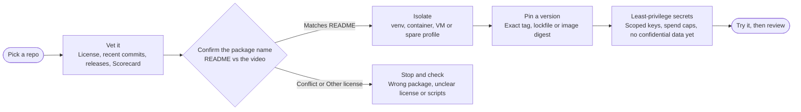
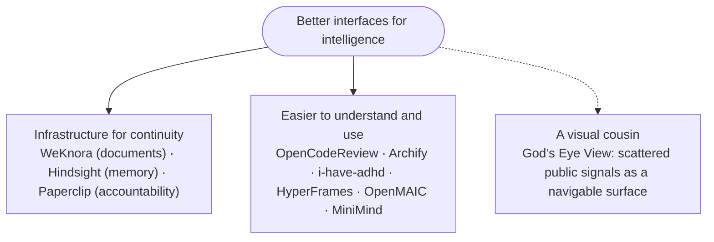

# September 2026’s Top 10 GitHub Repos: Step-by-Step Try-It Guide

Based on Full Stack’s “Top 10 GitHub Repos This Month | September 2026 | Intelligence Needs Better Interfaces” (25:08). For each repo: what it does, how to try it, why it ranked, common mistakes, and Beyond the video notes so you try it safely. Ranking is star growth in a GitHub trending window captured October 1, 2026, not lifetime popularity.

**PDF:** [Download this guide (PDF)](guide.pdf)

## At a glance

| Metric | Value | Detail |
| --- | --- | --- |
| New stars in the window | **198,564** | All 10 combined, per the video’s October 1 snapshot |
| Runtime | **25:08** | Uploaded October 1, 2026 |
| #1 Archify this month | **38,190** | Largest gain; 75,439 total in the snapshot |

| | |
| --- | --- |
| **Video** | Top 10 GitHub Repos This Month \| September 2026 \| Intelligence Needs Better Interfaces |
| **Channel** | Full Stack · uploaded Oct 1, 2026 · 25:08 |
| **Watch** | [youtu.be/N2o9AoYt7_k](https://youtu.be/N2o9AoYt7_k) |
| **Video’s thesis** | “The best interfaces make intelligence useful only when the underlying evidence remains visible.” (24:43) |
| **Guide type** | A monthly countdown turned into a try-it workflow. Steps come from the video and each repo’s README, with Beyond the video additions marked. Current star counts are from the GitHub API on Nov 27, 2026. |

!!! warning "Read this first"

    Several of these tools send your documents or source code to a model (#9, #5, #4, #7), or give an agent tools and a budget (#6, #9). Two of the spoken install commands name npm packages that do not exist. This guide uses the README package names, adds a vetting step, and asks you to isolate and pin a version before you try anything with secrets or private data.

## Before you install anything (Beyond the video)

*One workflow for all 10 repos, based on OpenSSF Scorecard, SLSA, SPDX license checks and GitHub Actions hardening guidance.*



1. **Pick one or two repos, not all ten** — Start with a low-risk local tool (#10, #8 or #3) before anything that holds documents, code, or agent budgets.
2. **Vet the repository** — Confirm the GitHub URL in the description, read LICENSE (especially WeKnora and God’s Eye View), check the latest release, and glance at OpenSSF Scorecard if it has a score.
3. **Prefer the README command over the spoken one** — This month that matters for Paperclip and OpenCodeReview. If the two disagree, stop and verify the package on npm or PyPI.
4. **Isolate the trial** — A Python venv, Docker Compose, or a spare browser profile. Do not point a first run at production data.
5. **Pin the version** — A release tag, lockfile, or image digest. Several of these projects are pre-1.0 or ship weekly.
6. **Scope secrets and keep a human in the loop** — A separate API key per tool, with a spending limit, in a gitignored `.env`. Leave approvals on (OWASP LLM06, Excessive Agency).

## All 10 compared

*Bars are new stars in the video’s October 1, 2026 trending window, which is how the ranking was made. The table also shows lifetime stars in that snapshot and on Nov 27, 2026.*

| Item | Value |
| --- | --- |
| #1 Archify | 38,190 |
| #2 God’s Eye View | 31,402 |
| #3 i-have-adhd | 26,622 |
| #4 Hindsight | 21,957 |
| #5 OpenCodeReview | 21,460 |
| #6 Paperclip | 15,694 |
| #7 OpenMAIC | 13,868 |
| #8 HyperFrames | 11,385 |
| #9 WeKnora | 10,658 |
| #10 MiniMind | 7,328 |

| # | Repo | What it is | Lang | License | Window → now | Risk | Jump to |
| --- | --- | --- | --- | --- | --- | --- | --- |
| 10 | jingyaogong/minimind | Train a compact 64M-parameter LLM from scratch in native PyTorch, so you can inspect tokenizer, architecture, data and optimizers instead of calling an API. | Python | Apache-2.0 | 7,328 new; 62,995 → 72,126 | Low risk · local educational training | [▶ 0:43](https://youtu.be/N2o9AoYt7_k?t=43) |
| 9 | Tencent/WeKnora | Open-source LLM knowledge platform: document RAG, an autonomous agent, and a self-maintaining wiki over shared knowledge bases. | Go | MIT + third-party (GitHub: Other) | 10,658 new; 31,560 → 38,365 | Medium risk · RAG + agent tools on your documents | [▶ 2:59](https://youtu.be/N2o9AoYt7_k?t=179) |
| 8 | heygen-com/hyperframes | Write HTML and seekable animations, then render a deterministic MP4. A developer-friendly path to version-controlled video, by HeyGen. | TypeScript | Apache-2.0 | 11,385 new; 54,907 → 91,345 | Low risk · local render; media-rights care | [▶ 5:13](https://youtu.be/N2o9AoYt7_k?t=313) |
| 7 | THU-MAIC/OpenMAIC | Open Multi-Agent Interactive Classroom from Tsinghua MAIC: turn a topic or materials into an interruptible class with teaching agents, quizzes, and exportable artifacts. | TypeScript | MIT | 13,868 new; 39,701 → 44,862 | Medium risk · API keys and possible learner data | [▶ 7:31](https://youtu.be/N2o9AoYt7_k?t=451) |
| 6 | paperclipai/paperclip | Open-source app for managing agents at work: companies, roles, goals, tasks, budgets, approvals, and an audit trail, with adapters rather than a universal runtime. | TypeScript | MIT | 15,694 new; 95,479 → 117,539 | High risk · agents, budgets and tool access | [▶ 9:49](https://youtu.be/N2o9AoYt7_k?t=589) |
| 5 | alibaba/open-code-review | CLI that combines deterministic pipelines (file selection, rules, line-accurate comments) with an LLM agent, battle-tested at Alibaba’s scale. | Go | Apache-2.0 | 21,460 new; 43,011 → 56,849 | Medium risk · your code is sent to a model | [▶ 12:02](https://youtu.be/N2o9AoYt7_k?t=722) |
| 4 | vectorize-io/hindsight | Agent memory that learns: retain, recall and reflect over facts, experiences, observations and mental models, rather than replaying yesterday’s chat. | Python | MIT | 21,957 new; 44,049 → 63,814 | Medium risk · persistent memory; isolation required | [▶ 14:20](https://youtu.be/N2o9AoYt7_k?t=860) |
| 3 | ayghri/i-have-adhd | A skill that stops a coding agent burying the answer: lead with the next action, number the steps, end with one concrete next move. Not a new model, and not a medical intervention. | Python | MIT | 26,622 new; 52,509 → 62,732 | Low risk · response-style skill | [▶ 16:37](https://youtu.be/N2o9AoYt7_k?t=997) |
| 2 | bilawalsidhu/gods-eye-view | A spy-satellite-style globe in the browser, except many of the signals are real: flights, ships, orbits, earthquakes and other public layers on a photorealistic 3D earth. | JavaScript | MIT code; mixed third-party data | 31,402 new; 45,838 → 67,149 | Medium risk · API keys, data licenses, OSINT ethics | [▶ 18:59](https://youtu.be/N2o9AoYt7_k?t=1139) |
| 1 | tt-a1i/archify | An agent skill that turns an idea, plan or codebase into interactive, shareable diagrams (architecture, workflow, sequence, data flow, lifecycle) as standalone HTML. | JavaScript | Apache-2.0 | 38,190 new; 75,439 → 100,855 | Low–medium risk · agent skill; diagrams are not runtime truth | [▶ 21:21](https://youtu.be/N2o9AoYt7_k?t=1281) |

Paperclip already had the most lifetime stars in the snapshot (95,479) and still ranks sixth, because the list counts growth, not the overall balance (0:13). HyperFrames has grown the most since the video (54,907 → 91,345).

## #10 MiniMind

*Train a compact 64M-parameter LLM from scratch in native PyTorch, so you can inspect tokenizer, architecture, data and optimizers instead of calling an API.*

| | |
| --- | --- |
| **Repo** | [github.com/jingyaogong/minimind](https://github.com/jingyaogong/minimind) |
| **Video segment** | [▶ 0:43](https://youtu.be/N2o9AoYt7_k?t=43) |
| **Stack and license** | Python · Apache-2.0 |
| **Stars** | 7,328 new in the window; 62,995 in the snapshot → 72,126 on Nov 27, 2026 |
| **Risk** | Low risk · local educational training |

1. **Clone and install in a venv** — The video starts with `git clone` and dependencies (2:03). Use Python 3.10+ in a virtualenv so training packages do not touch the system interpreter.
2. **Keep inference and training on separate paths** — Loading published weights and running `eval_llm.py` is not training from scratch. The video is explicit: keep those paths separate (2:15).
3. **Try inference first** — Download a MiniMind-3 weight set from ModelScope or Hugging Face, then run the CLI evaluator. Optionally copy a Transformers-format folder into `scripts/` and launch the Streamlit web UI.
4. **Only then walk the training recipe** — The project covers pre-training, supervised fine-tuning, later adaptation, preference methods (DPO-style) and reinforcement learning, plus tool-use examples (1:27). Start with `trainer/train_pretrain.py`, then `train_full_sft.py`.
5. **Treat it as a laboratory, not a production model** — The video’s verdict: the main value is educational, not universal productivity (1:03). Use it to see how a changed recipe changes the outcome.

```bash
python3 -m venv .venv && source .venv/bin/activate
git clone --depth 1 https://github.com/jingyaogong/minimind
cd minimind && pip install -r requirements.txt
# Inference (not training): download weights, then
# python eval_llm.py --load_from ./minimind-3
```

## Common mistakes

- ✗ Calling a downloaded checkpoint ‘training from scratch.’ The video warns against this (2:15).
- ✗ Launching the Streamlit UI before a Transformers-format weight folder is in `scripts/`. The README says the demo will error if it cannot find one.
- ✗ Starting a full pre-train on a laptop GPU and expecting the 2-hour 64M path without reading the hardware notes.

## Beyond the video

- Already covered, with more training-stage detail, in the Full Stack Featured Repos, Nov 10–24 guide in this library.
- Pin `requirements.txt` and the weight revision you download. The default README pip index is a regional mirror; use a mirror you trust, or plain PyPI.
- Training scripts can run for a long time and write checkpoints under `./checkpoints/`. Use `--from_resume 1` only when you intend to continue that run.

## #9 WeKnora

*Open-source LLM knowledge platform: document RAG, an autonomous agent, and a self-maintaining wiki over shared knowledge bases.*

| | |
| --- | --- |
| **Repo** | [github.com/Tencent/WeKnora](https://github.com/Tencent/WeKnora) |
| **Video segment** | [▶ 2:59](https://youtu.be/N2o9AoYt7_k?t=179) |
| **Stack and license** | Go · MIT + third-party (GitHub: Other) |
| **Stars** | 10,658 new in the window; 31,560 in the snapshot → 38,365 on Nov 27, 2026 |
| **Risk** | Medium risk · RAG + agent tools on your documents |

1. **Clone, copy the env file, and start Docker Compose** — The video walks this exact path (4:17): copy `.env.example` to `.env`, configure it, pull images, and start the core services.
2. **Open the onboarding UI** — Web UI at `http://localhost`, API at `http://localhost:8080`. Follow the setup guide with a small, non-confidential sample collection first (4:41).
3. **Separate knowledge scope from execution scope** — RAG can cite a document; that is not permission to call tools. The video stresses this when browser integration or sandboxes enter the workflow (4:05).
4. **Check every answer against the source document** — Confirm the user cannot retrieve data outside the workspace (4:41).
5. **Harden before production** — The README, and the video, recommend private networks, firewall rules and regular updates instead of exposing the service (4:29).

```bash
git clone https://github.com/Tencent/WeKnora.git
cd WeKnora
cp .env.example .env   # edit before starting
docker compose pull && docker compose up -d
# UI: http://localhost    API: http://localhost:8080
```

## Common mistakes

- ✗ Loading confidential or customer documents into a first trial.
- ✗ Treating a citation as authorization for the agent to take actions or call external tools.
- ✗ Opening the compose stack to the public internet without auth, a firewall, or updates.

## Beyond the video

- GitHub cannot label this SPDX-cleanly (it shows Other / NOASSERTION). The LICENSE is MIT for WeKnora plus a long third-party notice. Read that file before you redistribute.
- Optional compose profiles add Neo4j, MinIO and Langfuse. Start with the core profile until you need them.
- A local Ollama model is supported, but only after `ollama serve` is running and the embedding name and RAM notes in the configuration docs are checked.
- Pin the image tag you pull (`v0.9.1` was current on Nov 24, 2026) rather than always `latest`.

## #8 HyperFrames

*Write HTML and seekable animations, then render a deterministic MP4. A developer-friendly path to version-controlled video, by HeyGen.*

| | |
| --- | --- |
| **Repo** | [github.com/heygen-com/hyperframes](https://github.com/heygen-com/hyperframes) |
| **Video segment** | [▶ 5:13](https://youtu.be/N2o9AoYt7_k?t=313) |
| **Stack and license** | TypeScript · Apache-2.0 |
| **Stars** | 11,385 new in the window; 54,907 in the snapshot → 91,345 on Nov 27, 2026 |
| **Risk** | Low risk · local render; media-rights care |

1. **Confirm Node 22+ and FFmpeg** — The video calls both mandatory (6:32). The README badge and requirements line match that.
2. **Scaffold a composition** — `npx hyperframes init my-video`, then preview in the browser and render to MP4 (6:32).
3. **Start small and compare preview to the file** — A time effect that looks fine in the browser can fail when frames are captured independently. Determinism is a real constraint, not a slogan (6:07). Check the exported footage before you trust the preview (6:44).
4. **Keep editorial control** — Skills and ready-made blocks can speed the work; they do not decide what the viewer should see, or when (6:19).
5. **Optional: install the agent skills** — `npx skills add heygen-com/hyperframes` and pick Core Skills, or `npx hyperframes skills update` in CI.

```bash
# Requires Node.js 22+ and FFmpeg
npx hyperframes init my-video
cd my-video
npx hyperframes preview    # live preview
npx hyperframes render     # MP4
```

## Common mistakes

- ✗ Treating the browser preview as the finished video without opening the rendered MP4.
- ✗ Using animations that depend on wall-clock time or network fetches, which break frame-by-frame capture.
- ✗ Dropping other people’s media into a composition without rights or quality checks (6:56).

## Beyond the video

- Still pre-1.0 (`v0.9.103` on Nov 27, 2026). Pin the CLI version in projects you care about.
- Cloud render and AWS Lambda paths exist in the README; they send your composition to a remote renderer, so review what leaves your machine.
- HyperFrames has grown fast since the video (54,907 → 91,345 stars by Nov 27). Re-read the changelog before you upgrade a pinned project.

## #7 OpenMAIC

*Open Multi-Agent Interactive Classroom from Tsinghua MAIC: turn a topic or materials into an interruptible class with teaching agents, quizzes, and exportable artifacts.*

| | |
| --- | --- |
| **Repo** | [github.com/THU-MAIC/OpenMAIC](https://github.com/THU-MAIC/OpenMAIC) |
| **Video segment** | [▶ 7:31](https://youtu.be/N2o9AoYt7_k?t=451) |
| **Stack and license** | TypeScript · MIT |
| **Stars** | 13,868 new in the window; 39,701 in the snapshot → 44,862 on Nov 27, 2026 |
| **Risk** | Medium risk · API keys and possible learner data |

1. **Meet the prerequisites** — Node.js 22.19+, pnpm 10+, and PostgreSQL 16. The video’s ‘pnpm db up’ is the README command `pnpm db:up`, which starts a dev database in Docker (8:47).
2. **Clone, install, and configure** — `git clone`, `pnpm install`, then copy `.env.example` to `.env.local` and `openmaic.example.yml` to `openmaic.yml` before you run anything (8:47).
3. **Start the dev database and the app** — `pnpm db:up` then `pnpm dev`. Hosted access is a different path, with its own access-code and terms-of-service requirements (8:59).
4. **Keep a learning objective, then check facts** — Try an explanation-plus-quiz, a guided paper, or a project exercise (8:59). A lively class can still teach the wrong thing; compare answers with primary sources (9:11).
5. **Export is not a quality stamp** — Editable slides and interactive HTML can leave the classroom, which is useful, but export does not confirm pedagogical value or factual accuracy (8:34).

```bash
git clone https://github.com/THU-MAIC/OpenMAIC.git
cd OpenMAIC
pnpm install
cp .env.example .env.local
cp openmaic.example.yml openmaic.yml
pnpm db:up
pnpm dev
```

## Common mistakes

- ✗ Putting real student work or personal data into a trial instance without a privacy review.
- ✗ Trusting generated slides or quiz answers without checking a reliable source.
- ✗ Running `pnpm db up` (as spoken). The script is `pnpm db:up`.

## Beyond the video

- v1.5.0 (Nov 24, 2026) redesigned the home page as a workbench. Pin a release; upgrades such as the knowledge-base and PBL features are documented as one-way.
- Only `OPENAI_API_KEY` is required in a minimal `.env.local`; other providers are optional. Use a scoped key with a spend cap.
- If you ever use this with real learners, education-privacy rules (for example FERPA in the US) apply to anything you store. That is beyond the video.

## #6 Paperclip

*Open-source app for managing agents at work: companies, roles, goals, tasks, budgets, approvals, and an audit trail, with adapters rather than a universal runtime.*

| | |
| --- | --- |
| **Repo** | [github.com/paperclipai/paperclip](https://github.com/paperclipai/paperclip) |
| **Video segment** | [▶ 9:49](https://youtu.be/N2o9AoYt7_k?t=589) |
| **Stack and license** | TypeScript · MIT |
| **Stars** | 15,694 new in the window; 95,479 in the snapshot → 117,539 on Nov 27, 2026 |
| **Risk** | High risk · agents, budgets and tool access |

1. **Use the real npm package name** — The video says `npx paperclip-ai@latest onboard --yes` (11:00). That package is not on npm. The README command is `npx paperclipai@latest onboard --yes`.
2. **Treat onboard as setup, not a finished company** — The video is right about this (11:00): finish configuration, connect one agent, and start with a limited task you can verify yourself before widening authority (11:12).
3. **Check tools, approvals, and the audit trail** — Ask what the agent can touch, which actions need a human, and whether the history is enough to reconstruct the job (10:48).
4. **Keep the first tasks narrow** — Maintenance chores, recurring research, or content prep are the examples in the video (11:12). The useful question is not how many agents are running, but whether there is a goal, visible progress, and a moment a person can take over (11:37).

```bash
# Package name is paperclipai (no hyphen). paperclip-ai is not on npm.
npx paperclipai@latest onboard --yes
# Optional first run with a key you already trust:
# ANTHROPIC_API_KEY=... npx paperclipai test-drive
```

## Common mistakes

- ✗ Copying the spoken package name `paperclip-ai`. npm has no such package.
- ✗ Giving a freshly onboarded agent broad tools or a production budget.
- ✗ Leaving approvals off, or skipping the audit trail, once work leaves a personal experiment.

## Beyond the video

- `--yes` skips interactive prompts. Read what onboard will bind to (local, LAN, or tailnet flags are documented) before you use it on a shared network.
- Latest release at check time was `v2026.1117.0`. Pin that or a later tag you have reviewed.
- The repo had 6,809 open issues on Nov 27, 2026. That is a busy project, not a stability score; read the release notes.

## #5 OpenCodeReview

*CLI that combines deterministic pipelines (file selection, rules, line-accurate comments) with an LLM agent, battle-tested at Alibaba’s scale.*

| | |
| --- | --- |
| **Repo** | [github.com/alibaba/open-code-review](https://github.com/alibaba/open-code-review) |
| **Video segment** | [▶ 12:02](https://youtu.be/N2o9AoYt7_k?t=722) |
| **Stack and license** | Go · Apache-2.0 |
| **Stars** | 21,460 new in the window; 43,011 in the snapshot → 56,849 on Nov 27, 2026 |
| **Risk** | Medium risk · your code is sent to a model |

1. **Install the published package** — The video says `npm install -g @alibaba/opencode-review` (13:13). That name is not on npm. The README package is `@alibaba-group/open-code-review`. You can also run `npx skills add alibaba/open-code-review`.
2. **Configure provider and model first** — `ocr config provider` then `ocr config model`, then `ocr review` inside a project (13:25).
3. **Pick the right mode** — Workspace review for staged and unstaged work, branch review when preparing a pull request, `ocr scan` for full files with no useful diff, and `ocr delegate` when your existing coding agent should do the reasoning while OCR handles selection and rules (13:01, 13:25).
4. **Treat comments as leads, not verdicts** — An agent comment is a reason to investigate, not a verified vulnerability or an automatic merge block (13:13). Try it first on a change whose defect you already understand (13:37).

```bash
# Package name is @alibaba-group/open-code-review. @alibaba/opencode-review is not on npm.
npm install -g @alibaba-group/open-code-review
ocr config provider
ocr config model
cd your-project
ocr review                  # staged, unstaged, untracked
ocr review --from main      # since the branch diverged
ocr scan --path internal/   # full-file mode
```

## Common mistakes

- ✗ Installing `@alibaba/opencode-review`. That package does not exist.
- ✗ Sending a repo that still has secrets, credentials or customer data to a hosted model.
- ✗ Blocking a merge solely because the agent left a comment.

## Beyond the video

- Anything you review is visible to the configured provider. Use a self-hosted or approved endpoint for private code, and redact secrets first.
- Latest release at check time was `v1.14.4` (Nov 26, 2026). Pin the CLI version.
- Structured JSON output (`--format json --output result.json`) is the documented path into a later workflow, not an auto-fail gate.

## #4 Hindsight

*Agent memory that learns: retain, recall and reflect over facts, experiences, observations and mental models, rather than replaying yesterday’s chat.*

| | |
| --- | --- |
| **Repo** | [github.com/vectorize-io/hindsight](https://github.com/vectorize-io/hindsight) |
| **Video segment** | [▶ 14:20](https://youtu.be/N2o9AoYt7_k?t=860) |
| **Stack and license** | Python · MIT |
| **Stars** | 21,957 new in the window; 44,049 in the snapshot → 63,814 on Nov 27, 2026 |
| **Risk** | Medium risk · persistent memory; isolation required |

1. **Decide how you will run the service** — The video’s `pip install hindsight-client` (15:37) installs the Python client, not a working memory service. You still need a server or hosted endpoint.
2. **Start a server, then point the client at it** — Docker (`ghcr.io/vectorize-io/hindsight:latest`), Compose, `pip install hindsight-api` plus `hindsight-api`, or Helm are all documented. Configure the model key and data volume before you test.
3. **Keep contexts in separate memory banks** — The video asks you to separate users or projects and to be deliberate about what is stored (16:01). Mixing contexts is the configuration failure to avoid (16:13).
4. **Know the three operations** — Retain extracts facts, entities, relationships and time; recall mixes semantic, keyword, graph and temporal search, then re-ranks; reflect uses what was stored for a more considered answer (15:13).

```bash
# Client only — you still need a server
pip install hindsight-client

# Example local server (needs an API key and a volume)
export OPENAI_API_KEY=sk-xxx
docker run -it --pull always --name hindsight --restart unless-stopped \
  -p 8888:8888 -p 9999:9999 \
  -e HINDSIGHT_API_LLM_API_KEY=$OPENAI_API_KEY \
  -v hindsight-data:/home/hindsight/.pg0 \
  ghcr.io/vectorize-io/hindsight:latest
```

## Common mistakes

- ✗ Installing the client and assuming memory is already running.
- ✗ Storing secrets, personal data or mixed-user conversations in one bank.
- ✗ Taking ‘state of the art on LongMemEval’ as a guarantee for your workload. That is a published benchmark claim, not a test you have run.

## Beyond the video

- v1.3.0 (Nov 24, 2026) also ships decision, rerank and embedding models. Pin both the image or API package and the client.
- Use a dedicated API key with a spend cap, and do not commit it.
- The README’s LongMemEval and Fortune 500 claims were not independently re-run for this guide. Treat them as vendor-reported, with a noted collaborator reproduction at Virginia Tech. A deeper dedicated guide, from Full Stack’s 11:35 Hindsight tutorial, is in this library: [Hindsight: Agent Memory That Learns](https://lipford-dutch.github.io/goc-guide-library/guides/hindsight-agent-memory-that-learns/).

## #3 i-have-adhd

*A skill that stops a coding agent burying the answer: lead with the next action, number the steps, end with one concrete next move. Not a new model, and not a medical intervention.*

| | |
| --- | --- |
| **Repo** | [github.com/ayghri/i-have-adhd](https://github.com/ayghri/i-have-adhd) |
| **Video segment** | [▶ 16:37](https://youtu.be/N2o9AoYt7_k?t=997) |
| **Stack and license** | Python · MIT |
| **Stars** | 26,622 new in the window; 52,509 in the snapshot → 62,732 on Nov 27, 2026 |
| **Risk** | Low risk · response-style skill |

1. **Read the rules, then install for your agent** — The README’s first path is to paste a prompt that tells your CLI to install from the repo and follow `AGENTS.md`. Platform commands live in `INSTALL.md` (17:49).
2. **Claude Code path** — `claude plugin marketplace add ayghri/i-have-adhd` then `claude plugin install i-have-adhd@i-have-adhd`. Type `/i-have-adhd`. Restart the session after install (18:01).
3. **Cursor and other skills harnesses** — Follow the Cursor / agent-skills section in `INSTALL.md`, usually a copy of the skill under `~/.cursor/skills/`.
4. **Use it when the next action should be obvious** — Debugging, a migration, or returning to a task after a break (18:13). If you need a full architectural explanation, tune or temporarily drop the skill rather than cutting off needed context (18:13).

```bash
# Claude Code
claude plugin marketplace add ayghri/i-have-adhd
claude plugin install i-have-adhd@i-have-adhd
# then type /i-have-adhd

# Or paste this into your coding-agent CLI:
# Install the i-have-adhd skill/plugin from https://github.com/ayghri/i-have-adhd,
# refer to the repo's AGENTS.md for instructions.
```

## Common mistakes

- ✗ Treating this as diagnosis, therapy or medical advice. It is a set of response rules. The README says you do not need an ADHD diagnosis (17:25).
- ✗ Expecting brevity to replace a necessary explanation. The skill itself says not to confuse shortness with vagueness (17:37).
- ✗ Assuming the video’s ‘no tagged releases’ line is still true. `v0.4.1` shipped Oct 19, 2026.

## Beyond the video

- Ten rules live in `skills/i-have-adhd/SKILL.md`. Fork that file if you need to tune them, then point your plugin at your fork.
- Credits: loosely based on The Adult ADHD Tool Kit by J. Russell Ramsay and Anthony L. Rostain, adapted for how an LLM should respond.
- This is prompt-and-skill surface only: low operational risk, but still review what the agent does after the style changes.

## #2 God’s Eye View

*A spy-satellite-style globe in the browser, except many of the signals are real: flights, ships, orbits, earthquakes and other public layers on a photorealistic 3D earth.*

| | |
| --- | --- |
| **Repo** | [github.com/bilawalsidhu/gods-eye-view](https://github.com/bilawalsidhu/gods-eye-view) |
| **Video segment** | [▶ 18:59](https://youtu.be/N2o9AoYt7_k?t=1139) |
| **Stack and license** | JavaScript · MIT code; mixed third-party data |
| **Stars** | 31,402 new in the window; 45,838 in the snapshot → 67,149 on Nov 27, 2026 |
| **Risk** | Medium risk · API keys, data licenses, OSINT ethics |

1. **Clone and use the documented Node path** — `git clone`, `npm ci`, `npm run doctor`, then `npm run dev` (20:14). You can start without API keys using bundled sources (20:14).
2. **Read the honesty notes in the README** — Traffic is simulated along real roads; camera positions and launch trajectories are rough estimates (19:50). A cinematic cockpit is not privileged observation (20:38).
3. **Add paid or quota-limited providers only when you need them** — Photorealistic tiles and some live feeds need credentials, added in the app. Check quotas before you assume a free global channel (20:26).
4. **Use it to compare signals, not to invent certainty** — The video’s suggested uses are learning, news presentation with provenance, and adding a layer instead of redrawing the globe (20:26). Keep source limits visible enough to question the picture (21:03).

```bash
git clone https://github.com/bilawalsidhu/gods-eye-view.git
cd gods-eye-view
npm ci
npm run doctor
npm run dev
```

## Common mistakes

- ✗ Treating simulated traffic, estimated camera positions or a tactical visual style as ground truth.
- ✗ Using the project commercially without reading the data licenses. TeleGeography’s submarine-cable map is CC BY-NC-SA 3.0 (non-commercial); other bundled sets have their own terms.
- ✗ Tracking people or leaking location context from a ‘public’ layer you have no legitimate reason to watch.

## Beyond the video

- GitHub shows the license as Other / NOASSERTION because the LICENSE is MIT for source code plus a long third-party data notice. The video was right to say the license field needs care (19:14).
- Latest tagged release at check time was `v0.3.0` (Oct 28, 2026). Pin it, or note that `main` moves quickly.
- Voice-agent features depend on an OpenAI Realtime session. That is a separate key, cost and data-handling choice.
- Docker Compose and NAS-oriented UID/GID examples are in the README if you do not want a local Node toolchain.

## #1 Archify

*An agent skill that turns an idea, plan or codebase into interactive, shareable diagrams (architecture, workflow, sequence, data flow, lifecycle) as standalone HTML.*

| | |
| --- | --- |
| **Repo** | [github.com/tt-a1i/archify](https://github.com/tt-a1i/archify) |
| **Video segment** | [▶ 21:21](https://youtu.be/N2o9AoYt7_k?t=1281) |
| **Stack and license** | JavaScript · Apache-2.0 |
| **Stars** | 38,190 new in the window; 75,439 in the snapshot → 100,855 on Nov 27, 2026 |
| **Risk** | Low–medium risk · agent skill; diagrams are not runtime truth |

1. **Install the skill for your agent** — The video’s idea is `npx skills add tt-a1i/archify` with a global flag (22:41). The current README examples include `npx -y skills@latest add [archify.si](https://archify.si) --skill archify --skill archify-pr --agent cursor --global --copy --yes` and `npx skills use tt-a1i/archify@archify --agent codex`.
2. **Start from a short description, or let the agent read the repo** — Output is typed-code-backed HTML you can open without a diagramming workspace (22:05). Pick the diagram type that answers the question, instead of cramming everything into one picture (22:17).
3. **Treat specified relationships as declared, not as production runtime** — The video draws this line clearly: a diagram states what the author declared. Removing a downstream box does not take it out of production (22:29). The compare function checks before-and-after author data, not security risk or whether code merged.
4. **Use it where a shared artifact beats a chat** — Onboarding (the main request path), incident analysis (retries and cancellation), or a design discussion against a baseline (22:53). Shared HTML keeps the interaction; external links still depend on the network (23:05).

```bash
# Current README (Cursor example); adjust --agent for your harness
npx -y skills@latest add https://archify.si --skill archify --skill archify-pr --agent cursor --global --copy --yes
# Codex:
# npx skills use tt-a1i/archify@archify --agent codex
```

## Common mistakes

- ✗ Believing a generated diagram is a live inventory of production.
- ✗ Skipping a check that the source (repo, description, or ownership data) actually supports the arrows.
- ✗ Citing the video’s ‘MIT license’ line. The GitHub SPDX license is Apache-2.0.

## Beyond the video

- Latest release at check time was `v3.3.2` (Nov 25, 2026). Pin the skill version if your harness allows it.
- The ownership profile can error when author data is missing, rather than pretend to inspect infrastructure. That is a feature, not a broken install (22:41).
- Pairs naturally with OpenCodeReview: one asks whether a change is justified, the other whether the structure is understandable. Neither replaces a reviewer who knows the system (23:17).

## The two trends

*From the recap at [▶ 23:52](https://youtu.be/N2o9AoYt7_k?t=1432)*



The first trend is what happens after the first impressive response: documents stay organized, memory is retained on purpose, and agent work stays visible and approvable (23:53). The second is making intelligence inspectable: constrained reviews, shareable diagrams, an answer that leads with the next action, video and classroom artifacts you can keep, and a small model whose training code you can read (24:05). God’s Eye View is the visual exception, but it shares the same idea: discrete data becomes a surface whose limits should stay visible (24:30).

> The best interfaces make intelligence useful only when the underlying evidence remains visible.
>
> — Full Stack, 24:43

198,564 new stars measure attention, not reliability (24:30). The repeatable opportunity the video names is an artifact you can verify, and a clearer human decision (24:43).

## Standards and best practices

*Each link was checked on Nov 27, 2026.*

| Standard or guidance | Applies to | What to do |
| --- | --- | --- |
| OWASP Top 10 for LLM Applications (LLM01 Prompt Injection, LLM06 Sensitive Information Disclosure, LLM08 Excessive Agency) | #9, #6, #5, #4, #7 | Treat retrieved documents and agent tools as untrusted, keep approvals on, and do not load confidential data into a first trial. |
| NIST AI Risk Management Framework (Govern, Map, Measure, Manage) | #6, #9, #4, #7 | Write down what each agent or classroom instance may touch, test it before you trust it, and keep a way to shut it off. |
| NIST SSDF SP 800-218 (PW.7 code review) | #5 | Use independent review and tests as gates. Treat model comments as leads, not merge blockers. |
| OpenSSF Scorecard / SLSA | All 10 | Check repo health and provenance, and pin versions or image digests. |
| SPDX license identification | #9, #2, #1 | Do not trust a spoken license or a green badge when GitHub shows Other. Read the LICENSE file, including third-party data terms. |
| GitHub Actions hardening and encrypted secrets; OWASP secrets management | #6, #7, #5, #4 | Keep keys in a gitignored `.env` or a secret store, one scoped key per tool, with a spend cap. |
| WCAG 2.2 | #3, #7 | A tighter answer style helps some readers; it does not make a classroom UI accessible. Test the interface you actually ship. |
| FERPA and education-privacy practice | #7 | If real learners’ work or identity is stored, you need a privacy review the video does not provide. |
| 3-2-1 backups (CISA guidance) | #9, #4, #6 | Back up knowledge bases, memory volumes and task databases, and test a restore. |
| ISO/IEC/IEEE 42010 (architecture description) | #1 | A diagram is a view for a stated concern, not a live inventory. Keep the source and the picture in sync. |
| Agent Skills specification | #3, #1, #8, #5 | Install from the documented repo or marketplace, keep SKILL.md short, and restart the agent after install. |
| Third-party geospatial and OSINT terms | #2 | Bundled maps and live feeds keep their own licenses. Non-commercial datasets cannot be used commercially without a separate grant. Have a lawful purpose for anything you watch or store. |

- [OWASP Top 10 for LLM Applications](https://genai.owasp.org/llm-top-10/) — genai.owasp.org
- [NIST AI Risk Management Framework](https://www.nist.gov/itl/ai-risk-management-framework) — nist.gov
- [NIST SSDF SP 800-218](https://csrc.nist.gov/pubs/sp/800/218/final) — csrc.nist.gov
- [OpenSSF Scorecard](https://scorecard.dev/) — scorecard.dev
- [SLSA supply-chain levels](https://slsa.dev/) — slsa.dev
- [SPDX License List](https://spdx.org/licenses/) — spdx.org
- [Security hardening for GitHub Actions](https://docs.github.com/en/actions/security-for-github-actions/security-guides/security-hardening-for-github-actions) — docs.github.com
- [WCAG 2.2](https://www.w3.org/TR/WCAG22/) — w3.org
- [CISA 3-2-1 backup guidance](https://www.cisa.gov/sites/default/files/publications/data_backup_options.pdf) — cisa.gov
- [ISO/IEC/IEEE 42010 overview](https://www.iso.org/standard/74393.html) — iso.org
- [Student privacy (FERPA) overview](https://studentprivacy.ed.gov/ferpa) — studentprivacy.ed.gov
- [Agent Skills specification](https://agentskills.io/specification) — agentskills.io

## Where the video departs, and what is unverified

| Item | In the video | What to use instead |
| --- | --- | --- |
| Paperclip install | `npx paperclip-ai@latest onboard --yes` (11:00) | `paperclip-ai` is not on npm. Use `npx paperclipai@latest onboard --yes` from the README. |
| OpenCodeReview install | `npm install -g @alibaba/opencode-review` (13:13) | `@alibaba/opencode-review` is not on npm. Use `@alibaba-group/open-code-review`. |
| OpenMAIC database command | Spoken as `pnpm db up` (8:47) | The script is `pnpm db:up`. |
| Archify license | Spoken as MIT (21:28) | GitHub SPDX and the LICENSE file are Apache-2.0, checked Nov 27, 2026. |
| i-have-adhd releases | No tagged releases in the October 1 snapshot (16:49) | `v0.4.1` was published Oct 19, 2026. Prefer a tag when you install. |
| Ranking claims | 198,564 new stars and the per-repo gains | The video itself says this is a popularity snapshot as of October 1, 2026, not an official calendar-month archive (0:38). We did not independently rebuild GitHub’s trending window. |
| Hindsight accuracy | Useful-memory framing; the README goes further with LongMemEval SOTA claims | Not re-run for this guide. Treat benchmark and ‘Fortune 500’ statements as vendor-reported. |
| Security and privacy | Strong on citations, approvals and ‘comments are not proven vulns’ | The video does not walk through Scorecard, secret hygiene, provider data-handling for code review, or education-privacy rules for a real classroom. Those are Beyond the video. |

The video is careful in several places the captions could have oversold: loading MiniMind weights is not training from scratch; WeKnora and God’s Eye View licenses need a close read; God’s Eye View traffic is simulated; Archify diagrams are not a live production inventory; OpenCodeReview comments are investigation leads. Those points match the READMEs.

## Troubleshooting

| Symptom | Likely cause | Fix |
| --- | --- | --- |
| `npm install -g paperclip-ai` or `@alibaba/opencode-review` fails with 404 | Those package names are not on npm | Use `paperclipai` and `@alibaba-group/open-code-review`, as in the READMEs. |
| MiniMind web UI errors on start | No Transformers-format weight folder under `scripts/` | Copy the downloaded model directory into `scripts/` first, as the README requires. |
| WeKnora UI never appears on localhost | Compose still pulling, `.env` incomplete, or port 80 in use | Check `docker compose ps` and the logs, finish `.env`, and free port 80 or change the published port. |
| `npx hyperframes render` produces a broken or empty MP4 | Node below 22, FFmpeg missing, or a non-deterministic animation | Install Node 22+ and FFmpeg, make the composition seekable, and open the file rather than trusting the preview. |
| `pnpm db up` not found in OpenMAIC | The spoken command is missing the colon | Run `pnpm db:up`. Confirm Docker is running so PostgreSQL 16 can start. |
| `ocr review` asks for a provider or posts unexpected code | Provider and model not configured, or the tree still contains secrets | Run `ocr config provider` and `ocr config model`. Redact secrets, or use an approved endpoint, before reviewing private code. |
| Hindsight client cannot store or recall anything | Only `hindsight-client` is installed; no server is running | Start the Docker image, Compose stack, or `hindsight-api`, then point the client at that endpoint. |
| `/i-have-adhd` does nothing | Session started before the plugin was installed, or the wrong marketplace | Restart the agent and re-invoke the skill. For Claude Code, confirm `claude plugin list` shows `i-have-adhd`. |
| God’s Eye View doctor or dev server fails | Incomplete `npm ci`, or a photorealistic provider key that is missing or over quota | Re-run `npm ci` and `npm run doctor`. Start with bundled sources before adding paid keys. |
| An Archify diagram disagrees with production | The picture reflects declared author data, not a live inventory | Re-run from the current repo, and treat missing ownership data as a prompt to fill it in, not as a runtime scan. |

## Caption fixes

*This guide was built from the English auto-generated captions plus the official description, then checked against each README. Auto-captions mangled several names; timestamp links use the official chapter starts.*

| Auto-caption said | Actually | Where |
| --- | --- | --- |
| We Nora / Winora / WeNora | WeKnora | 2:59, 23:53 |
| Open May I See / THU May I See | OpenMAIC (THU-MAIC) | 7:31, 24:18 |
| HayGen | HeyGen | 5:13 |
| I have a DHD / Agree | i-have-adhd by ayghri | 16:37 |
| arc i 5 / Archifiy / TT a 1 i | Archify by tt-a1i | 21:21 |
| Balawal Sidhu | Bilawal Sidhu (bilawalsidhu) | 18:59 |
| Jing Yao Gong | jingyaogong | 0:43 |
| pnpm db up | pnpm db:up | 8:47 |
| paperclip-ai | paperclipai | 11:00 |
| @alibaba/opencode-review | @alibaba-group/open-code-review | 13:13 |
| start with the conclusion | start with inference | 2:27 |
| methods of providing benefits | preference methods such as DPO | 1:27 |
| blockchain network | a single block diagram (likely) | 22:17 |

Anything shown only on screen, such as a demo click-path that never appears in the captions or the README, is not treated as a verified step.

## Final checklist

*Nothing done yet, as of Nov 27, 2026.*

- [ ] Pick one or two repos to try instead of all ten *(Start low-risk: #10, #8 or #3)*
- [ ] Confirm the GitHub URL and read LICENSE, including third-party notices *(Especially #9 and #2)*
- [ ] Use the README package name, not the spoken one *(Paperclip and OpenCodeReview)*
- [ ] Check recent activity and pin a release, lockfile or image digest
- [ ] Set up an isolated venv, Compose stack or spare profile
- [ ] Create scoped API keys with spend caps *(#9, #7, #6, #5, #4, #2)*
- [ ] Keep keys in a gitignored .env or a secret store
- [ ] Do not load confidential documents, private code, or learner data into a first trial
- [ ] Leave agent approvals on and review the audit trail *(#6, #9)*
- [ ] Treat review comments and generated diagrams as leads, not ground truth *(#5, #1)*
- [ ] Re-check release notes before upgrading a fast-moving repo

## Video chapters

- [Intro](https://youtu.be/N2o9AoYt7_k?t=0) — 0:00
- [#10 MiniMind](https://youtu.be/N2o9AoYt7_k?t=43) — 0:43
- [#9 WeKnora](https://youtu.be/N2o9AoYt7_k?t=179) — 2:59
- [#8 HyperFrames](https://youtu.be/N2o9AoYt7_k?t=313) — 5:13
- [#7 OpenMAIC](https://youtu.be/N2o9AoYt7_k?t=451) — 7:31
- [#6 Paperclip](https://youtu.be/N2o9AoYt7_k?t=589) — 9:49
- [#5 OpenCodeReview](https://youtu.be/N2o9AoYt7_k?t=722) — 12:02
- [#4 Hindsight](https://youtu.be/N2o9AoYt7_k?t=860) — 14:20
- [#3 i-have-adhd](https://youtu.be/N2o9AoYt7_k?t=997) — 16:37
- [#2 God’s Eye View](https://youtu.be/N2o9AoYt7_k?t=1139) — 18:59
- [#1 Archify](https://youtu.be/N2o9AoYt7_k?t=1281) — 21:21
- [Recap and trends](https://youtu.be/N2o9AoYt7_k?t=1432) — 23:52

Chapter times are from the official video description. This guide also draws on each repository’s README, LICENSE, and latest release, plus npm and PyPI, as of Nov 27, 2026. MiniMind was previously covered in the Full Stack Featured Repos, Nov 10–24 guide at [lipford-dutch.github.io/goc-guide-library/guides/full-stack-featured-repos-nov-2026/](https://lipford-dutch.github.io/goc-guide-library/guides/full-stack-featured-repos-nov-2026/).

